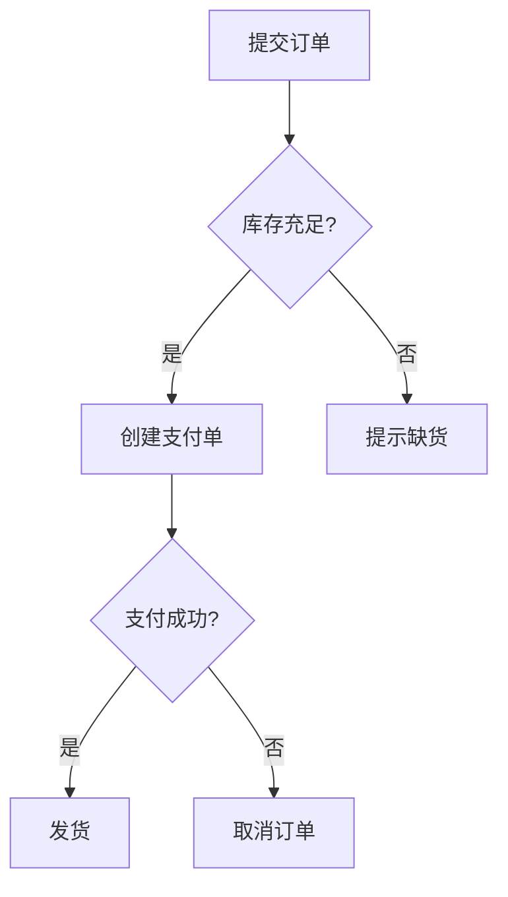
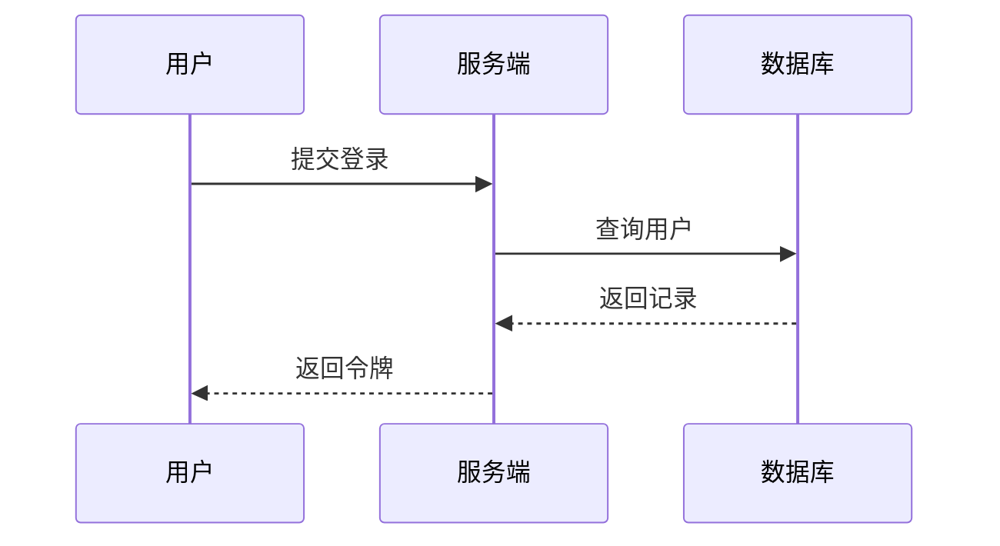
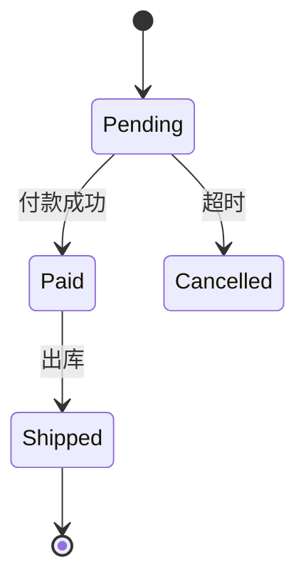
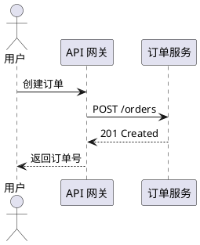

技术文档经常需要公式和图表：算法笔记要写推导，架构文档要画流程，状态机要画转移关系。Markdown 本身并不认识这些内容，它们全部依赖渲染阶段的扩展。本篇讲 LaTeX 数学、Mermaid、PlantUML 和 ASCII 图四种表达方式，重点说明各自的适用边界与平台差异。

# 1. LaTeX 数学公式

## 1.1 行内与块级

行内公式用一对美元符号：

```markdown
当 $x > 0$ 时，函数单调递增。
```

块级公式用两对美元符号，单独成段：

```markdown
$$
E = mc^2
$$
```

有些平台也接受 LaTeX 原生的 `\(...\)` 和 `\[...\]`，但兼容性不如美元符号。

★ **关键认知**：公式能否显示，取决于渲染器有没有装载数学插件。GitHub、VS Code 预览、Typora 默认支持；VitePress、MkDocs 需要额外配置。源码里的 `$...$` 在未启用插件的平台上就是普通文本。

⚠ 美元符号与货币写法冲突。正文里写"价格是 $5 到 $10"时，两个 `$` 之间的内容可能被当成公式。规避方法是写成 `\$5` 到 `\$10`，或者在配置中要求行内公式两侧必须有空格。

## 1.2 常用符号

| 类别 | 写法 | 效果 |
|------|------|------|
| 分式 | `\frac{a}{b}` | 分数 |
| 上标 | `x^{2}` | 幂 |
| 下标 | `a_{i}` | 索引 |
| 平方根 | `\sqrt{x}`、`\sqrt[3]{x}` | 根号 |
| 求和 | `\sum_{i=1}^{n}` | 求和 |
| 积分 | `\int_{0}^{1}` | 定积分 |
| 极限 | `\lim_{x \to 0}` | 极限 |
| 不等号 | `\neq`、`\leq`、`\geq` | 比较 |
| 约等号 | `\approx` | 近似 |
| 乘除 | `\times`、`\div` | 运算 |
| 正负 | `\pm` | 正负号 |
| 无穷 | `\infty` | 无穷 |
| 属于 | `\in`、`\notin` | 集合 |
| 箭头 | `\to`、`\Rightarrow` | 推导 |

希腊字母用反斜杠加名称：`\alpha`、`\beta`、`\lambda`、`\sigma`、`\theta`。

## 1.3 多行公式与对齐

多行推导用 `aligned` 环境，`&` 指定对齐位置，`\\` 换行：

```latex
$$
\begin{aligned}
\mathrm{MSE} &= \frac{1}{n}\sum_{i=1}^{n}(y_i-\hat{y}_i)^2 \\
\mathrm{MAE} &= \frac{1}{n}\sum_{i=1}^{n}|y_i-\hat{y}_i|
\end{aligned}
$$
```

分段函数用 `cases`：

```latex
$$
f(x) =
\begin{cases}
x^2, & x \geq 0 \\
-x,  & x < 0
\end{cases}
$$
```

矩阵用 `matrix`、`pmatrix`、`bmatrix`：

```latex
$$
A = \begin{pmatrix}
1 & 2 \\
3 & 4
\end{pmatrix}
$$
```

正文中的变量名要用 `\mathrm{}` 或 `\text{}` 包起来，否则会被当成多个变量相乘：

```latex
$$
\mathrm{accuracy} = \frac{\mathrm{TP} + \mathrm{TN}}{\mathrm{TP} + \mathrm{TN} + \mathrm{FP} + \mathrm{FN}}
$$
```

★ **关键认知**：LaTeX 里多字母标识符默认是**逐字母变量相乘**，`accuracy` 会被排成斜体的 a、c、c…… 要得到正体的词，必须写 `\mathrm{accuracy}` 或 `\text{accuracy}`。这是公式显得"不专业"的最常见原因。

## 1.4 渲染引擎

主流引擎有两个：

| 引擎 | 特点 | 常见使用方 |
|------|------|------------|
| KaTeX | 渲染快、体积小、支持子集 | VitePress、部分博客主题 |
| MathJax | 覆盖全、支持复杂宏包 | 学术站点、MkDocs 插件 |

⚠ KaTeX 不支持全部 LaTeX 命令，例如部分 `\begin{align}` 宏包写法。遇到"本地能显示、站点报错"，先查目标引擎的支持列表，再决定是否降级写法。

# 2. Mermaid

## 2.1 流程图

Mermaid 用文本描述图，浏览器端渲染，适合版本化管理：

````markdown

````

方向关键字：

| 关键字 | 含义 |
|--------|------|
| `TD` | 从上到下 |
| `LR` | 从左到右 |
| `BT` | 从下到上 |
| `RL` | 从右到左 |

节点形状：`A[矩形]`、`B(圆角)`、`C{菱形}`、`D((圆形))`。连线：`-->` 实线箭头、`---` 实线、`-.->` 虚线箭头。

## 2.2 时序图

````markdown

````

箭头含义：

- `->>`：实线请求。
- `-->>`：虚线响应。
- `-x`：带叉的失败消息。

## 2.3 状态图

````markdown

````

`[*]` 表示起点或终点，冒号后是转移条件。

## 2.4 使用建议

- 节点文字尽量短，长句放进文档正文，不要塞进图里。
- 标签含空格、括号、冒号时用双引号包起来：`A["创建订单（异步）"]`。
- 一张图只表达一个主题，超过二十个节点就拆图。
- 图也要有上下文说明，不能只丢一张图。

⚠ Mermaid 的语法在不同版本间有差异，`graph` 与 `flowchart`、`stateDiagram` 与 `stateDiagram-v2` 的行为不完全一致。跨平台文档应使用较稳定的 `flowchart` 和 `stateDiagram-v2`，并在目标平台实际预览。

# 3. PlantUML

PlantUML 用类似的文本语法描述 UML 图，但通常需要 Java 服务端或插件渲染：



与 Mermaid 的对比：

| 维度 | Mermaid | PlantUML |
|------|---------|----------|
| 渲染位置 | 浏览器端为主 | 服务端为主 |
| 部署成本 | 低 | 需要 Java 或在线服务 |
| 图形种类 | 常用图够用 | UML 覆盖更全 |
| 语法稳定性 | 版本差异较明显 | 相对稳定 |
| 适合场景 | 文档内嵌、快速迭代 | 正式 UML、复杂建模 |

★ **关键认知**：Mermaid 与 PlantUML 的选择，本质是**渲染位置**的选择。Mermaid 把渲染负担放在浏览器，部署简单；PlantUML 把渲染放在服务端，图形能力强但多一个依赖。文档站优先 Mermaid，正式设计文档再考虑 PlantUML。

⚠ GitHub 不会渲染 PlantUML 代码块，只会显示为普通代码。需要在仓库里放预渲染的图片，或接入 PlantUML Action。

# 4. ASCII 图

不依赖任何渲染器，用框线字符画结构：

```text
┌──────────┐      ┌──────────┐      ┌──────────┐
│  Client  │─────▶│  Gateway │─────▶│  Service │
└──────────┘      └──────────┘      └──────────┘
```

常用字符：

```text
┌ ─ ┐ │ └ ┘ ├ ┤ ┬ ┴ ┼ ▼ ▲ ► ◀ → ←
```

适用场景：

- 终端环境、纯文本邮件、代码注释。
- 需要精确控制布局的目录树、内存布局。
- 渲染器不支持 Mermaid 时的兜底。

★ **关键认知**：ASCII 图的优势是**零依赖**，劣势是**维护成本高**。改一个节点名就可能要重新对齐所有竖线。图会频繁变动时用 Mermaid，图需要永久稳定、随处可读时用 ASCII。

⚠ 中文字符在等宽字体中通常占两个字符宽度，和英文混排时容易错位。画框时要么全用英文，要么按两倍宽度估算中文，并在目标字体下实际检查。

# 5. 渲染平台差异

| 能力 | GitHub | VS Code 预览 | VitePress | MkDocs Material | Obsidian |
|------|--------|--------------|-----------|-----------------|----------|
| LaTeX 公式 | 原生 | 原生 | 需插件 | 需配置 | 原生 |
| Mermaid | 原生 | 需扩展 | 需插件 | 需配置 | 原生 |
| PlantUML | 不支持 | 需扩展 | 需插件 | 需插件 | 需插件 |
| ASCII 图 | 原生 | 原生 | 原生 | 原生 | 原生 |

平台差异带来的三条实践原则：

1. **关键图配文字说明**：图渲染失败时，读者仍能理解结论。
2. **公式给出来源或代码**：复杂公式旁边附 LaTeX 源码，方便复制到其他工具。
3. **构建后验收**：本地预览通过不代表线上通过，CI 构建后要实际打开页面。

# 6. 常见坑

| 现象 | 原因 | 修复 |
|------|------|------|
| 公式原样显示 | 平台未启用数学插件 | 配置 KaTeX 或 MathJax |
| 货币符号被当公式 | 两个 `$` 被配对 | 转义 `\$` 或调整空格 |
| 下标变成斜体 | 未启用公式，`_` 被当强调 | 启用插件或改写 |
| 多行公式报错 | 用了引擎不支持的宏包 | 改用 `aligned` |
| Mermaid 图不显示 | 平台不支持或语法错误 | 检查版本与节点标签 |
| 标签导致解析失败 | 括号、引号未转义 | 用双引号包裹标签 |
| ASCII 图错位 | 中英文宽度不一致 | 统一字符宽度或改英文 |
| PlantUML 显示为代码 | 平台无渲染服务 | 预渲染成图片 |

# 7. 动手练习

1. 用 LaTeX 写一个包含分式、求和和分段函数的公式块，分别用 KaTeX 与 MathJax 预览，记录不兼容的写法。
2. 用 Mermaid 画一张订单状态图，要求包含至少四个状态和两个条件分支，再把同一张图改写成 ASCII 版本。
3. 在文档中同时放入 Mermaid 流程图和它的文字步骤说明，模拟图渲染失败的情况，检查信息是否仍然完整。

```bash
# 用 mermaid-cli 把图预渲染成图片，便于不支持 Mermaid 的平台使用
npx @mermaid-js/mermaid-cli -i diagram.mmd -o diagram.png
```

# 8. 小结

| 方式 | 优点 | 局限 |
|------|------|------|
| LaTeX | 表达力强、学术通用 | 依赖数学插件 |
| Mermaid | 文本化、易版本管理 | 版本差异、图形种类有限 |
| PlantUML | UML 覆盖全 | 需要渲染服务 |
| ASCII | 零依赖、随处可读 | 维护成本高、易错位 |

选择顺序可以概括为：能在文档内渲染的优先 Mermaid，需要正式 UML 时用 PlantUML，公式用 LaTeX，兜底和终端场景用 ASCII。

下一篇进入文档站与工具链，讲 VitePress、MkDocs、Docusaurus 的选型、目录组织、构建流程和部署方式。
