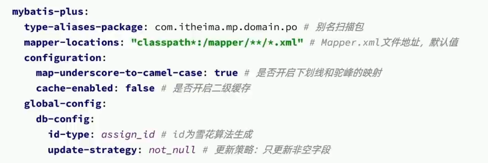

# 1.Mybatis-Plus使用步骤

## 1.1 引入mybatis-plus依赖

**Maven：**
```xml
<dependency>
    <groupId>com.baomidou</groupId>
    <artifactId>mybatis-plus-spring-boot3-starter</artifactId>
    <version>3.5.9</version>
</dependency>
```
> 如果是 Spring Boot 2.x 项目，使用 `mybatis-plus-boot-starter`。

**Gradle：**
```groovy
implementation 'com.baomidou:mybatis-plus-spring-boot3-starter:3.5.9'
```

> Mybatis-Plus 自带 Mybatis 核心依赖和 JDBC 驱动，无需单独引入 Mybatis。但数据库驱动（如 MySQL Connector）仍需按需引入。

## 1.2 定义的Mapper接口继承BaseMapper

```java
package com.example.mapper;

import com.baomidou.mybatisplus.core.mapper.BaseMapper;
import com.example.entity.User;
import org.apache.ibatis.annotations.Mapper;

@Mapper
public interface UserMapper extends BaseMapper<User> {
    // 继承 BaseMapper 后自动拥有 CRUD 方法，无需编写任何 XML
    // 包括：insert、delete、update、selectById、selectList、selectPage 等
}
```

**实体类：**
```java
package com.example.entity;

import com.baomidou.mybatisplus.annotation.TableName;
import lombok.Data;

@Data
@TableName("t_user")  // 如果表名与类名不是蛇形映射关系，需要手动指定
public class User {
    private Long id;
    private String username;
    private Integer age;
    private String email;
}
```

**使用示例：**
```java
@SpringBootTest
class UserMapperTest {
    @Autowired
    private UserMapper userMapper;

    @Test
    void testSelect() {
        // 查询所有用户
        List<User> users = userMapper.selectList(null);
        // 按ID查询
        User user = userMapper.selectById(1L);
    }

    @Test
    void testInsert() {
        User user = new User();
        user.setUsername("张三");
        user.setAge(25);
        user.setEmail("zhangsan@example.com");
        userMapper.insert(user);
    }
}
```

---

# 2.常见注解

## 2.1 @TableName：用来指定表名

当实体类的名字无法从驼峰正确映射到蛇形表名时使用这个注解标注实体类，用value指定表名。

**使用场景：**
- 表名与类名无蛇形映射关系（如 `User` → 期望 `t_user` 而非 `user`）
- 类名与表名差异较大（如 `UserInfo` → `sys_user`）

```java
@Data
@TableName("t_user")       // 映射到 t_user 表
public class User {
    private Long id;
    private String username;
}
```

**全局表前缀配置（推荐）：**

如果项目中所有表都有统一前缀（如 `t_`），可以在配置文件中全局设置，无需在每个实体类上加 `@TableName`：

```yaml
mybatis-plus:
  global-config:
    db-config:
      table-prefix: t_
```

这样 `User` 类会自动映射到 `t_user` 表。

## 2.2 @TableId：用来指定表中的主键字段信息

`@TableId` 拥有的属性 `type` 的枚举值：

| type 值 | 说明 |
|---------|------|
| `AUTO` | 数据库自增长（需数据库字段设置 auto_increment） |
| `INPUT` | 通过 set 方法自行输入 |
| `ASSIGN_ID` | 分配 ID，使用雪花算法生成 Long 型 ID（**默认值**） |
| `ASSIGN_UUID` | 分配 UUID，生成 32 位 String 型 UUID（去除中划线） |
| `NONE` | 无状态，等同于不做任何处理 |

**使用 @TableId 的情况：**
1. 主键字段名不是 `id`
2. 需要指定主键生成策略
3. 主键字段名与数据库列名不同

**可以不写 @TableId 的情况：**
1. 字段名就是 `id`，且数据库主键字段名也是 `id`
2. 使用默认主键策略（`ASSIGN_ID`）

```java
@Data
@TableName("t_user")
public class User {
    @TableId(value = "user_id", type = IdType.AUTO)   // 自增主键
    private Long id;

    private String username;
}
```

```java
@Data
@TableName("t_order")
public class Order {
    @TableId(type = IdType.ASSIGN_ID)   // 雪花算法（默认策略，可不写）
    private Long id;

    @TableId(value = "order_no", type = IdType.ASSIGN_UUID)  // UUID 策略
    private String orderNo;
}
```

**雪花算法（Snowflake）说明：**
- 生成 64 bit 的 Long 型纯数字 ID
- 由 时间戳 + 机器标识 + 序列号 组成
- 趋势递增，非严格递增（时间回拨可能导致问题）
- 适合分布式系统，无需依赖数据库自增

**全局主键策略配置：**
```yaml
mybatis-plus:
  global-config:
    db-config:
      id-type: auto   # 全局设置主键生成策略
```

## 2.3 @TableField：用来指定表中的普通字段信息

**使用 @TableField 的常见场景：**

### 场景一：成员变量名和数据库字段名不一致

指的是小驼峰转蛇形之后不一致的情况。

```java
@Data
public class User {
    @TableField("username")     // 手动指定映射的数据库字段名
    private String name;        // 类中字段名为 name，数据库字段名为 username

    @TableField("is_vip")       // 解决驼峰映射不对的问题
    private Boolean isVip;
}
```

### 场景二：成员变量名以 `is` 开头，且是布尔类型

以 `is` 开头的布尔类型字段在处理时，Mybatis-Plus 会去除开头的 `is` 再转下划线，导致字段名映射错误。

```java
@Data
public class User {
    // 不加 @TableField → MP 会自动映射为 "married"（丢失了 is）
    // 实际数据库字段是 is_married
    @TableField("is_married")
    private Boolean isMarried;
}
```

### 场景三：成员变量名与数据库关键字冲突

```java
@Data
public class Product {
    // order 是 SQL 关键字，需要用反引号转义
    @TableField("`order`")
    private Integer order;

    // 或者换个字段名
    @TableField("`group`")
    private String group;
}
```

### 场景四：成员变量不是数据库字段

```java
@Data
public class User {
    private Long id;
    private String username;

    // 该字段在数据库表中不存在，仅用于业务逻辑
    @TableField(exist = false)
    private String confirmPassword;

    // 仅用于展示的关联数据
    @TableField(exist = false)
    private List<Order> orders;
}
```

**@TableField 其他常用属性：**

| 属性 | 说明 |
|------|------|
| `value` | 数据库字段名 |
| `exist` | 是否为数据库字段，`false` 表示不是 |
| `fill` | 字段自动填充策略（配合 MetaObjectHandler），枚举值：`DEFAULT`、`INSERT`、`UPDATE`、`INSERT_UPDATE` |
| `select` | 是否进行 select 查询，`false` 则查询时不返回该字段 |
| `jdbcType` | 设置 JDBC 类型，如 `JdbcType.VARCHAR` |
| `typeHandler` | 类型处理器，如 JSON 处理器 `JacksonTypeHandler.class` |

```java
@Data
public class User {
    @TableField(fill = FieldFill.INSERT)   // 插入时自动填充
    private LocalDateTime createTime;

    @TableField(fill = FieldFill.INSERT_UPDATE)  // 插入和更新时自动填充
    private LocalDateTime updateTime;

    @TableField(select = false)   // 查询时不返回（如密码字段）
    private String password;

    @TableField(typeHandler = JacksonTypeHandler.class)  // JSON 类型字段
    private Map<String, Object> extraInfo;
}
```

---

# 3.常见配置



**YAML 完整配置示例：**

```yaml
spring:
  datasource:
    url: jdbc:mysql://localhost:3306/mybatis_plus?useUnicode=true&characterEncoding=utf-8&serverTimezone=Asia/Shanghai
    username: root
    password: root
    driver-class-name: com.mysql.cj.jdbc.Driver

mybatis-plus:
  # Mapper XML 文件位置（如果有自定义 XML）
  mapper-locations: classpath*:/mapper/**/*.xml
  # 实体类包路径，用于类型别名
  type-aliases-package: com.example.entity
  configuration:
    # 日志输出（开发时建议开启，便于查看 SQL）
    log-impl: org.apache.ibatis.logging.stdout.StdOutImpl
    # 下划线转驼峰（默认开启）
    map-underscore-to-camel-case: true
    # 二级缓存
    cache-enabled: false
  global-config:
    db-config:
      # 全局主键类型
      id-type: assign_id
      # 全局表前缀
      table-prefix: t_
      # 逻辑删除字段名
      logic-delete-field: deleted
      # 逻辑删除值（1 表示已删除）
      logic-delete-value: 1
      # 逻辑未删除值（0 表示未删除）
      logic-not-delete-value: 0
      # 字段更新策略（not_null 表示非 NULL 判断）
      update-strategy: not_null
      # 字段插入策略
      insert-strategy: not_null
```

**application.properties 写法：**
```properties
mybatis-plus.mapper-locations=classpath*:/mapper/**/*.xml
mybatis-plus.type-aliases-package=com.example.entity
mybatis-plus.configuration.log-impl=org.apache.ibatis.logging.stdout.StdOutImpl
mybatis-plus.configuration.map-underscore-to-camel-case=true
mybatis-plus.global-config.db-config.id-type=assign_id
mybatis-plus.global-config.db-config.table-prefix=t_
```

---

# 4.排除某个字段的三种方式

开发中可能需要让实体类的某个字段不参与数据库操作，以下三种方式均可实现：

| 方式 | 说明 |
|------|------|
| `@TableField(exist = false)` | 标记非数据库字段（推荐，语义最清晰） |
| `transient` 关键字 | Java 原生关键字，表示不参与序列化，Mybatis-Plus 也会自动忽略 |
| `static` 关键字 | 静态字段不会被当作表字段 |

```java
@Data
public class User {
    private Long id;

    @TableField(exist = false)
    private String confirmPassword;  // 方式一：注解标记

    private transient String tempToken;  // 方式二：transient 关键字

    // private static String tableName;   // 方式三：静态字段（极少使用）
}
```
