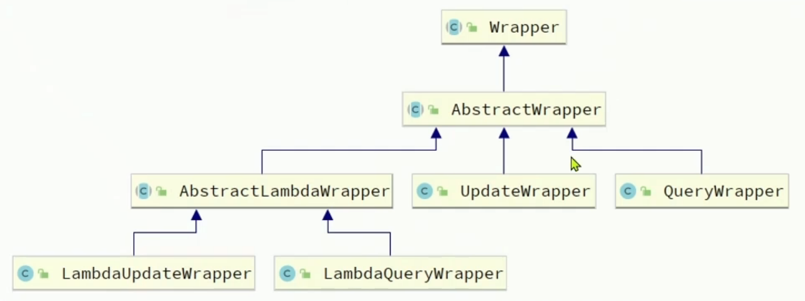

# 1. 条件构造器



## 1.1 概述

QueryWrapper 和 LambdaQueryWrapper 通常用来构建 select、delete、update 的 where 条件部分。
UpdateWrapper 和 LambdaUpdateWrapper 通常只有在 set 语句比较特殊时才使用。
**尽量使用 LambdaQueryWrapper 和 LambdaUpdateWrapper，避免硬编码。**

| 构造器 | 适用场景 |
|--------|----------|
| `QueryWrapper<T>` | 纯字符串字段名构建 where，需要手动写字段名 |
| `LambdaQueryWrapper<T>` | Lambda 表达式引用实体 getter，避免字段名硬编码（**推荐**） |
| `UpdateWrapper<T>` | 构建 update 语句的 set 部分（简单更新推荐用 LambdaUpdateWrapper） |
| `LambdaUpdateWrapper<T>` | Lambda 方式构建 update 语句 |

## 1.2 QueryWrapper 常用方法

```java
@SpringBootTest
class QueryWrapperTest {
    @Autowired
    private UserMapper userMapper;

    // 1. 基本等值查询
    @Test
    void testEq() {
        QueryWrapper<User> wrapper = new QueryWrapper<>();
        wrapper.eq("username", "张三");                          // WHERE username = '张三'
        List<User> users = userMapper.selectList(wrapper);
    }

    // 2. 多条件查询
    @Test
    void testMultiCondition() {
        QueryWrapper<User> wrapper = new QueryWrapper<>();
        wrapper.eq("username", "张三")                           // username = '张三'
               .gt("age", 18)                                   // AND age > 18
               .lt("age", 60)                                   // AND age < 60
               .or()                                            // 拼接 OR
               .eq("status", 1);                                // OR status = 1
        List<User> users = userMapper.selectList(wrapper);
        // SQL: WHERE username = '张三' AND age > 18 AND age < 60 OR status = 1
    }

    // 3. 模糊查询
    @Test
    void testLike() {
        QueryWrapper<User> wrapper = new QueryWrapper<>();
        wrapper.like("username", "张");                          // username LIKE '%张%'
        wrapper.likeLeft("username", "张");                       // username LIKE '%张'
        wrapper.likeRight("username", "张");                      // username LIKE '张%'
        List<User> users = userMapper.selectList(wrapper);
    }

    // 4. 范围查询
    @Test
    void testBetween() {
        QueryWrapper<User> wrapper = new QueryWrapper<>();
        wrapper.between("age", 18, 30);                         // age BETWEEN 18 AND 30
        List<User> users = userMapper.selectList(wrapper);
    }

    // 5. IN 查询
    @Test
    void testIn() {
        QueryWrapper<User> wrapper = new QueryWrapper<>();
        wrapper.in("id", Arrays.asList(1L, 2L, 3L));            // id IN (1, 2, 3)
        wrapper.notIn("id", Arrays.asList(4L, 5L));              // id NOT IN (4, 5)
        List<User> users = userMapper.selectList(wrapper);
    }

    // 6. 排序
    @Test
    void testOrderBy() {
        QueryWrapper<User> wrapper = new QueryWrapper<>();
        wrapper.orderByDesc("age")                               // ORDER BY age DESC
               .orderByAsc("id");                                // , id ASC
        List<User> users = userMapper.selectList(wrapper);
    }

    // 7. NULL 判断查询
    @Test
    void testIsNull() {
        QueryWrapper<User> wrapper = new QueryWrapper<>();
        wrapper.isNull("email");                                 // WHERE email IS NULL
        wrapper.isNotNull("phone");                              // AND phone IS NOT NULL
        List<User> users = userMapper.selectList(wrapper);
    }

    // 8. 分组与聚合
    @Test
    void testGroupBy() {
        QueryWrapper<User> wrapper = new QueryWrapper<>();
        wrapper.select("age, COUNT(*) as count")                 // SELECT age, COUNT(*)
               .groupBy("age")                                   // GROUP BY age
               .having("COUNT(*) > 1");                          // HAVING COUNT(*) > 1
        List<Map<String, Object>> list = userMapper.selectMaps(wrapper);
    }

    // 9. 动态条件拼接（实战常用）
    @Test
    void testDynamicCondition() {
        String username = "张三";    // 模拟前端传参
        Integer minAge = null;       // 可能为 null

        QueryWrapper<User> wrapper = new QueryWrapper<>();
        wrapper.eq(username != null, "username", username)       // 第一个参数为 true 才生效
               .gt(minAge != null, "age", minAge);
        List<User> users = userMapper.selectList(wrapper);
    }

    // 10. 只查询指定字段
    @Test
    void testSelect() {
        QueryWrapper<User> wrapper = new QueryWrapper<>();
        wrapper.select("id", "username", "age");                 // SELECT id, username, age
        List<User> users = userMapper.selectList(wrapper);
    }

    // 11. 子查询
    @Test
    void testSubQuery() {
        QueryWrapper<User> wrapper = new QueryWrapper<>();
        wrapper.inSql("id", "SELECT user_id FROM t_order WHERE amount > 100");
        // WHERE id IN (SELECT user_id FROM t_order WHERE amount > 100)
        List<User> users = userMapper.selectList(wrapper);
    }
}
```

## 1.3 LambdaQueryWrapper（推荐）

使用 Lambda 表达式引用 getter 方法，编译器会检查字段名，避免硬编码。

```java
@Test
void testLambdaQuery() {
    LambdaQueryWrapper<User> wrapper = new LambdaQueryWrapper<>();
    wrapper.eq(User::getUsername, "张三")      // 相当于 eq("username", "张三")
           .gt(User::getAge, 18)
           .between(User::getAge, 18, 30)
           .like(User::getEmail, "@qq.com")
           .orderByDesc(User::getAge)
           .in(User::getId, Arrays.asList(1L, 2L, 3L));

    List<User> users = userMapper.selectList(wrapper);
}

// 链式调用（通过 Service 层的 lambdaQuery）
@Test
void testChainQuery() {
    List<User> users = userService.lambdaQuery()
            .eq(User::getUsername, "张三")
            .gt(User::getAge, 18)
            .list();
}
```

## 1.4 UpdateWrapper 使用

适用于需要直接 set 字段值的场景：

```java
@Test
void testUpdateWrapper() {
    // 方式一：UpdateWrapper 直接 set
    UpdateWrapper<User> wrapper = new UpdateWrapper<>();
    wrapper.set("username", "李四")                           // SET username = '李四'
           .set("age", 30)                                    // , age = 30
           .eq("id", 1L);                                     // WHERE id = 1
    userMapper.update(null, wrapper);  // 第一个参数为 null（不用实体）

    // 方式二：LambdaUpdateWrapper（推荐）
    LambdaUpdateWrapper<User> lambdaWrapper = new LambdaUpdateWrapper<>();
    lambdaWrapper.set(User::getUsername, "李四")
                 .set(User::getAge, 30)
                 .eq(User::getId, 1L);
    userMapper.update(null, lambdaWrapper);

    // 方式三：简单更新直接用 Service 的 lambdaUpdate 链式调用
    userService.lambdaUpdate()
            .set(User::getUsername, "李四")
            .eq(User::getId, 1L)
            .update();

    // 方式四：更简单的更新操作
    // 先查询，再修改，最后更新（推荐方式）
    User user = userMapper.selectById(1L);
    user.setUsername("李四");
    userMapper.updateById(user);
}
```

## 1.5 Delete 与 Wrapper

```java
// 按条件删除
LambdaQueryWrapper<User> wrapper = new LambdaQueryWrapper<>();
wrapper.eq(User::getStatus, 0);           // 删除 status=0 的用户
userMapper.delete(wrapper);

// 按 ID 删除
userMapper.deleteById(1L);

// 批量按 ID 删除
userMapper.deleteBatchIds(Arrays.asList(1L, 2L, 3L));

// 按 Map 条件删除
Map<String, Object> map = new HashMap<>();
map.put("status", 0);
map.put("age", 18);
userMapper.deleteByMap(map);
```

---

# 2. 自定义 SQL

我们可以使用 Mybatis-Plus 的 Wrapper 来构建复杂的 Where 条件，然后自定义 SQL 语句的剩下部分。

**核心三步：**
1. 基于 Wrapper 构建 Where 条件
2. 在 Mapper 方法参数中使用 `@Param` 注解声明 wrapper 变量名称，**必须是 `ew`**（或使用 `@Param(Constants.WRAPPER)`）
3. 在 XML 或注解中编写自定义 SQL，使用 `${ew.customSqlSegment}` 引用 Wrapper 条件

**方式一：XML 自定义 SQL**

```java
// Mapper 接口
@Mapper
public interface UserMapper extends BaseMapper<User> {
    // 注意：@Param 中的变量名必须为 "ew"（或 Constants.WRAPPER）
    List<User> selectUsersByWrapper(@Param("ew") LambdaQueryWrapper<User> wrapper);

    // 结合分页
    IPage<User> selectPageByWrapper(Page<User> page, @Param("ew") LambdaQueryWrapper<User> wrapper);
}
```

```xml
<!-- resources/mapper/UserMapper.xml -->
<?xml version="1.0" encoding="UTF-8"?>
<!DOCTYPE mapper PUBLIC "-//mybatis.org//DTD Mapper 3.0//EN"
        "http://mybatis.org/dtd/mybatis-3-mapper.dtd">
<mapper namespace="com.example.mapper.UserMapper">

    <select id="selectUsersByWrapper" resultType="com.example.entity.User">
        SELECT id, username, age, email, create_time
        FROM t_user
        ${ew.customSqlSegment}   <!-- 自动拼接 Wrapper 生成的条件 -->
    </select>

    <select id="selectPageByWrapper" resultType="com.example.entity.User">
        SELECT u.*, o.order_count
        FROM t_user u
        LEFT JOIN (SELECT user_id, COUNT(*) as order_count FROM t_order GROUP BY user_id) o
        ON u.id = o.user_id
        ${ew.customSqlSegment}
    </select>
</mapper>
```

**方式二：注解自定义 SQL**

```java
@Mapper
public interface UserMapper extends BaseMapper<User> {

    @Select("SELECT id, username, age, email FROM t_user ${ew.customSqlSegment}")
    List<User> selectUsersByWrapper(@Param("ew") LambdaQueryWrapper<User> wrapper);

    // 复杂 SQL 不建议用注解，可读性差
}
```

**实战示例：多表关联 + 条件筛选**

```java
// 需求：查询用户及该用户的订单数量，支持按用户名、年龄段筛选
@Test
void testCustomSQLWithWrapper() {
    LambdaQueryWrapper<User> wrapper = new LambdaQueryWrapper<>();
    wrapper.like(StringUtils.isNotBlank(name), User::getUsername, name)
           .between(minAge != null && maxAge != null, User::getAge, minAge, maxAge);

    List<User> users = userMapper.selectUsersByWrapper(wrapper);
    // 生成的 SQL：
    // SELECT id, username, age, email FROM t_user WHERE username LIKE '%张三%' AND age BETWEEN 18 AND 30
}

// 分页 + 自定义 SQL
@Test
void testCustomSQLWithPage() {
    Page<User> page = new Page<>(1, 10);   // 第1页，每页10条
    LambdaQueryWrapper<User> wrapper = new LambdaQueryWrapper<>();
    wrapper.like(User::getUsername, "张");

    IPage<User> result = userMapper.selectPageByWrapper(page, wrapper);
    List<User> records = result.getRecords();
    long total = result.getTotal();
}
```

---

# 3. Service 接口

## 3.1 使用步骤

### 3.1.1 XxxMapper 接口继承 BaseMapper 接口

```java
@Mapper
public interface UserMapper extends BaseMapper<User> {
}
```

### 3.1.2 XxxService 接口继承 IService 接口

```java
public interface UserService extends IService<User> {
    // 在此定义业务特有的方法
    User login(String username, String password);
    boolean register(User user);
}
```

### 3.1.3 创建 XxxServiceImpl 类实现 XxxService 接口并继承 ServiceImpl

```java
@Service
public class UserServiceImpl extends ServiceImpl<UserMapper, User> implements UserService {

    @Override
    public User login(String username, String password) {
        // IService 提供的方法可直接用
        User user = lambdaQuery()
                .eq(User::getUsername, username)
                .eq(User::getPassword, password)
                .one();
        if (user == null) {
            throw new RuntimeException("用户名或密码错误");
        }
        return user;
    }

    @Override
    public boolean register(User user) {
        // save 是 IService 提供的方法
        return save(user);
    }
}
```

## 3.2 IService 提供的常用方法

IService 接口提供了大量开箱即用的方法，无需像 Mapper 层那样需要显式调用。

| 分类 | 方法 | 说明 |
|------|------|------|
| **保存** | `save(entity)` | 插入一条记录 |
| | `saveBatch(list)` | 批量插入 |
| | `saveOrUpdate(entity)` | 有 ID 则更新，无则插入 |
| | `saveOrUpdateBatch(list)` | 批量新增或更新 |
| **删除** | `removeById(id)` | 根据 ID 删除 |
| | `removeByIds(ids)` | 批量根据 ID 删除 |
| | `removeByMap(map)` | 根据 Map 条件删除 |
| | `remove(wrapper)` | 根据 Wrapper 条件删除 |
| **更新** | `updateById(entity)` | 根据 ID 更新 |
| | `update(entity, wrapper)` | 根据 Wrapper 条件更新 |
| | `updateBatchById(list)` | 批量根据 ID 更新 |
| **查询单个** | `getById(id)` | 根据 ID 查询 |
| | `getOne(wrapper)` | 根据 Wrapper 查询一条（多条会抛异常） |
| | `getOne(wrapper, false)` | 查询一条，多条时返回第一条不抛异常 |
| | `getMap(wrapper)` | 查询一条返回 Map |
| **查询列表** | `list()` | 查询所有 |
| | `listByIds(ids)` | 根据 ID 列表查询 |
| | `listByMap(map)` | 根据 Map 条件查询 |
| | `list(wrapper)` | 根据 Wrapper 条件查询 |
| | `listMaps(wrapper)` | 查询返回 List\<Map\> |
| **计数** | `count()` | 查询总记录数 |
| | `count(wrapper)` | 根据条件查询记录数 |
| **分页** | `page(page)` | 无条件分页 |
| | `page(page, wrapper)` | 条件分页 |
| | `pageMaps(page, wrapper)` | 分页返回 List\<Map\> |

## 3.3 IService 的 Lambda 方法

IService 提供了便捷的 Lambda 链式调用方法，避免创建 Wrapper 实例。

```java
@Service
public class UserServiceImpl extends ServiceImpl<UserMapper, User> implements UserService {

    public void lambdaExamples() {
        // ===== LambdaQuery 链式调用 =====
        // 查询列表
        List<User> list = lambdaQuery()
                .eq(User::getStatus, 1)
                .gt(User::getAge, 18)
                .orderByDesc(User::getCreateTime)
                .list();

        // 查询单个
        User user = lambdaQuery()
                .eq(User::getUsername, "张三")
                .one();

        // 查询数量
        long count = lambdaQuery()
                .gt(User::getAge, 18)
                .count();

        // 只查指定字段
        List<User> users = lambdaQuery()
                .select(User::getId, User::getUsername, User::getAge)
                .eq(User::getStatus, 1)
                .list();

        // ===== LambdaUpdate 链式调用 =====
        // 条件更新
        boolean updated = lambdaUpdate()
                .set(User::getStatus, 0)                    // SET status = 0
                .setSql("version = version + 1")            // SET version = version + 1 (直接拼接 SQL)
                .eq(User::getId, 1L)
                .update();

        // 也可以使用 setIncrBy（Mybatis-Plus 3.5.6+）
        lambdaUpdate()
                .setIncrBy(User::getBalance, -100)          // SET balance = balance - 100
                .eq(User::getId, 1L)
                .update();

        // ===== LambdaQuery 链式调用（通过静态方法）=====
        // 在非 Service 层也可以使用
        List<User> userList = Wrappers.<User>lambdaQuery()
                .eq(User::getUsername, "张三")
                .list();
    }
}
```

## 3.4 IService 的批量新增

```java
@Service
public class UserServiceImpl extends ServiceImpl<UserMapper, User> implements UserService {

    public void batchInsertExample() {
        List<User> userList = new ArrayList<>();
        for (int i = 0; i < 100; i++) {
            User user = new User();
            user.setUsername("用户" + i);
            user.setAge(20 + (i % 30));
            user.setEmail("user" + i + "@example.com");
            userList.add(user);
        }

        // 批量插入（默认每批 1000 条，自动分批提交）
        saveBatch(userList);

        // 指定每批数量
        saveBatch(userList, 50);     // 每批 50 条

        // 批量更新
        updateBatchById(userList);

        // 批量新增或更新（有 ID 则更新，无则插入）
        saveOrUpdateBatch(userList);
    }
}
```

> **注意：** `saveBatch` 底层默认使用 for 循环逐条 insert，并非真正的 batch insert。若要使用真正的 JDBC batch，需要在 JDBC URL 中添加 `rewriteBatchedStatements=true` 参数。
>
> ```yaml
> spring:
>   datasource:
>     url: jdbc:mysql://localhost:3306/mybatis_plus?rewriteBatchedStatements=true
> ```

## 3.5 自定义 ServiceImpl 的实践

```java
@Service
@Transactional  // 类级别事务
public class UserServiceImpl extends ServiceImpl<UserMapper, User> implements UserService {

    @Autowired
    private OrderMapper orderMapper;

    // 复杂业务：注册用户同时创建默认订单
    @Override
    @Transactional(rollbackFor = Exception.class)
    public boolean register(User user) {
        // 1. 保存用户
        boolean saved = save(user);
        if (!saved) {
            throw new RuntimeException("用户注册失败");
        }

        // 2. 创建默认订单
        Order order = new Order();
        order.setUserId(user.getId());
        order.setAmount(BigDecimal.ZERO);
        orderMapper.insert(order);

        return true;
    }

    // 分页查询用户及订单数量（多表关联）
    public IPage<UserVO> queryUserWithOrderCount(Page<UserVO> page, String username) {
        return baseMapper.selectUserWithOrderCount(page, username);
        // baseMapper 是 ServiceImpl 提供的属性，指向当前 Mapper
    }

    // 使用 IService 的 getOne 时避免抛异常
    public User findUserByEmail(String email) {
        // 第二个参数 false：多条匹配时取第一条，而不是抛异常
        return getOne(Wrappers.<User>lambdaQuery().eq(User::getEmail, email), false);
    }
}
```

---

# 4. Db 静态工具类（补充）

`Db` 是 Mybatis-Plus 3.5.1+ 提供的通用数据库操作工具类，可在非 Service 层直接使用，无需注入 Mapper。

```java
// 查询
List<User> users = Db.list(User.class);                          // 查询所有
User user = Db.getById(1L, User.class);                          // 按 ID 查询
List<User> list = Db.lambdaQuery(User.class)
        .eq(User::getStatus, 1)
        .gt(User::getAge, 18)
        .list();                                                  // Lambda 条件查询
long count = Db.lambdaQuery(User.class).eq(User::getStatus, 1).count();  // 计数

// 新增
User newUser = new User();
newUser.setUsername("张三");
Db.save(newUser);
Db.saveBatch(userList);                                          // 批量新增

// 更新
Db.updateById(user);                                             // 按 ID 更新
Db.lambdaUpdate(User.class)
        .set(User::getStatus, 0)
        .eq(User::getId, 1L)
        .update();                                                // 条件更新

// 删除
Db.removeById(1L, User.class);                                  // 按 ID 删除
Db.lambdaUpdate(User.class)   // 注意：没有 Db.lambdaDelete，用 lambdaUpdate 即可（逻辑删除场景）
        .eq(User::getStatus, -1);
```

> **最佳实践：** Service 层用 `lambdaQuery()` / `lambdaUpdate()`，非 Service 层（如工具类、定时任务）用 `Db.xxx()`。
