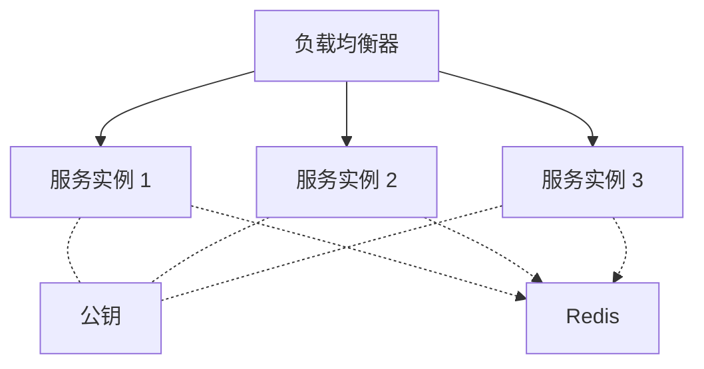

# 1. JWT 性能考量概述

JWT 的无状态特性带来了横向扩展的优势，但也引入了特定的性能开销：每次请求都需要验证签名、解码 Payload、检查 Claims。理解这些开销并合理优化是生产部署的关键。

---

# 2. JWT 性能开销分析

## 2.1 各环节开销评估

| 环节 | 开销程度 | 频率 | 说明 |
|------|----------|------|------|
| 签名验证 | 中-高 | 每次请求 | 取决于算法（RSA 慢，HMAC 快） |
| Base64URL 解码 | 低 | 每次请求 | 极快的操作 |
| Claims 验证 | 极低 | 每次请求 | 比较时间戳、字符串 |
| 黑名单查询 | 低 | 每次请求 | 1 次 Redis 查询 |
| JWT 签发 | 中 | 仅登录/刷新时 | 远低于验证频率 |

## 2.2 签名算法的性能对比

```java
// 基准测试参考代码（JMH 伪代码）
@Benchmark
public void benchmarkHS256Verification() {
    // HS256 验证：~2 μs/次
    Jwts.parser().verifyWith(hsKey).build()
        .parseSignedClaims(hs256Token);
}

@Benchmark
public void benchmarkRS256Verification() {
    // RS256 验证：~200 μs/次（约 HS256 的 100 倍）
    Jwts.parser().verifyWith(rsaPublicKey).build()
        .parseSignedClaims(rs256Token);
}

@Benchmark
public void benchmarkES256Verification() {
    // ES256 验证：~150 μs/次
    Jwts.parser().verifyWith(ecPublicKey).build()
        .parseSignedClaims(es256Token);
}

@Benchmark
public void benchmarkEdDSAVerification() {
    // EdDSA 验证：~30 μs/次
    Jwts.parser().verifyWith(edPublicKey).build()
        .parseSignedClaims(edToken);
}
```

> 数据说明：以上数字为参考数量级，实际值取决于 JVM 版本、硬件、加密库实现等因素。

## 2.3 性能数据参考

| 算法 | 签发速度 | 验证速度 | 签名大小 | 建议场景 |
|------|----------|----------|----------|----------|
| HS256 | 极快（~1μs） | 极快（~2μs） | 43 字符 | 内部微服务 |
| RS256 | 慢（~1ms） | 中（~200μs） | 342 字符 | 互联互通 |
| ES256 | 快（~50μs） | 快（~150μs） | 86 字符 | 移动端、IoT |
| EdDSA | 极快（~20μs） | 快（~30μs） | 86 字符 | 新项目首选 |

---

# 3. JWT 验证性能优化

## 3.1 缓存 JwtParser 实例

```java
// 错误：每次请求都创建新 Parser
@Component
public class BadJwtValidator {
    private final Key key;
    
    public Claims validate(String token) {
        // 不要这样做！每次都创建新 Parser
        return Jwts.parser()
            .verifyWith(key)
            .build()
            .parseSignedClaims(token)
            .getPayload();
    }
}

// 正确：预构建 Parser，线程安全，重复使用
@Component
public class GoodJwtValidator {
    private final JwtParser parser;
    
    public GoodJwtValidator(Key key) {
        // 构建一次，重复使用
        this.parser = Jwts.parser()
            .verifyWith(key)
            .clockSkewSeconds(30)
            .build();
    }
    
    public Claims validate(String token) {
        return parser.parseSignedClaims(token).getPayload();
    }
}
```

## 3.2 提前拒绝无效 Token

```java
public Claims validateEfficiently(String token) {
    // 策略1：先做低成本检查，再做高成本操作
    
    // 1. 格式检查（几乎零成本）
    int dotCount = countDots(token);
    if (dotCount != 2) {
        throw new JwtException("Invalid token format");
    }
    
    // 2. 长度检查（拒绝异常大的 Token）
    if (token.length() > 4096) {
        throw new JwtException("Token too large");
    }
    
    // 3. 黑名单/缓存检查（如有本地缓存，避免 Redis 调用）
    String jti = extractJtiFromToken(token);
    if (localCache.isBlacklisted(jti)) {
        throw new JwtException("Token revoked");
    }
    
    // 4. 签名验证（较昂贵的操作）
    return parser.parseSignedClaims(token).getPayload();
}
```

## 3.3 JWK Set 缓存

```java
@Component
public class CachingJwkProvider {
    
    private final Cache<String, RSAKey> keyCache = Caffeine.newBuilder()
        .maximumSize(100)
        .expireAfterWrite(1, TimeUnit.HOURS)
        .build();
    
    private final String jwkSetUrl;
    private final RestTemplate restTemplate;
    
    public RSAKey getKey(String kid) {
        return keyCache.get(kid, this::fetchKey);
    }
    
    private RSAKey fetchKey(String kid) {
        String jwks = restTemplate.getForObject(jwkSetUrl, String.class);
        JWKSet jwkSet = JWKSet.parse(jwks);
        return (RSAKey) jwkSet.getKeyByKeyId(kid);
    }
}
```

## 3.4 批量验证优化

```java
// 对于需要验证大量 Token 的场景（如数据迁移、审计）
public class BatchTokenValidator {
    
    // 使用 ForkJoinPool 并行验证
    private final ForkJoinPool customPool = new ForkJoinPool(
        Runtime.getRuntime().availableProcessors()
    );
    
    public Map<String, ValidationResult> batchValidate(List<String> tokens) {
        return customPool.submit(() ->
            tokens.parallelStream()
                .collect(Collectors.toConcurrentMap(
                    token -> extractJti(token),
                    this::validateQuietly
                ))
        ).join();
    }
}
```

---

# 4. JWT 体积优化

## 4.1 体积影响因素

```
JWT 体积 ≈ Header(约 50B) + Payload(变化) + Signature(算法相关)

算法签名大小（Base64URL 编码后）：
HS256: ~43 字符
RS256: ~342 字符
ES256: ~86 字符
EdDSA: ~86 字符
```

## 4.2 Payload 压缩

```java
public String compressPayload(String payloadJson) throws IOException {
    ByteArrayOutputStream bos = new ByteArrayOutputStream();
    try (GZIPOutputStream gzip = new GZIPOutputStream(bos)) {
        gzip.write(payloadJson.getBytes(StandardCharsets.UTF_8));
    }
    return Base64.getUrlEncoder().withoutPadding()
        .encodeToString(bos.toByteArray());
}

public String decompressPayload(String compressedB64) throws IOException {
    byte[] compressed = Base64.getUrlDecoder().decode(compressedB64);
    try (GZIPInputStream gzip = new GZIPInputStream(
            new ByteArrayInputStream(compressed));
         ByteArrayOutputStream bos = new ByteArrayOutputStream()) {
        gzip.transferTo(bos);
        return bos.toString(StandardCharsets.UTF_8);
    }
}
```

## 4.3 短字段名策略

```json
// 标准命名（可读性好，体积大）
{
  "subject": "user123",
  "issuer": "https://auth.example.com",
  "expiration": 1712345678,
  "roles": ["ADMIN", "USER"],
  "permissions": ["read", "write"]
}

// 短命名（体积小，但可读性差）
{
  "sub": "user123",
  "iss": "https://auth.example.com",
  "exp": 1712345678,
  "rol": ["ADMIN", "USER"],
  "prm": ["r", "w"]
}
```

> 建议：使用标准 Claims 名（如 `sub`、`exp`），自定义 Claims 可使用短名称但需在团队内保持一致。

---

# 5. 水平扩展与无状态认证

## 5.1 无状态扩展的优势



- 所有实例使用相同公钥验证 JWT
- 无需 Session 共享（无状态）
- 黑名单/版本号使用 Redis 等共享存储
- 可无限水平扩展

## 5.2 密钥分发

```yaml
# 方案A：环境变量注入
jwt:
  public-key: ${JWT_PUBLIC_KEY}

# 方案B：配置中心（Spring Cloud Config、Consul、Apollo）
jwt:
  public-key: ${jwt.public-key}

# 方案C：JWK Set 端点
jwt:
  jwk-set-uri: https://auth.internal/.well-known/jwks.json

# 方案D：KMS（AWS KMS、Azure Key Vault、HashiCorp Vault）
jwt:
  key-vault-uri: https://vault.internal/jwt/keys
```

## 5.3 跨数据中心部署

```
数据中心 A               数据中心 B
┌─────────────┐         ┌─────────────┐
│ Auth Server │         │ Auth Server │
│  (签发 JWT)  │         │  (签发 JWT)  │
└──────┬──────┘         └──────┬──────┘
       │                       │
       └─────── JWK Set ───────┘
                (CDN 分发)
       ┌───────┐         ┌───────┐
       │ API   │         │ API   │
       │ (验证) │         │ (验证) │
       └───────┘         └───────┘

关键：JWK Set 通过 CDN 分发到全球，API 节点本地验证
```

---

# 6. 高并发优化

## 6.1 线程模型优化

```java
@Configuration
public class JwtConcurrencyConfig {
    
    @Bean
    public SecurityFilterChain filterChain(HttpSecurity http) throws Exception {
        http
            // ... 其他配置 ...
            
            // 在 SecurityContext 中保存 JWT 凭证，避免重复解析
            .addFilterBefore(new JwtParsingFilter(), 
                UsernamePasswordAuthenticationFilter.class);
        
        return http.build();
    }
}

// 使用 reactive 栈进一步提高吞吐量（Spring WebFlux）
// JWT 验证本身是非阻塞的，适合 reactive 模型
```

## 6.2 连接池与资源管理

```java
@Configuration
public class HttpClientConfig {
    
    @Bean
    public RestTemplate restTemplate() {
        // 用于 Introspection / JWK Set 获取
        return new RestTemplateBuilder()
            .setConnectTimeout(Duration.ofSeconds(2))
            .setReadTimeout(Duration.ofSeconds(5))
            .build();
    }
    
    @Bean
    public RedisConnectionFactory redisConnectionFactory() {
        LettuceClientConfiguration config = LettuceClientConfiguration.builder()
            .commandTimeout(Duration.ofSeconds(1))
            .build();
        
        return new LettuceConnectionFactory(
            new RedisStandaloneConfiguration("redis", 6379), config);
    }
}
```

## 6.3 限流与熔断

```java
// 对 JWT 接口实施限流
@RestController
@RequestMapping("/api/auth")
public class AuthController {
    
    @PostMapping("/login")
    @RateLimiter(name = "loginLimiter", fallbackMethod = "loginRateLimitExceeded")
    public ResponseEntity<AuthResponse> login(@RequestBody LoginRequest request) {
        // 登录逻辑
    }
    
    // 多次提交无效 JWT 时触发熔断
    @CircuitBreaker(name = "jwtValidation", fallbackMethod = "validationFallback")
    public Claims validateToken(String token) {
        // 正常验证
    }
}
```

---

# 7. JWT vs 其他方案的扩展性对比

## 7.1 会话状态管理对比

| 维度 | JWT（无状态） | 集中 Session（Redis） | 黏性 Session |
|------|--------------|----------------------|-------------|
| 水平扩展 | 简单 | 简单 | 困难 |
| 基础设施依赖 | 低（只需公钥） | 需 Redis 集群 | 需负载均衡支持 |
| 故障容错 | 高（本地验证） | 依赖 Redis 可用性 | 中等 |
| 请求延迟 | 低（本地验证） | 增加 Redis 查询 | 低 |
| 会话吊销 | 困难（需黑名单） | 简单 | 简单 |

## 7.2 选型决策

```
系统规模 < 10 服务节点、低并发:
  → Session + Redis 方案足够

系统规模 > 50 服务节点、高并发、多数据中心:
  → JWT 无状态方案更有优势

系统需要三方集成、OAuth2/SAML:
  → JWT 是标准选择
```

---

# 8. 缓存策略

## 8.1 令牌验证结果缓存

```java
@Component
public class CachingJwtValidator {
    
    private final Cache<String, CachedValidation> cache = Caffeine.newBuilder()
        .maximumSize(10_000)
        .expireAfterWrite(5, TimeUnit.MINUTES)
        .build();
    
    private final JwtParser parser;
    
    public Authentication validate(String token) {
        // 使用 token 的哈希作为缓存 key
        String cacheKey = DigestUtils.sha256Hex(token);
        
        CachedValidation cached = cache.getIfPresent(cacheKey);
        if (cached != null && !cached.isExpired()) {
            return cached.authentication();
        }
        
        Claims claims = parser.parseSignedClaims(token).getPayload();
        Authentication auth = buildAuthentication(claims);
        
        // 注意：TTL 不超过 Token 本身的过期时间
        long ttl = claims.getExpiration().getTime() - System.currentTimeMillis();
        cache.put(cacheKey, new CachedValidation(auth, claims.getExpiration()));
        
        return auth;
    }
}
```

> 警告：验证结果缓存会延迟吊销生效。仅在确认安全影响可接受时使用。

## 8.2 公钥缓存

```java
@Component
public class CachedJwkProvider {
    
    private final LoadingCache<String, RSAKey> cache = Caffeine.newBuilder()
        .maximumSize(50)
        .expireAfterWrite(15, TimeUnit.MINUTES)
        .refreshAfterWrite(10, TimeUnit.MINUTES)  // 适当刷新
        .build(this::loadJwk);
    
    public RSAKey getKey(String kid) {
        return cache.get(kid);
    }
    
    private RSAKey loadJwk(String kid) {
        // 从 JWK Set 端点获取
        // 或从本地密钥库读取
    }
}
```

---

# 9. 压力测试指南

## 9.1 JMeter / Gatling 测试

```bash
# 使用 Apache Bench 简单压力测试
ab -n 10000 -c 100 -H "Authorization: Bearer $TOKEN" \
   http://localhost:8080/api/users

# 监控指标
# - 平均响应时间 < 50ms（其中 JWT 验证 < 10ms）
# - 99 分位延迟 < 200ms
# - 错误率 < 0.1%
```

## 9.2 性能基准

```yaml
# 参考基准（基于 Spring Boot 3.x, JDK 17, 4 Core CPU）
jwt-benchmark:
  scenarios:
    - name: "HS256 验证"
      requests-per-second: 50000
      avg-latency: 0.5ms
    
    - name: "RS256 验证"
      requests-per-second: 5000
      avg-latency: 2ms
    
    - name: "ES256 验证"
      requests-per-second: 10000
      avg-latency: 1.5ms
    
    - name: "RS256 + Redis 黑名单"
      requests-per-second: 3000
      avg-latency: 5ms
```
