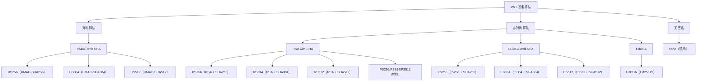

# 1. JWT 签名算法概述

JWT 的签名算法由 JWA（JSON Web Algorithms，RFC 7518）规范定义。算法选择直接影响 JWT 的安全性、性能和适用场景。

## 1.1 算法分类



## 1.2 算法选择决策树

```
                          是否需要多方验证？
                          /                \
                        是                   否
                        /                     \
                 使用非对称算法              同一服务签发和验证？
                 (RS256/ES256)               /              \
                                           是                否
                                          /                   \
                                   使用对称算法             使用非对称算法
                                   (HS256)                 (RS256/ES256)
```

---

# 2. HMAC 对称签名算法

## 2.1 HS256（HMAC with SHA-256）

HS256 是最常用的对称签名算法，**同一个密钥**用于签名和验证。

### 2.1.1 算法原理

```
HS256 JWT 签名 = HMAC-SHA256(
    key = 共享密钥,
    message = base64UrlEncode(header) + "." + base64UrlEncode(payload)
)
```

HMAC 的本质是将密钥与消息混合后计算哈希：

```
HMAC(K, m) = H((K' ⊕ opad) || H((K' ⊕ ipad) || m))
```

其中：
- `H` 是哈希函数（SHA-256）
- `K'` 是填充到块大小的密钥
- `opad` = 0x5c5c5c...（外部填充）
- `ipad` = 0x363636...（内部填充）
- `⊕` 是 XOR 运算
- `||` 是拼接运算

### 2.1.2 HS256 的密钥要求

- **最小长度**：256 位（32 字节）
- **推荐长度**：≥ 256 位
- 使用高质量随机数生成器（如 `java.security.SecureRandom`）生成
- 密钥保存于安全存储（环境变量、Vault、HSM）

**反例：弱密钥的危害**

```java
// 危险！弱密钥可被暴力破解
String weakSecret = "my-secret";
Jwts.parser().setSigningKey(weakSecret).parseClaimsJws(jwt);

// 正确：使用足够强度的随机密钥
byte[] keyBytes = new byte[32];
SecureRandom.getInstanceStrong().nextBytes(keyBytes);
String secretKey = Base64.getEncoder().encodeToString(keyBytes);
```

### 2.1.3 HS256 的优缺点

| 优点 | 缺点 |
|------|------|
| 计算速度快 | 密钥必须共享，泄漏风险大 |
| 签名体积小（43 字符） | 不提供不可否认性 |
| 算法实现简单 | 无法区分签发方和验证方 |
| 适用于内部微服务间通信 | 不适合公开给第三方 |

## 2.2 HS384（HMAC with SHA-384）

- 使用 SHA-384 哈希，密钥要求 ≥ 384 位（48 字节）
- 签名长度更大，安全性略高于 HS256
- 用于需要与 AES-192 对称的高安全场景

## 2.3 HS512（HMAC with SHA-512）

- 使用 SHA-512 哈希，密钥要求 ≥ 512 位（64 字节）
- 签名长度最大，安全性最高
- 在 64 位 CPU 上 SHA-512 实际计算速度可能快于 SHA-256

---

# 3. RSA 非对称签名算法

RSA 使用**私钥签名、公钥验证**：

```
签名：signer 使用 private key
验证：verifier 使用 public key
```

## 3.1 RS256（RSA PKCS#1 v1.5 with SHA-256）

### 3.1.1 签名生成过程

```
1. 计算消息摘要：digest = SHA-256(base64(header) + "." + base64(payload))

2. PKCS#1 v1.5 填充：EM = 0x00 || 0x01 || PS || 0x00 || T
   其中：
   - PS 是填充字符串（全 0xFF）
   - T 是 DigestInfo（ASN.1 DER 编码的摘要）

3. RSA 私钥运算：signature = EM^d mod n
```

### 3.1.2 签名验证过程

```
1. RSA 公钥运算：EM = signature^e mod n

2. 去除 PKCS#1 v1.5 填充，提取 DigestInfo

3. 重新计算消息摘要并与解密后的摘要比较
```

### 3.1.3 Java 生成 RSA 密钥对

```java
import java.security.*;

KeyPairGenerator keyGen = KeyPairGenerator.getInstance("RSA");
keyGen.initialize(2048); // 最小 2048 位
KeyPair keyPair = keyGen.generateKeyPair();
PrivateKey privateKey = keyPair.getPrivate();
PublicKey publicKey = keyPair.getPublic();

// 使用 JJWT 签名
String jwt = Jwts.builder()
    .setSubject("user123")
    .signWith(privateKey, SignatureAlgorithm.RS256)
    .compact();

// 使用公钥验证
Jws<Claims> jws = Jwts.parserBuilder()
    .setSigningKey(publicKey)
    .build()
    .parseClaimsJws(jwt);
```

### 3.1.4 RSA 密钥长度建议

| 密钥长度 | 安全等级 | 状态 |
|----------|----------|------|
| 2048 位 | 112 位 | 当前最低可接受 |
| 3072 位 | 128 位 | 推荐 |
| 4096 位 | 152 位 | 高安全需求 |
| < 2048 位 | < 112 位 | 已不安全，禁止使用 |

## 3.2 RS384（RSA PKCS#1 v1.5 with SHA-384）

- 与 RS256 类似，使用 SHA-384 作为哈希函数
- 需要与无哈希碰撞攻击特性配对比特强度的密钥

## 3.3 RS512（RSA PKCS#1 v1.5 with SHA-512）

- 与 RS256 类似，使用 SHA-512 作为哈希函数

## 3.4 PS256/PS384/PS512（RSA-PSS）

PS（Probabilistic Signature Scheme）是 RSA 的另一种签名方案，相比 PKCS#1 v1.5：

| 特性 | PKCS#1 v1.5 | PSS |
|------|-------------|-----|
| 安全性证明 | 无 | 有（可证明安全） |
| 签名随机性 | 确定性 | 概率性（含随机盐） |
| 对填充攻击抵抗力 | 较弱 | 强 |
| 兼容性 | 广泛支持 | 较新，支持不如 PKCS#1 v1.5 |

**建议：优先使用 PS256 替代 RS256，除非有兼容性要求。**

---

# 4. ECDSA 椭圆曲线签名算法

ECDSA 使用椭圆曲线加密，在相同安全强度下密钥更小、速度更快：

## 4.1 各曲线对比

| 算法 | 曲线 | 密钥大小 | 签名大小 | 等效于 |
|------|------|----------|----------|--------|
| ES256 | P-256 (secp256r1) | 32 字节 | 64 字节 | RSA 3072 位 |
| ES384 | P-384 (secp384r1) | 48 字节 | 96 字节 | RSA 7680 位 |
| ES512 | P-521 (secp521r1) | 66 字节 | 132 字节 | RSA 15360 位 |

### 4.1.1 ECDSA 的优势

```
安全强度对比（128位安全级别）：
RSA：需要 3072 位密钥
ECDSA：只需要 256 位密钥（P-256）

签名速度对比：
ES256 签名速度快于 RS256 约 10 倍
ES256 验证速度快于 RS256 约 1-2 倍
```

### 4.1.2 Java 生成 EC 密钥对

```java
import java.security.*;
import java.security.spec.ECGenParameterSpec;

KeyPairGenerator keyGen = KeyPairGenerator.getInstance("EC");
keyGen.initialize(new ECGenParameterSpec("secp256r1")); // P-256
KeyPair keyPair = keyGen.generateKeyPair();

// JJWT 签名
String jwt = Jwts.builder()
    .setSubject("user123")
    .signWith(keyPair.getPrivate(), SignatureAlgorithm.ES256)
    .compact();

// 验证
Jws<Claims> jws = Jwts.parserBuilder()
    .setSigningKey(keyPair.getPublic())
    .build()
    .parseClaimsJws(jwt);
```

### 4.1.3 ECDSA 的 k 值重用问题

ECDSA 签名的随机数 `k` **绝对不能**重用。历史上多次因为 k 值重用导致私钥泄漏的事故：

```
签名1：k → (r, s1)
签名2：k → (r, s2)  ← 相同的 r 暴露了 k 被重用

攻击者可以计算：(s1 - s2) = k^(-1)(z1 - z2) mod n
从而恢复出 k，进而恢复私钥
```

Java 的 `Signature` 类默认使用安全的随机数生成，但使用第三方低级库时需特别小心。

---

# 5. EdDSA（Edwards-curve Digital Signature Algorithm）

EdDSA 是最新的签名算法，基于 Edwards 曲线（Ed25519、Ed448）：

## 5.1 Ed25519 特性

| 特性 | 说明 |
|------|------|
| 曲线 | Curve25519 |
| 密钥大小 | 32 字节 |
| 签名大小 | 64 字节 |
| 安全级别 | 128 位 |
| 签名速度 | 极快（无需随机数生成，确定性） |
| 设计原则 | 抵抗侧信道攻击，常量时间实现 |

### 5.1.1 EdDSA vs ECDSA

| 维度 | Ed25519 | ECDSA P-256 |
|------|---------|-------------|
| 安全性 | 无已知后门嫌疑 | NIST 曲线有争议 |
| 签名生成 | 确定性（无需随机数） | 需要安全随机数 k |
| 实现难度 | 简单 | 复杂（容易出错） |
| 密钥长度 | 256 位 | 256 位 |
| 签名长度 | 512 位 | 512 位 |
| 速度 | 更快 | 较慢 |

### 5.1.2 Java 中的 EdDSA

Java 15+ 原生支持 Ed25519/Ed448：

```java
KeyPairGenerator keyGen = KeyPairGenerator.getInstance("Ed25519");
KeyPair keyPair = keyGen.generateKeyPair();

// JJWT 0.12+ 支持 EdDSA
String jwt = Jwts.builder()
    .subject("user123")
    .signWith(keyPair.getPrivate(), Jwts.SIG.EdDSA)
    .compact();
```

**推荐：新项目优先选择 EdDSA（Ed25519），平衡了安全性、性能和实现简洁性。**

---

# 6. 算法全面对比

## 6.1 性能对比（相对指标）

| 算法 | 签名速度 | 验证速度 | 密钥大小 | 签名大小 | 安全级别 |
|------|----------|----------|----------|----------|----------|
| HS256 | ★★★★★ | ★★★★★ | 32 B | 43 字符 | 128 位 |
| HS512 | ★★★★ | ★★★★ | 64 B | 86 字符 | 256 位 |
| RS256 | ★★ | ★★★ | 256-512 B | 342 字符 | 112 位 |
| ES256 | ★★★★ | ★★★ | 64 B | 86 字符 | 128 位 |
| EdDSA | ★★★★★ | ★★★★ | 32 B | 86 字符 | 128 位 |

## 6.2 算法推荐

```
内部微服务间通信（同域）:
  1st: ES256 或 EdDSA（无状态对称易用）
  2nd: HS256（适合无密钥分发机制的场景）

公开 API / 分布式多方验证:
  1st: ES256 或 EdDSA
  2nd: RS256（兼容性最佳）

高安全需求:
  1st: EdDSA (Ed25519)
  2nd: ES256

应避免的算法:
  - none：任何实现都不应接受
  - RS256 with < 2048 bit key
  - 未知或自定义算法
```

## 6.3 限制允许的算法

必须明确指定接受的算法白名单：

```java
// JJWT：仅允许白名单算法
JwtParser parser = Jwts.parserBuilder()
    .setSigningKey(publicKey)
    .setAllowedClockSkewSeconds(30)
    .build();

// 显式构建不同算法的 Parser
// 不要使用自动算法检测
```

---

# 7. 密钥管理与Key Rotation

## 7.1 密钥轮换（Key Rotation）

### 7.1.1 为什么需要轮换

- 密钥可能泄漏（内部人员、日志泄漏、备份泄漏）
- 符合安全合规要求（PCI DSS、SOC2 等）
- 限制单个密钥泄漏的影响范围

### 7.1.2 轮换策略

```
密钥 ID              有效期
├── key-2025-01       2025-01-01 ~ 2025-04-01（已过期）
├── key-2025-04       2025-04-01 ~ 2025-07-01（正在使用）
└── key-2025-07       2025-07-01 ~ 2025-10-01（待启用）
```

### 7.1.3 轮换实现

```java
// 1. 签发时指定 kid（Key ID）
String jwt = Jwts.builder()
    .setHeaderParam("kid", "key-2025-04")
    .setSubject("user123")
    .signWith(SignatureAlgorithm.RS256, privateKey)
    .compact();

// 2. 验证时根据 kid 选择公钥
public PublicKey resolvePublicKey(String kid) {
    return keyRepository.getPublicKey(kid);
}

// 验证过程
Claims claims = Jwts.parserBuilder()
    .setSigningKeyResolver(new SigningKeyResolverAdapter() {
        @Override
        public Key resolveSigningKey(JwsHeader header, Claims claims) {
            String kid = header.getKeyId();
            return keyService.getPublicKey(kid);
        }
    })
    .build()
    .parseClaimsJws(jwt)
    .getBody();
```

## 7.2 密钥存储安全

| 层级 | 方案 | 适用场景 |
|------|------|----------|
| 开发 | 配置文件 | 本地开发 |
| 测试 | 环境变量 | CI/CD |
| 生产（基础） | Kubernetes Secret / 配置中心 | 小型项目 |
| 生产（推荐） | HashiCorp Vault / AWS Secrets Manager | 中大型项目 |
| 生产（最高） | HSM（硬件安全模块）/ AWS KMS | 金融、政务 |

**防泄漏关键点：**
- 密钥绝不硬编码在代码中
- 密钥绝不提交到版本控制系统
- 密钥定期轮换（建议 90 天）
- 密钥访问需要审计日志

---

# 8. 算法攻击面与防范

## 8.1 alg=none 攻击

**攻击方式**：攻击者将 Header 中的 `alg` 改为 `none`，删除签名部分。

```java
// 伪造的 JWT（alg: none）
eyJhbGciOiJub25lIiwidHlwIjoiSldUIn0.
eyJzdWIiOiJhZG1pbiIsInJvbGUiOiJBRE1JTiJ9.
```

**防范**：
- 明确指定允许的算法列表
- 不接受 `alg: none`

```java
// 方案1：每种算法使用不同的 Parser 实例
JwtParser rs256Parser = Jwts.parserBuilder()
    .setSigningKey(publicKey) // 隐式限制为 RS256
    .build();

// 方案2：自定义签名密钥解析器
Jwts.parserBuilder()
    .setSigningKeyResolver(new SigningKeyResolverAdapter() {
        @Override
        public Key resolveSigningKey(JwsHeader header, Claims claims) {
            if (!allowedAlgs.contains(header.getAlgorithm())) {
                throw new JwtException("Algorithm not allowed: " + header.getAlgorithm());
            }
            return resolveKey(header.getKeyId());
        }
    })
    .build();
```

## 8.2 密钥混淆攻击（Key Confusion）

**攻击方式**：攻击者知道 RSA 公钥，使用该公钥作为 HMAC 密钥，用 HS256 算法伪造 JWT，某些实现可能错误地使用 RSA 公钥来验证 HS256 签名。

**防范**：不同算法使用独立密钥，验证时严格检查算法类型：

```java
// Nimbus JOSE+JWT 中的算法约束
JWTClaimsSet claimsSet = SignedJWT.parse(token).getJWTClaimsSet();

// 验证时确保算法在预期范围内
JWSVerifier verifier = new MACVerifier(sharedSecret); // 只为 HS256 创建 MAC 验证器
// 或
JWSVerifier verifier = new RSASSAVerifier(publicKey); // 只为 RS256 创建 RSA 验证器
```

## 8.3 弱密钥与暴力破解

对称算法（HS256）若密钥过短（< 256 位），攻击者可离线暴力破解。防范措施：

```java
// 生成安全的 HS256 密钥（至少 256 位）
SecureRandom secureRandom = new SecureRandom();
byte[] key = new byte[32]; // 256 bits
secureRandom.nextBytes(key);
String secret = Base64.getUrlEncoder().withoutPadding().encodeToString(key);
```

---

# 9. 算法选择实战指南

## 9.1 场景驱动算法选择

### 9.1.1 场景一：前后端分离 SPA

```
浏览器 ↔ API 网关 ↔ 微服务集群

推荐：RS256 或 ES256
原因：
  - API 网关需要公钥验证，不能共享私钥给前端
  - 多服务验证时非对称算法更安全
```

### 9.1.2 场景二：微服务内部通信

```
服务 A → 服务 B → 服务 C

推荐：HS256（同一可信域内）
原因：
  - 性能最优
  - 同一管理域内共享密钥风险可控
```

### 9.1.3 场景三：OAuth2 / OIDC Provider

```
Authorization Server → Resource Server

推荐：RS256 或 ES256
原因：
  - 多个 Resource Server 只需公钥
  - JWK Set 端点（/.well-known/jwks.json）分发公钥
```

### 9.1.4 场景四：移动端 / IoT 设备

```
低功耗设备 ↔ 服务器

推荐：EdDSA (Ed25519)
原因：
  - 签名和验证速度极快
  - 密钥小，节省带宽
  - 确定性签名，无需安全随机数
```

## 9.2 渐进式算法迁移

```
阶段1：当前使用 RS256
阶段2：签发时同时支持 RS256 和 ES256（旧系统用 RS256，新系统用 ES256）
阶段3：只签发 ES256，但仍验证 RS256（让旧令牌自然过期）
阶段4：只支持 ES256
```
