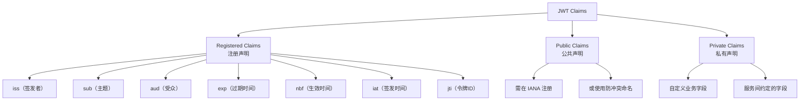

# 1. Claims（声明）概述

Claims 是 JWT 的核心——它们携带关于主体（通常是用户）及附加数据的"声明"语句。每条 Claim 是一个键值对，其中 key 是一个字符串（Claim Name），value 可以是任意 JSON 值。

## 1.1 Claims 的三种类型

根据 RFC 7519，Claims 分为三类：



---

# 2. Registered Claims（注册声明）

RFC 7519 定义了 7 个标准声明，虽然都不是强制性的，但强烈建议遵守这些语义约定。

## 2.1 `iss`（Issuer）— 签发者

标识 JWT 的签发者。

### 2.1.1 规范要求

- 值是区分大小写的字符串（StringOrURI）
- 通常使用 HTTPS URL，如 `https://auth.example.com`
- 接收方应当验证 `iss` 是否在信任的签发者列表中

```json
{
  "iss": "https://auth.example.com"
}
```

### 2.1.2 最佳实践

```java
// 验证 iss 声明
JwtParser parser = Jwts.parserBuilder()
    .setSigningKey(key)
    .requireIssuer("https://auth.example.com") // 验证签发者
    .build();
```

**为什么用 URI 而非纯字符串？** URI 提供命名空间隔离，防止不同组织间的标识冲突。例如 `https://auth.company-a.com` 和 `https://auth.company-b.com` 天然不同。

## 2.2 `sub`（Subject）— 主题

标识 JWT 所代表的主体（Principal），通常是用户唯一标识符。

### 2.2.1 规范要求

- 值是字符串（StringOrURI）
- 在同一个 `iss` 下，`sub` 应该是唯一的
- 不要将 PII（个人身份信息，如姓名、邮箱）直接作为 `sub`，应使用匿名 ID

```json
{
  "sub": "550e8400-e29b-41d4-a716-446655440000"
}
```

### 2.2.2 反模式与正确做法

```java
// 错误：将邮箱作为 sub
"sub": "john@company.com"  // 邮箱可能变更，且泄露 PII

// 正确：使用内部唯一 ID
"sub": "usr_a1b2c3d4"  // 内部 ID，不携带业务含义
```

### 2.2.3 Java 验证

```java
Jwts.parserBuilder()
    .requireSubject("usr_a1b2c3d4")  // 验证特定用户
    .build();
```

## 2.3 `aud`（Audience）— 受众

标识 JWT 的目标接收方。

### 2.3.1 规范要求

- 可以是单个字符串或字符串数组
- 接收方必须验证自己是否在 `aud` 列表中
- 如果目标受众不在 `aud` 中，必须拒绝该令牌

```json
{
  "aud": "https://api.example.com"
}

// 或多个受众
{
  "aud": ["https://api.example.com", "https://service-b.example.com"]
}
```

### 2.3.2 为什么 `aud` 很重要

防止令牌被用于非预期的服务：

```
攻击场景：
- 用户从 Service A 获得 JWT（aud: Service-A）
- 用户使用这个 JWT 访问 Service B
- 如果 Service B 不检查 aud，攻击者就可以跨服务使用令牌

正确做法：
- Service B 检查 aud，发现不包含自己 → 拒绝请求
```

### 2.3.3 Java 验证

```java
Jwts.parserBuilder()
    .requireAudience("https://api.example.com")
    .build();
```

## 2.4 `exp`（Expiration Time）— 过期时间

标识 JWT 的过期时间。

### 2.4.1 规范要求

- 值是 NumericDate：从 1970-01-01T00:00:00Z UTC 起的秒数
- 必须是整数（不允许小数）
- 过期时间必须晚于当前处理时间，否则拒绝令牌

```json
{
  "exp": 1712345678
}
```

### 2.4.2 NumericDate 详解

**为什么使用秒级 Unix 时间戳**
- 跨语言、跨平台的一致表示
- 避免时区问题（始终是 UTC）
- JSON 原生支持的数字类型
- 紧凑，比 ISO 8601 字符串短

### 2.4.3 过期时间的设置策略

| 令牌类型 | 推荐有效期 | 原因 |
|----------|-----------|------|
| Access Token | 5 ~ 30 分钟 | 短有效期，配合 Refresh Token |
| Refresh Token | 7 ~ 30 天 | 用于刷新 Access Token |
| ID Token（OIDC） | 10 分钟 | 仅用于一次性身份断言 |
| API Token | 数小时 ~ 数天 | 取决于安全要求 |
| 邮件验证 Token | 24 小时 | 用户体验与安全的平衡 |

### 2.4.4 时钟偏差（Clock Skew）

分布式系统中，各服务器时钟可能存在偏差。应允许一定的容差：

```java
Jwts.parserBuilder()
    .setAllowedClockSkewSeconds(60) // 允许 60 秒时钟偏差
    .build();
```

Nimbus JOSE+JWT 默认允许 60 秒偏差。

## 2.5 `nbf`（Not Before）— 生效时间

标识 JWT 在此之前不可使用。用于发布"未来生效"的令牌。

```json
{
  "nbf": 1712346000
}
```

### 2.5.1 使用场景

- **定时发布**：提前生成认证令牌，设定未来生效时间
- **迁移保护**：上线新系统时，JWT 设定为切换时间生效
- **延迟激活**：新用户注册后 N 分钟才能使用某些功能

## 2.6 `iat`（Issued At）— 签发时间

标识 JWT 的签发时间。

```json
{
  "iat": 1712345600
}
```

### 2.6.1 使用场景

- 判断令牌的新旧，用于令牌轮换
- 确定令牌年龄，拒绝过老的令牌（即使未过期）
- 结合 `nbf` 实现时间窗口控制

### 2.6.2 令牌年龄检查

```java
Claims claims = jwtParser.parseClaimsJws(token).getBody();
Date issuedAt = claims.getIssuedAt();
long ageInMinutes = (System.currentTimeMillis() - issuedAt.getTime()) / 60000;

if (ageInMinutes > 30) {
    throw new JwtException("Token too old, please re-authenticate");
}
```

## 2.7 `jti`（JWT ID）— 令牌唯一标识

为 JWT 提供唯一标识符，用于防止重放攻击和实现令牌吊销。

### 2.7.1 规范要求

- 区分大小写的字符串
- 每个 JWT 应有唯一的 `jti`
- 可用于构建"已使用令牌集合"防止重放

### 2.7.2 生成方式

```java
String jti = UUID.randomUUID().toString();
// eyJqdGkiOiI1NTBlODQwMC1lMjliLTQxZDQtYTcxNi00NDY2NTU0NDAwMDAifQ
```

### 2.7.3 使用 `jti` 防止重放

```java
public class JwtReplayProtection {
    private final Set<String> usedTokenIds = ConcurrentHashMap.newKeySet();
    
    public void validateToken(String jwt) {
        String jti = extractClaims(jwt).getId();
        
        if (!usedTokenIds.add(jti)) {
            throw new SecurityException("Token has been replayed: " + jti);
        }
        
        // 清理过期 jti（基于定时任务）
        // TTL = token max lifetime + clock skew
    }
}
```

---

# 3. Public Claims（公共声明）

## 3.1 什么是 Public Claims

Public Claims 是 JWT 社区定义的可共享声明名称：
- 需要在 **IANA JSON Web Token Claims Registry** 中注册
- 或使用防冲突的命名空间（如 URI）
- 提供跨系统互操作性

## 3.2 已注册的 Public Claims 精选

| Claim 名称 | 说明 | 值类型 |
|------------|------|--------|
| `name` | 用户全名 | String |
| `given_name` | 名（First Name） | String |
| `family_name` | 姓（Last Name） | String |
| `middle_name` | 中间名 | String |
| `nickname` | 昵称 | String |
| `preferred_username` | 首选用户名 | String |
| `profile` | 用户资料页 URL | String (URI) |
| `picture` | 用户头像图片 URL | String (URI) |
| `website` | 用户网站 URL | String (URI) |
| `email` | 电子邮件地址 | String |
| `email_verified` | 邮箱是否已验证 | Boolean |
| `gender` | 性别 | String |
| `birthdate` | 生日 | String (ISO 8601) |
| `zoneinfo` | 时区 | String |
| `locale` | 区域设置 | String |
| `phone_number` | 电话号码 | String |
| `phone_number_verified` | 电话是否已验证 | Boolean |
| `address` | 地址 | JSON Object |
| `updated_at` | 最后更新时间 | NumericDate |
| `azp` | 授权方 | String |
| `nonce` | 防重放随机字符串（OIDC） | String |
| `auth_time` | 最近认证时间 | NumericDate |
| `at_hash` | Access Token 哈希 | String |
| `c_hash` | Code 哈希 | String |
| `acr` | 认证上下文类引用 | String |
| `amr` | 认证方法引用 | String Array |
| `sub_jwk` | 用于拥有者证明的公钥 | JSON Object |

## 3.3 防冲突命名

如果不使用 IANA 注册的名称，应使用 URI 命名空间防止冲突：

```json
{
  "https://yourcompany.com/claims/department": "Engineering",
  "https://yourcompany.com/claims/tenant_id": "tenant-001"
}
```

---

# 4. Private Claims（私有声明）

## 4.1 什么是 Private Claims

Private Claims 是服务双方协商的自定义声明，不在公共注册表中。用于传递业务特定的信息。

```json
{
  "user_id": 12345,
  "tenant_id": "t-abc",
  "roles": ["ROLE_ADMIN", "ROLE_USER"],
  "permissions": ["user:read", "user:write", "report:export"],
  "department": "Engineering",
  "employee_type": "full-time"
}
```

## 4.2 Private Claims 设计原则

### 4.2.1 避免敏感信息

```json
// 错误：在 JWT 中存储敏感信息
{
  "credit_card": "4111-1111-1111-1111",  // 绝对不行！
  "password_hash": "xxx",               // 绝对不行！
  "ssn": "123-45-6789"                  // 绝对不行！
}

// 正确：只存储非敏感的标识信息
{
  "user_id": "abc123",
  "roles": ["USER"],
  "permission_tier": "basic"
}
```

### 4.2.2 保持 Payload 精简

```json
// 不良：过于详细的静态信息
{
  "sub": "123",
  "name": "Johnathan William Doe the Third",
  "department_full_name": "Engineering Department - Backend Infrastructure Team",
  "manager": {"id": "456", "name": "Jane Smith", "email": "jane@company.com"},
  "joined_date": "2020-03-15",
  "office_location": "Building A-12, Floor 3, Desk 42",
  "all_permissions": ["perm:1", "perm:2", ..., "perm:500"]
}

// 优化：关键信息 + 按需查询
{
  "sub": "123",
  "roles": ["ENGINEER"],
  "dep_id": "eng-backend"
}
// 详细信息通过 ID 查询服务端 API 获取
```

---

# 5. Claims 的验证策略

## 5.1 验证流程

```
校验 iss → 校验 aud → 校验 exp → 校验 nbf → 校验 jti（防重放）
     ↓           ↓           ↓           ↓                ↓
  在信任列表中  包含自己    未到期      已生效         首次使用
```

## 5.2 Java 标准验证

```java
import io.jsonwebtoken.*;

public class JwtValidator {
    
    private static final String EXPECTED_ISSUER = "https://auth.example.com";
    private static final String EXPECTED_AUDIENCE = "api.example.com";
    
    public Claims validateAndParse(String token, Key signingKey) {
        JwtParser parser = Jwts.parserBuilder()
            .setSigningKey(signingKey)
            .requireIssuer(EXPECTED_ISSUER)
            .requireAudience(EXPECTED_AUDIENCE)
            .setAllowedClockSkewSeconds(30)
            .build();
        
        return parser.parseClaimsJws(token).getBody();
    }
}
```

## 5.3 自定义 Claims 验证

```java
public Claims parseWithCustomValidation(String token) {
    Claims claims = parser.parseClaimsJws(token).getBody();
    
    // 验证权限范围
    List<String> scopes = claims.get("scope", List.class);
    if (scopes == null || !scopes.contains("api:read")) {
        throw new SecurityException("Insufficient scope");
    }
    
    // 验证租户
    String tenantId = claims.get("tenant_id", String.class);
    if (tenantId == null || !isValidTenant(tenantId)) {
        throw new SecurityException("Invalid tenant");
    }
    
    // 验证令牌年龄
    long tokenAge = (System.currentTimeMillis() / 1000) - 
                    claims.getIssuedAt().getTime() / 1000;
    if (tokenAge > MAX_TOKEN_AGE_SECONDS) {
        throw new SecurityException("Token too old");
    }
    
    return claims;
}
```

---

# 6. Claims 与 Java 映射

## 6.1 JJWT Claims 对象

```java
// 构建 Claims
Claims claims = Jwts.claims();
claims.setSubject("user123");
claims.setIssuer("https://auth.example.com");
claims.setIssuedAt(new Date());
claims.setExpiration(new Date(System.currentTimeMillis() + 3600000));
claims.put("roles", Arrays.asList("ROLE_USER", "ROLE_ADMIN"));
claims.put("email", "user@example.com");

// 解析 Claims
Claims parsed = Jwts.parserBuilder()
    .setSigningKey(key)
    .build()
    .parseClaimsJws(token)
    .getBody();

String sub = parsed.getSubject();           // "user123"
Date exp = parsed.getExpiration();          // Date 对象
List<String> roles = parsed.get("roles", List.class);
```

## 6.2 强类型映射

将 Claims 映射到 Java 对象：

```java
public class UserPrincipal {
    private String sub;
    private String email;
    private List<String> roles;
    // getters / setters
}

// ObjectMapper 转换
ObjectMapper mapper = new ObjectMapper();
UserPrincipal principal = mapper.convertValue(claims, UserPrincipal.class);
```

---

# 7. Claims 设计模式

## 7.1 分层 Claims 设计

```json
{
  "iss": "https://auth.example.com",
  "sub": "usr_abc123",
  "iat": 1712345600,
  "exp": 1712349200,
  "jti": "unique-id",
  
  // Layer 1: 身份认证信息（谁）
  "auth_time": 1712345600,
  "amr": ["pwd", "mfa"],
  
  // Layer 2: 授权信息（能做什么）
  "scope": "read write",
  "roles": ["USER"],
  "permissions": ["user:read", "user:write"],
  
  // Layer 3: 上下文信息（使用场景）
  "client_id": "web-app",
  "session_id": "sess_xyz",
  "ip_address": "192.168.1.1"
}
```

## 7.2 最小权限原则

JWT 的 Claims 应遵循最小权限原则：

```java
// 根据使用场景签发不同权限的 JWT
public enum TokenType {
    ACCESS_TOKEN,  // 高权限，短有效期
    READ_ONLY,     // 只读权限
    TEMPORARY,     // 临时权限，单一操作
}

public String issueToken(User user, TokenType type) {
    ClaimsBuilder builder = Jwts.builder()
        .setSubject(user.getId());
    
    switch (type) {
        case ACCESS_TOKEN:
            builder.claim("scope", "read write delete");
            builder.setExpiration(now + 30 * 60 * 1000);
            break;
        case READ_ONLY:
            builder.claim("scope", "read");
            builder.setExpiration(now + 60 * 60 * 1000);
            break;
        case TEMPORARY:
            builder.claim("scope", "upload");
            builder.setExpiration(now + 5 * 60 * 1000);
            break;
    }
    
    return builder.signWith(key).compact();
}
```

## 7.3 声明版本控制

当 Claims 结构需要变更时，使用版本管理：

```json
{
  "ver": "2.0",
  "sub": "user123",
  "roles_v2": [
    {"role": "ADMIN", "scope": "global"},
    {"role": "USER", "scope": "eu-west"}
  ]
}
```

---

# 8. 常见错误与陷阱

## 8.1 过度使用 Claims

```
错误：将大量数据放入 JWT
- 用户的所有权限列表（可能上千条）
- 用户的完整个人信息
- 用户首选项配置

后果：
- JWT 体积膨胀（影响每次 HTTP 请求）
- 缓存刷新时需重新签发
- 信息可能过时（用户权限变更后 JWT 仍是旧的）

正确做法：
- JWT 中只存放核心身份和简单授权信息
- 详细数据通过 API 按需查询
```

## 8.2 忽略 `aud` 验证

```java
// 危险：不验证 aud，可能导致跨服务令牌滥用
Jwts.parserBuilder()
    .setSigningKey(key)
    .build(); // 没有 requireAudience()

// 安全：始终验证 aud
Jwts.parserBuilder()
    .setSigningKey(key)
    .requireAudience("api.example.com")
    .build();
```

## 8.3 使用 `sub` 存储用户名

```json
// 错误：sub 存储用户邮箱/用户名
{"sub": "john@company.com"}

// 正确：sub 存储稳定不变的内部 ID
{"sub": "usr_a1b2c3d4"}

// 原因：
// - 用户名/邮箱可能变更
// - 用户要求删除个人信息时将陷入困境
// - 泄露 PII 信息
```

## 8.4 不使用 `jti`

不使用 `jti` 意味着无法有效防止令牌重放。在需要高安全性的场景（如支付操作），应坚持使用 `jti`。

## 8.5 Payload 数据未压缩

对于包含较大数据的 Payload，可考虑使用压缩：

```java
// 使用 Gzip 压缩 Payload 后再 Base64URL 编码
ByteArrayOutputStream bos = new ByteArrayOutputStream();
try (GZIPOutputStream gzip = new GZIPOutputStream(bos)) {
    gzip.write(payloadJson.getBytes(StandardCharsets.UTF_8));
}
String compressed = Base64.getUrlEncoder()
    .withoutPadding()
    .encodeToString(bos.toByteArray());
```
