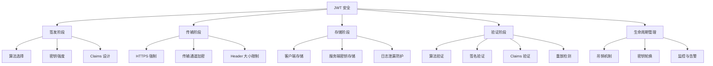

# 1. JWT 安全全景图

JWT 的安全性取决于**设计、实现、配置、部署**的每一个环节。任何一个环节的疏忽都可能导致严重安全漏洞。



---

# 2. 已知攻击类型与防范

## 2.1 `alg=none` 攻击（算法降级攻击）

### 2.1.1 攻击原理

攻击者修改 JWT Header，将 `alg` 改为 `none`，表示此 JWT 不需要签名验证。如果服务端实现没有正确限制算法，可能错误地接受未签名的 JWT。

```
原始 JWT（合法）:
Header:  {"alg":"HS256","typ":"JWT"}
Payload: {"sub":"user123","role":"USER"}
Signature: HMAC-SHA256(header.payload, secret)

攻击 JWT（伪造）:
Header:  {"alg":"none","typ":"JWT"}
Payload: {"sub":"admin","role":"ADMIN"}
Signature: (空)
```

### 2.1.2 防范措施

```java
// JJWT：不同算法使用不同解析器，天然防御
// 为 HS256 创建解析器，不会接受 none 算法
JwtParser parser = Jwts.parserBuilder()
    .setSigningKey(secretKey) // 绑定特定密钥，隐式限制算法
    .build();

// 显式验证算法
public class SafeJwtParser {
    
    private static final Set<String> ALLOWED_ALGORITHMS = Set.of("RS256", "ES256");
    
    public Claims parse(String token) {
        // 先解码 Header 检查算法
        String[] parts = token.split("\\.");
        if (parts.length != 3) {
            throw new JwtException("Invalid JWT format");
        }
        
        String headerJson = new String(Base64.getUrlDecoder().decode(parts[0]));
        String alg = JsonPath.read(headerJson, "$.alg");
        
        if (!ALLOWED_ALGORITHMS.contains(alg)) {
            throw new JwtException("Algorithm not allowed: " + alg);
        }
        
        // 再解析 JWT
        return Jwts.parserBuilder()
            .setSigningKey(publicKey)
            .build()
            .parseClaimsJws(token)
            .getBody();
    }
}
```

## 2.2 密钥混淆攻击（Key Confusion / Algorithm Confusion）

### 2.2.1 攻击原理

服务端使用 RSA 非对称算法验证 JWT，公钥是公开的。攻击者可以：
1. 获取服务端的 RSA 公钥
2. 使用这个公钥作为 HMAC 的对称密钥
3. 将 Header 中的 `alg` 改为 `HS256`
4. 用 RSA 公钥计算 HMAC 签名

某些实现会在同一个接口中根据 `alg` 字段动态选择密钥，导致使用 RSA 公钥验证 HS256 签名。

```
服务端逻辑（有漏洞）:
if (alg == "RS256") → 用 RSA 公钥验证
if (alg == "HS256") → 用 HMAC 密钥验证

攻击者:
- 获取 RSA 公钥（通常公开）
- 将 alg 改为 HS256
- 用 RSA 公钥作为 HMAC 密钥计算签名
- 服务端错误地使用 RSA 公钥验证 HS256 → 验证通过！
```

### 2.2.2 防范措施

```java
// Nimbus JOSE+JWT：使用特定验证器，算法不会混淆
JWSVerifier rsVerifier = new RSASSAVerifier(rsaPublicKey);   // 仅 RSA
JWSVerifier hmacVerifier = new MACVerifier(sharedSecret);     // 仅 HMAC

// JJWT：不同解析器实例绑定不同算法
JwtParser rsParser = Jwts.parserBuilder()
    .setSigningKey(rsaPublicKey)       // 绑定 RSA 公钥
    .build();

JwtParser hsParser = Jwts.parserBuilder()
    .setSigningKey(hmacSecretKey)       // 绑定 HMAC 密钥
    .build();

// 安全实践：根据 token 的算法选择对应的解析器
public JwtParser getParser(String algorithm) {
    return switch (algorithm) {
        case "RS256" -> rs256Parser;
        case "ES256" -> es256Parser;
        case "HS256" -> hs256Parser;
        default -> throw new JwtException("Unsupported algorithm: " + algorithm);
    };
}
```

## 2.3 JWT 篡改攻击（Signature Bypass）

### 2.3.1 攻击原理

攻击者拦截 JWT 后修改 Payload（如提升权限），但无法生成有效签名。如果服务端**跳过或不正确验证签名**，攻击即可成功。

```
原始:  {"sub":"user","role":"USER"} + 有效签名
篡改:  {"sub":"user","role":"ADMIN"} + 无效签名

服务端漏洞：
- 忘记调用 verify()
- 异常捕获过于宽泛，catch 后依然使用 claims
- 先使用 claims 再验证签名（顺序错误）
```

### 2.3.2 防范措施

```java
// 错误：先使用后验证
Claims claims = Jwts.parserBuilder().setSigningKey(key).build()
    .parseClaimsJws(token).getBody();
// 如果 parseClaimsJwt(token) 而非 parseClaimsJws(token)
// 签名不会被验证！

// 正确：确保使用 parseClaimsJws（验证签名）
Jws<Claims> jws = Jwts.parserBuilder()
    .setSigningKey(key)
    .build()
    .parseClaimsJws(token);  // 注意是 Jws 不是 Jwt

// 代码审查检查点：全局搜索 parseClaimsJwt，确保没有用于安全验证
```

## 2.4 重放攻击（Replay Attack）

### 2.4.1 攻击原理

攻击者截获合法 JWT，重复发送该令牌以冒充用户。

### 2.4.2 防范措施

**方案一：jti + 已使用令牌集合**

```java
@Service
public class ReplayProtectionService {
    private final RedisTemplate<String, String> redis;
    
    public void checkReplay(String jti, Date expiration) {
        Boolean isNew = redis.opsForValue()
            .setIfAbsent("used_jti:" + jti, "1",
                Duration.between(Instant.now(), expiration.toInstant()));
        
        if (Boolean.FALSE.equals(isNew)) {
            throw new ReplayAttackException("Token has been used: " + jti);
        }
    }
}
```

**方案二：Nonce（一次性随机数）**

在高敏感操作（支付、转账）中，每次请求携带唯一 nonce：

```java
// 签发一次性 JWT
public String issueOneTimeToken(String userId, String operation, String nonce) {
    return Jwts.builder()
        .setSubject(userId)
        .claim("nonce", nonce)
        .claim("operation", operation)
        .setExpiration(new Date(System.currentTimeMillis() + 60000))
        .setId(UUID.randomUUID().toString())
        .signWith(key)
        .compact();
}
```

## 2.5 弱密钥暴力破解攻击

### 2.5.1 攻击原理

对于 HS256 等对称算法，如果密钥不够随机（如 "secret"、"mysecretkey"），攻击者可以通过字典攻击暴力破解并伪造 JWT。

```bash
# 使用 hashcat 破解 JWT HS256 密钥
hashcat -m 16500 jwt.txt wordlist.txt
```

```python
# 使用 jwt-cracker 工具
python3 jwt-cracker.py "eyJhbGciOiJIUzI1NiIs..." "abcdefghijklmnop"
```

### 2.5.2 防范措施

```java
// 使用足够强度的随机密钥（≥ 256 位）
public String generateHS256Secret() {
    byte[] bytes = new byte[32]; // 256 bits
    SecureRandom.getInstanceStrong().nextBytes(bytes);
    return Base64.getUrlEncoder().withoutPadding().encodeToString(bytes);
}

// 密钥示例："dGhpcyBpcyBhIHZlcnkgbG9uZyBhbmQgc2VjdXJlIHNlY3JldCBrZXk"
```

## 2.6 JWT 泄漏风险

### 2.6.1 常见泄漏途径

| 泄漏途径 | 风险等级 | 说明 |
|----------|----------|------|
| 前端日志 | 高 | console.log 输出 JWT |
| 浏览器历史 | 中 | JWT 作为 URL 参数 |
| 服务器日志 | 高 | 错误日志中打印完整请求头 |
| 第三方服务 | 高 | 错误地将 JWT 发送给第三方 |
| 代码仓库 | 致命 | 硬编码的密钥被提交到 Git |
| 浏览器扩展 | 中 | 恶意扩展读取 localStorage |

### 2.6.2 防范措施

```java
// 日志脱敏
@Configuration
public class LoggingConfig {
    
    @Bean
    public Filter jwtLogMaskingFilter() {
        return (request, response, chain) -> {
            ContentCachingRequestWrapper wrapper = 
                new ContentCachingRequestWrapper((HttpServletRequest) request);
            
            // 确保日志中不会打印 Authorization header
            log.info("Request: {} {}", wrapper.getMethod(), wrapper.getRequestURI());
            // 不打印 headers，或明确排除 Authorization
            
            chain.doFilter(wrapper, response);
        };
    }
}

// 配置日志框架脱敏
// logback.xml
// <pattern>%d [%thread] %-5level %logger{36} - %msg%n</pattern>
// 配合自定义 Converter 替换 JWT
```

### 2.6.3 Git 防泄漏

```bash
# .gitignore
*.pem
*.key
*.jks
application-secret.yml
secrets/

# 使用 git-secrets 扫描
git secrets --scan

# 使用 truffleHog 扫描历史
trufflehog git file://. --only-verified
```

## 2.7 XSS → JWT 窃取攻击

### 2.7.1 攻击链

```
存在 XSS 漏洞 → 攻击者注入脚本 → 脚本读取 localStorage 中的 JWT 
→ 发送到攻击者服务器 → 攻击者使用 JWT 冒充用户
```

### 2.7.2 防范措施

- Access Token 存储于内存而非 localStorage
- 实施严格的 Content-Security-Policy (CSP)
- Refresh Token 使用 HttpOnly Cookie

```html
<!-- CSP Header -->
<meta http-equiv="Content-Security-Policy" 
      content="default-src 'self'; script-src 'self'; object-src 'none';">
```

## 2.8 CSRF → Refresh Token 滥用

当 Refresh Token 存储在 Cookie 中时，CSRF 攻击可能触发非预期的刷新：

```java
// Refresh 端点必须验证 CSRF token 或使用 SameSite Cookie
@PostMapping("/refresh")
public ResponseEntity<?> refresh(
        @CookieValue("refresh_token") String refreshToken,
        @RequestHeader("X-CSRF-Token") String csrfToken) {
    
    // 验证 CSRF Token
    csrfService.validate(csrfToken, getCurrentSession());
    
    // 执行刷新逻辑
    return ResponseEntity.ok(authService.refreshAccessToken(refreshToken));
}
```

```java
// SameSite Cookie 设置
Cookie cookie = new Cookie("refresh_token", token);
cookie.setHttpOnly(true);
cookie.setSecure(true);
cookie.setSameSite("Strict");  // 或 "Lax"
cookie.setPath("/api/auth");
```

---

# 3. JWT 验证的安全清单

## 3.1 验证清单

每次收到 JWT 时必须验证以下内容：

```
□ 签名是否有效？
□ 算法是否在白名单中？
□ 令牌是否已过期？（exp）
□ 令牌是否已生效？（nbf - 假设有时钟偏差）
□ 签发者是否可信？（iss）
□ 受众是否包含当前服务？（aud）
□ 令牌是否被吊销？
□ jti 是否未被使用？（防重放）
□ 令牌是否在有效期窗口内？（iat 检查）
□ 必要时检查设备指纹、IP 等绑定信息
```

## 3.2 完整验证实现

```java
public class RobustJwtValidator {
    
    private final JwtParser parser;
    private final Set<String> trustedIssuers;
    private final String expectedAudience;
    private final TokenBlacklistService blacklistService;
    private final ReplayProtectionService replayService;
    
    public Authentication validate(String token, HttpServletRequest request) {
        // 1. 签名验证 + 基础 Claims 验证
        Claims claims;
        try {
            claims = parser
                .requireIssuer(iss -> trustedIssuers.contains(iss))
                .requireAudience(expectedAudience)
                .parseClaimsJws(token)
                .getBody();
        } catch (ExpiredJwtException e) {
            throw new TokenExpiredException("Token has expired", e);
        } catch (JwtException e) {
            throw new InvalidTokenException("Token validation failed", e);
        }
        
        // 2. 检查 nbf
        Date nbf = claims.getNotBefore();
        if (nbf != null && nbf.after(new Date())) {
            throw new PrematureTokenException("Token not yet valid");
        }
        
        // 3. 检查令牌年龄
        long tokenAge = (System.currentTimeMillis() - claims.getIssuedAt().getTime());
        if (tokenAge > maxTokenAgeMs) {
            throw new StaleTokenException("Token too old");
        }
        
        // 4. 防重放
        replayService.checkReplay(claims.getId(), claims.getExpiration());
        
        // 5. 检查黑名单
        if (blacklistService.isBlacklisted(claims.getId())) {
            throw new InvalidTokenException("Token has been revoked");
        }
        
        // 6. 设备指纹验证（可选）
        String tokenFp = claims.get("fp", String.class);
        if (tokenFp != null) {
            String currentFp = extractDeviceFingerprint(request);
            if (!tokenFp.equals(currentFp)) {
                throw new SecurityException("Device fingerprint mismatch");
            }
        }
        
        // 7. 构建认证对象
        return buildAuthentication(claims);
    }
}
```

---

# 4. 客户端安全存储

## 4.1 安全等级矩阵

| 安全等级 | Access Token 存储 | Refresh Token 存储 | 适用场景 |
|----------|-------------------|-------------------|----------|
| 基本 | sessionStorage | sessionStorage | 内部工具 |
| 标准 | 内存（闭包） | HttpOnly Cookie | 大多数 Web 应用 |
| 增强 | 内存 + Service Worker | HttpOnly Cookie + 轮换 | 金融、医疗 |
| 最高 | 内存 + BFF 代理存储 | 服务端 Session | 银行、政府 |

## 4.2 BFF（Backend For Frontend）模式

```
浏览器 ←→ BFF（后端API） ←→ 微服务

BFF 持有 JWT，浏览器使用传统 Session Cookie
```

这是最安全的模式，浏览器完全不接触 JWT，适合高安全需求场景。

```java
// BFF 模式：浏览器使用 Session Cookie，BFF 持有 JWT
@GetMapping("/api/users")
public ResponseEntity<?> getUsers(HttpSession session) {
    // session 中存储 JWT
    String jwt = (String) session.getAttribute("access_token");
    
    // 使用 JWT 调用下游服务
    ResponseEntity<String> response = restTemplate.exchange(
        "http://user-service/api/users",
        HttpMethod.GET,
        new HttpEntity<>(createJwtHeaders(jwt)),
        String.class
    );
    
    return ResponseEntity.ok(response.getBody());
}
```

---

# 5. 传输安全

## 5.1 HTTPS 是强制性的

- JWT 的 Authorization Header 是明文（Base64URL 编码）传递
- HTTP 明文传输可被中间人截获
- 在生产环境必须使用 HTTPS

## 5.2 HTTP 安全响应头

```java
@Configuration
public class SecurityHeadersConfig {
    
    @Bean
    public WebMvcConfigurer securityHeadersConfigurer() {
        return new WebMvcConfigurer() {
            @Override
            public void addInterceptors(InterceptorRegistry registry) {
                registry.addInterceptor(new HandlerInterceptor() {
                    @Override
                    public void postHandle(HttpServletRequest request,
                                           HttpServletResponse response,
                                           Object handler,
                                           ModelAndView modelAndView) {
                        response.setHeader("Strict-Transport-Security", 
                            "max-age=31536000; includeSubDomains");
                        response.setHeader("X-Content-Type-Options", "nosniff");
                        response.setHeader("X-Frame-Options", "DENY");
                        response.setHeader("Content-Security-Policy", 
                            "default-src 'self'");
                        response.setHeader("Cache-Control", 
                            "no-store, no-cache, must-revalidate");
                    }
                });
            }
        };
    }
}
```

---

# 6. 生产环境安全检查清单

## 6.1 配置检查

```
□ 强制 HTTPS
□ 算法白名单（拒绝 none）
□ 密钥强度满足要求（HMAC ≥ 256 位，RSA ≥ 2048 位）
□ 密钥定期轮换计划（≤ 90 天）
□ Access Token 有效期 ≤ 15 分钟
□ Refresh Token 实现了轮换
□ 配置了 allowedClockSkewSeconds（默认 0 或极小值）
□ 验证了 iss、aud
□ 生产环境密钥与开发环境隔离
□ HSTS Header 配置
□ CSP Header 配置
```

## 6.2 代码审查检查点

```java
// 审查清单代码扫描关注点：

// 1. 搜索硬编码密钥
grep -r "secret\|password\|key" --include="*.java" --include="*.yml"

// 2. 搜索不安全的算法使用
grep -r "\"none\"" --include="*.java"

// 3. 搜索 parseClaimsJwt（可能是签名绕过）
grep -r "parseClaimsJwt" --include="*.java"

// 4. 搜索日志中的 JWT
grep -r "Authorization\|accessToken\|access_token" --include="log*"

// 5. 搜索缺失的 Claims 验证
grep -r "parseClaimsJws" | grep -v "requireIssuer\|requireAudience"
```

---

# 7. 安全事件响应

## 7.1 密钥泄漏应急流程

```
1. 立即轮换泄漏的密钥（生成新密钥，更新配置）
2. 递增所有用户的 Token 版本号（强制全量重新登录）
3. 将新密钥部署到所有服务节点
4. 审计被泄漏密钥签发的所有 Token（分析日志）
5. 通知受影响用户
6. 事后复盘，加强密钥管理流程
```

## 7.2 令牌滥用监控

```java
@Component
public class TokenUsageMonitor {
    
    private final MeterRegistry meterRegistry;
    private final Counter suspiciousTokens;
    
    public void recordTokenUsage(String tokenId, boolean valid) {
        if (!valid) {
            suspiciousTokens.increment();
            
            if (suspiciousTokens.count() > threshold) {
                alertingService.sendAlert(
                    "High rate of invalid token usage detected"
                );
            }
        }
    }
}
```
