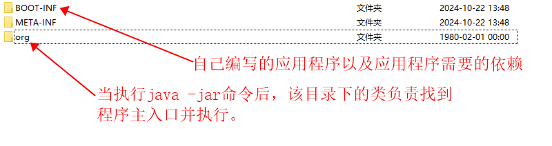
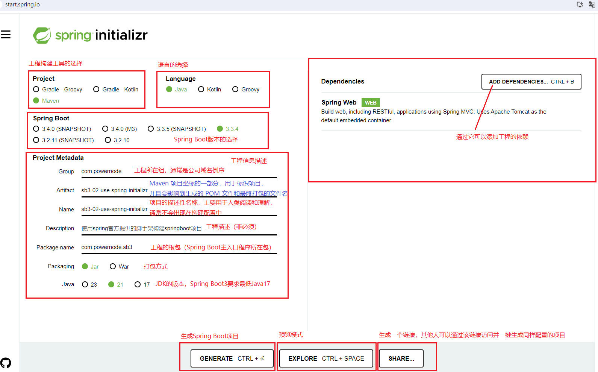
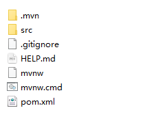
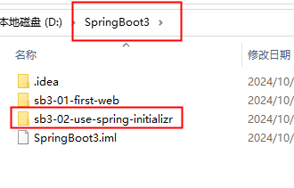
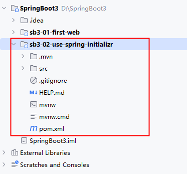
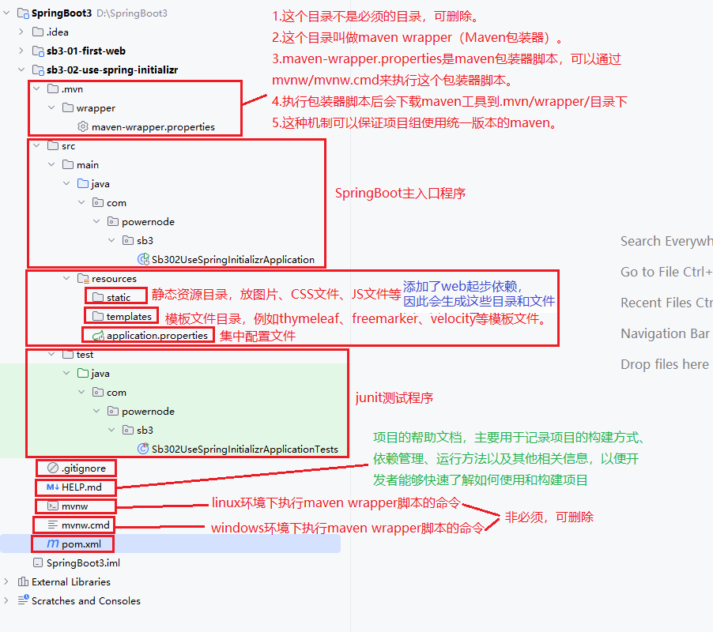
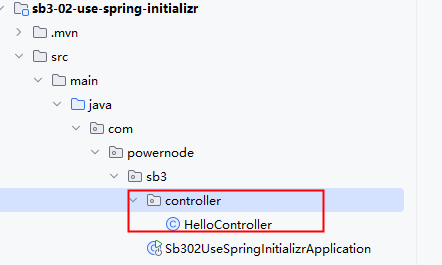
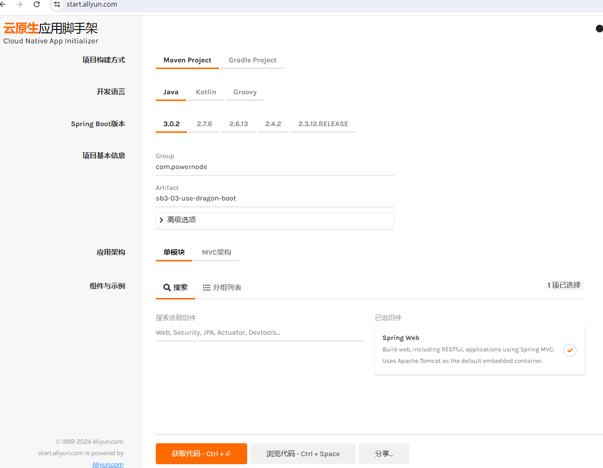
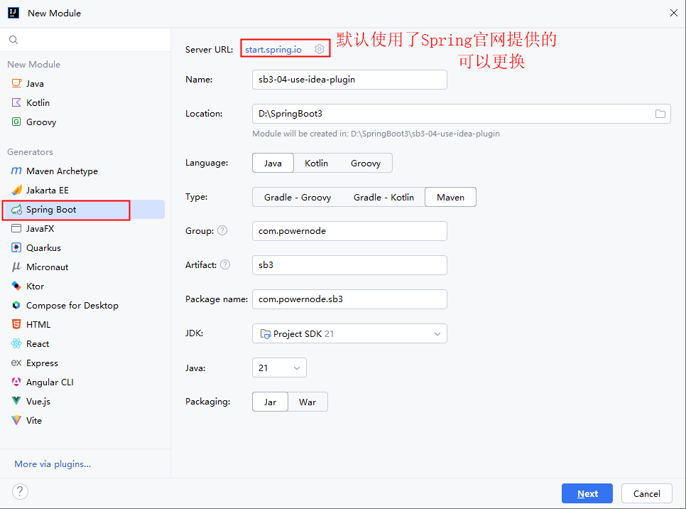
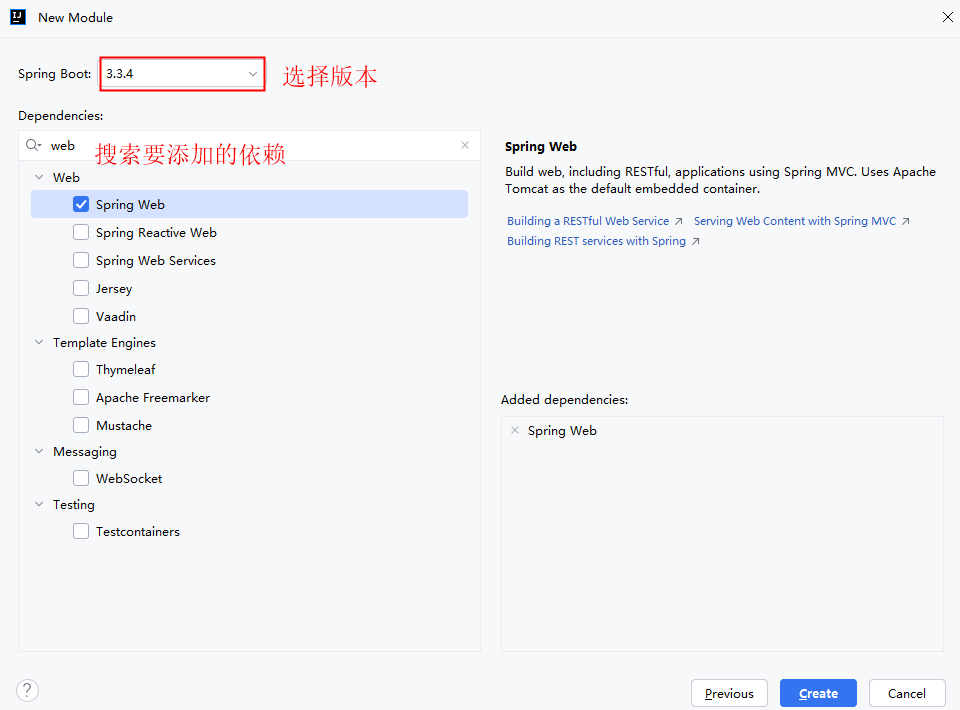

# 1.认识SpringBoot 

## 1.1什么是Spring Boot
Spring Boot是由Pivotal团队（现为VMware）提供的全新框架，其设计目的是用来**简化Spring应用初始搭建以及开发过程**。该框架使用了特定的方式来进行配置，从而使开发人员不再需要定义样板化的配置。

核心思想：**约定大于配置（Convention over Configuration）**。

## 1.2为什么要使用Spring Boot
在没有Spring Boot之前，使用Spring框架进行开发存在以下痛点：
- **依赖管理复杂**：需要手动管理各种依赖的版本，容易出现版本冲突
- **配置繁琐**：大量的XML配置或Java配置，重复劳动多
- **部署麻烦**：需要外部的Web服务器（如Tomcat），需要单独配置和部署
- **整合困难**：整合第三方框架（如MyBatis、Redis等）需要大量配置

Spring Boot解决了以上所有问题：
- 通过**Starter启动器**简化依赖管理
- 通过**自动配置**减少手动配置
- 内嵌**Tomcat/Jetty/Undertow**，打jar包直接运行
- 提供**生产级别的监控**（Actuator）、外部化配置等特性

## 1.3Spring Boot的核心特性
| 特性 | 说明 |
|------|------|
| 起步依赖（Starter） | 一站式引入功能所需的所有依赖 |
| 自动配置（Auto Configuration） | 根据类路径中的依赖自动配置Bean |
| 内嵌Web服务器 | 无需部署WAR包，直接运行JAR |
| Actuator | 生产级应用监控和管理 |
| 外部化配置 | 配置文件、环境变量、命令行参数等灵活配置 |
| 无代码生成 | 不需要生成代码，也不需要XML配置 |

# 2.知识储备

学习Spring Boot之前，需要具备以下基础：

## 2.1必备基础
- **Java SE**：熟悉Java基础语法、集合、IO、多线程、JDBC、注解等
- **Maven/Gradle**：了解依赖管理、插件、生命周期等构建工具的基本使用
- **Spring Framework**：掌握IoC容器、DI依赖注入、AOP面向切面编程等核心概念
- **Spring MVC**：了解DispatcherServlet、Controller、视图解析等Web开发基础
- **MyBatis / JPA**：掌握至少一种持久层框架的基本使用

## 2.2可选基础（学习特定章节时需要）
- **MySQL**：数据库基本操作
- **Redis**：缓存中间件基本使用（学习缓存章节时需要）
- **HTML/Thymeleaf**：前端页面基础（学习模板引擎时需要）
- **Lombok**：简化Java代码（笔记中有Lombok教程章节）

# 3.主要版本说明

## 3.1版本历史
| 版本 | 发布时间 | 主要变化 |
|------|---------|---------|
| 1.x | 2014 | 初始版本，基于Spring 4 |
| 2.x | 2018 | 基于Spring 5，Java 8+，支持Reactive |
| 3.x | 2022.11 | 基于Spring 6，要求Java 17+，Jakarta EE 9+ |

## 3.2Spring Boot 3.x 的重要变化
Spring Boot 3.x 相比 2.x 有重大变更：

1. **Java版本要求**：最低要求 Java 17（不再支持 Java 8/11）
2. **Jakarta EE迁移**：`javax.*` 包名全部迁移到 `jakarta.*`
   ```java
   // Spring Boot 2.x
   import javax.servlet.http.HttpServletRequest;
   // Spring Boot 3.x
   import jakarta.servlet.http.HttpServletRequest;
   ```
3. **移除旧依赖**：不再支持一些过时的第三方库
4. **GraalVM原生镜像支持**：可以编译为本地可执行文件
5. **Observability**：内置Micrometer和Micrometer Tracing，替代Spring Cloud Sleuth

## 3.3本笔记使用的版本
- Spring Boot：**3.3.x**
- Java：**21**
- 构建工具：**Maven**
- IDE：**IntelliJ IDEA**

# 4.First SpringBoot
```
1.继承父工程
2.引入依赖
3.编写启动类
4.编写controller

只有放在启动类同级目录或者同级目录的子目录下的类才会被扫描到，才会被IOC容器管理
```

# 5.便捷的部署方式
## 5.1打jar包运行
```
使用springboot官方提供的插件进行package
    <build>
        <plugins>
            <plugin>
                <groupId>org.springframework.boot</groupId>
                <artifactId>spring-boot-maven-plugin</artifactId>
            </plugin>
        </plugins>
    </build>
```
## 5.2SpringBoot的jar包和普通jar包的区别
```
SpringBoot打包的jar文件与传统Java应用程序的Jar文件相比确实有一些显著区别，主要体现在依赖管理和可执行性上
（1）依赖管理
● Spring Boot 的 JAR 包通常包含了应用程序运行所需的所有依赖项，也就是说它是一个“fat jar”（胖 JAR 包），这种打包方式使得应用可以独立运行，而不需要外部的类路径或应用服务器上的其他依赖。
● 普通的 JAR 文件一般只包含一个类库的功能，并且需要依赖于特定的类路径来找到其他的类库或者框架，这些依赖项通常在部署环境中已经存在，比如在一个应用服务器中。
（2）可执行性
● Spring Boot 的 JAR 文件可以通过直接执行这个 JAR 文件来启动应用程序，也就是说它是一个可执行的 JAR 文件。通过 java -jar your-application.jar 命令就可以直接运行应用程序。
● 而普通的 JAR 文件通常是不可直接执行的，需要通过指定主类（main class）的方式或者其他方式来启动一个应用程序，例如使用 -cp 或 -classpath 加上类路径以及主类名来执行。
```
springboot的可执行jar包目录结构

普通jar包的目录结构


# 6.SpringBoot脚手架 
## 6.1什么是脚手架
### 6.1.1建筑工程中的脚手架
```
在建筑工程领域，“脚手架”指的是临时性的结构，用于支撑建筑物以及建筑材料，同时为建筑工人提供工作平台。这种脚手架通常是由钢管、扣件、木板和其他配件组成的，可以根据施工需要搭建不同高度和形状的结构。
```
### 6.1.2软件开发中的脚手架
```
在软件开发领域，“脚手架”指的是用于快速创建项目基本结构的工具或模板。它帮助开发者初始化项目，设置必要的目录结构、文件模板以及依赖项。 
```
### 6.1.3SpringBoot脚手架
```
Spring Boot 脚手架（Scaffold）可以帮助开发者快速搭建一个Spring Boot项目结构，让开发者只专注于业务逻辑的开发，而不是在项目的初始阶段花费大量时间来配置环境或者解决依赖关系。

Spring Boot 脚手架工具存在多种形式，以下是一些常见的 Spring Boot 脚手架工具和方法：
● Spring Initializr：
这是 Spring 官方提供的工具，可以在 https://start.spring.io 上找到。它允许开发者选择所需的依赖、Java 版本、构建工具（Maven 或 Gradle）以及其他配置选项来生成一个新的 Spring Boot 项目。
● IntelliJ IDEA 内置支持：
IntelliJ IDEA 集成了 Spring Initializr 的功能，可以在 IDE 内直接创建 Spring Boot 项目。
● Start Alibaba Cloud：
阿里云提供的 Start Alibaba Cloud 增强版工具，除了基本的 Spring Boot 模块外，还集成了阿里云服务和中间件的支持。
● JHipster：
JHipster 是一个流行的脚手架工具，用于生成完整的 Spring Boot 应用程序，包括前端（Angular, React 或 Vue.js）和后端。它还包括用户管理和认证等功能。
● Yeoman Generators：
Yeoman 是一个通用的脚手架工具，它有一个庞大的插件生态系统，其中包括用于生成 Spring Boot 项目的插件。
● Bootify：
Bootify 是另一个用于生成 Spring Boot 应用程序的脚手架工具，提供了一些预定义的应用模板。
● Spring Boot CLI：
Spring Boot CLI 是一个命令行工具，允许用户通过命令行来编写和运行 Spring Boot 应用。
● Visual Studio Code 插件：
Visual Studio Code 社区提供了多个插件，如 Spring Boot Extension Pack，可以帮助开发者生成 Spring Boot 项目的基本结构。
● GitHub Gist 和 Bitbucket Templates：
在 GitHub 和 Bitbucket 上，有很多开发者分享了用于生成 Spring Boot 项目的脚本或模板。
● 自定义脚手架：
很多开发者也会根据自己的需求定制自己的脚手架工具，比如使用 Bash 脚本、Gradle 或 Maven 插件等。
```
## 6.2使用官方提供的
### 6.2.1使用官方脚手架生成Spring Boot项目
```
Spring Initializr：https://start.spring.io
```

点击“GENERATE”后，生成zip压缩包
将其解压后的目录结构是一个标准的maven 工程：


### 6.2.2将项目放到IDEA当中

接下来将其导入到IDEA当中：直接将解压后的sb3-02-use-spring-initializr拷贝到我们新建的空工程SpringBoot3下，如图：

打开IDEA工具，你会看到如下图：

注意：如果pom.xml文件的图标颜色不是蓝色，而是橘色，需要在pom.xml文件上右键，选择：add as maven project。这样pom.xml文件的图标就会变为蓝色了。

### 6.2.3脚手架生成的pom.xml文件
```
<?xml version="1.0" encoding="UTF-8"?>
<project xmlns="http://maven.apache.org/POM/4.0.0" xmlns:xsi="http://www.w3.org/2001/XMLSchema-instance"
    xsi:schemaLocation="http://maven.apache.org/POM/4.0.0 https://maven.apache.org/xsd/maven-4.0.0.xsd">
    <modelVersion>4.0.0</modelVersion>

  <!--继承Spring Boot父工程-->
    <parent>
        <groupId>org.springframework.boot</groupId>

        <artifactId>spring-boot-starter-parent</artifactId>

        <version>3.3.4</version>

        <relativePath/> <!-- lookup parent from repository -->
    </parent>

  <!--自己项目的坐标-->
    <groupId>com.powernode</groupId>

    <artifactId>sb3-02-use-spring-initializr</artifactId>

    <version>0.0.1-SNAPSHOT</version>

    <name>sb3-02-use-spring-initializr</name>

    <description>使用spring官方提供的脚手架构建springboot项目</description>

    <url/>
    <licenses>
        <license/>
    </licenses>

    <developers>
        <developer/>
    </developers>

    <scm>
        <connection/>
        <developerConnection/>
        <tag/>
        <url/>
    </scm>

    <properties>
        <java.version>21</java.version>

    </properties>

    <dependencies>
    <!--web起步依赖-->
        <dependency>
            <groupId>org.springframework.boot</groupId>

            <artifactId>spring-boot-starter-web</artifactId>

        </dependency>

    <!--单元测试起步依赖-->
        <dependency>
            <groupId>org.springframework.boot</groupId>

            <artifactId>spring-boot-starter-test</artifactId>

            <scope>test</scope>

        </dependency>

    </dependencies>

  <!--打包插件-->
    <build>
        <plugins>
            <plugin>
                <groupId>org.springframework.boot</groupId>

                <artifactId>spring-boot-maven-plugin</artifactId>

            </plugin>

        </plugins>

    </build>

  
</project>

```
可以看到脚手架生成的pom.xml文件的内容和我们手动创建Spring Boot项目的pom.xml文件是一样的。
### 6.2.4脚手架生成的Spring Boot项目结构


### 6.2.5编写controller并测试
新建controller包，并新建HelloController类，如下图：

重点：默认情况下，SpringBoot项目只扫描主入口程序所在目录以及子目录，因此创建的Controller类要求放在主入口程序的同级目录下或子目录下。其他位置默认情况下扫描不到。

## 6.3使用阿里提供的
阿里巴巴提供的 Spring Boot 项目脚手架服务称为 DragonBoot（也被称为 Alibaba Cloud Spring Boot Initializr）。DragonBoot 基于 Spring Initializr，并在此基础上增加了更多的定制选项，特别是针对阿里巴巴云服务和中间件的支持。脚手架地址：https://start.aliyun.com/
当下（2024年）阿里云提供的脚手架使用的版本较低，国内有一些公司在用。如果要求版本较高的，则阿里云脚手架不适用。


阿里提供的脚手架和spring官方脚手架基本上是相同的。不再赘述。点击`获取代码`也会生成zip压缩包

接下来操作和刚才一样，解压，放到特定位置
## 6.4使用IDEA工具的脚手架插件
IDEA工具自带了Spring Boot脚手架的插件，使用它会更加的方便，让我们来操作一下：

