# 1.整合持久层框架Mybatis

## 1.1准备数据库表及数据
创建数据库：springboot
使用IDEA工具自带的mysql插件来完成表的创建和数据的准备
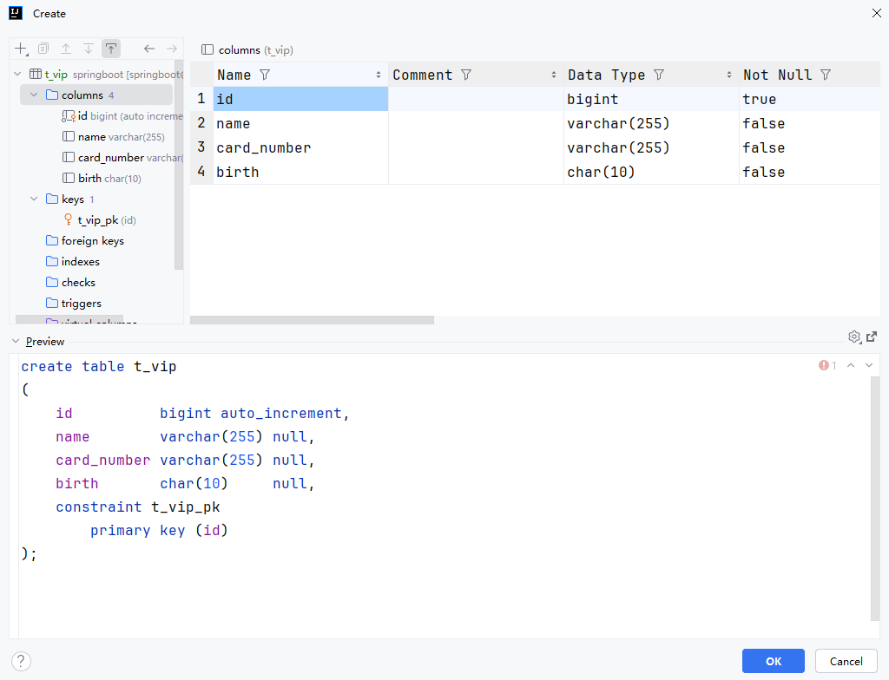
表创建成功后，为表准备数据

## 1.2创建Spring Boot项目
使用脚手架创建Spring Boot项目
引入mysql驱动以及mybatis的启动器
依赖如下：
```xml
<!--mybatis的启动器-->
<dependency>
    <groupId>org.mybatis.spring.boot</groupId>

    <artifactId>mybatis-spring-boot-starter</artifactId>

    <version>3.0.3</version>

</dependency>

<!--mysql的驱动依赖-->
<dependency>
    <groupId>com.mysql</groupId>

    <artifactId>mysql-connector-j</artifactId>

    <scope>runtime</scope>

</dependency>

```
注意，之前也提到过：
● Spring Boot官方提供的启动器的名字规则：spring-boot-starter-xxx
● 第三方（非Spring Boot官方）提供的启动器的名字规则：xxx-spring-boot-starter

## 1.3编写数据源配置
前面提到过，Spring Boot配置统一可以编写到application.properties中，配置如下：
```
# Spring Boot脚手架自动生成的
spring.application.name=sb3-05-springboot-mybatis

# mybatis连接数据库的数据源
spring.datasource.type=com.zaxxer.hikari.HikariDataSource
spring.datasource.driver-class-name=com.mysql.cj.jdbc.Driver
spring.datasource.url=jdbc:mysql://localhost:3306/springboot
spring.datasource.username=root
spring.datasource.password=123456
```
以上的配置属于连接池的配置，连接池使用的是Spring Boot默认的连接池：HikariCP

## 1.4编写实体类Vip
表t_vip中的字段分别是：
● id
● name
● card_number
● birth
对应实体类Vip中的属性名分别是：
● Long id;
● String name;
● String cardNumber;
● String birth;
创建包model，在该包下新建Vip类，代码如下：
```java
package com.powernode.sb305springbootmybatis.model;

public class Vip {
    private Long id;
    private String name;
    private String cardNumber;
    private String birth;

    public Vip() {
    }

    public Vip(Long id, String name, String cardNumber, String birth) {
        this.id = id;
        this.name = name;
        this.cardNumber = cardNumber;
        this.birth = birth;
    }

    public Vip(String name, String cardNumber, String birth) {
        this.name = name;
        this.cardNumber = cardNumber;
        this.birth = birth;
    }

    public Long getId() {
        return id;
    }

    public void setId(Long id) {
        this.id = id;
    }

    public String getName() {
        return name;
    }

    public void setName(String name) {
        this.name = name;
    }

    public String getCardNumber() {
        return cardNumber;
    }

    public void setCardNumber(String cardNumber) {
        this.cardNumber = cardNumber;
    }

    public String getBirth() {
        return birth;
    }

    public void setBirth(String birth) {
        this.birth = birth;
    }

    @Override
    public String toString() {
        return "Vip{" +
                "id=" + id +
                ", name='" + name + '\'' +
                ", cardNumber='" + cardNumber + '\'' +
                ", birth='" + birth + '\'' +
                '}';
    }
}
```
以上代码可以使用第三方库Lombok进行改造，后面再说。

## 1.5编写Mapper接口
创建repository包，在该包下新建VipMapper接口，代码如下：
```
package com.powernode.sb305springbootmybatis.repository;

import com.powernode.sb305springbootmybatis.model.Vip;

import java.util.List;

public interface VipMapper {
    /**
     * 插入会员信息
     * @param vip
     * @return 1表示插入成功，其他值表示失败
     */
    int insert(Vip vip);

    /**
     * 根据id删除会员信息
     * @param id 会员唯一标识
     * @return 1表示删除成功，其他值表示失败
     */
    int deleteById(Long id);

    /**
     * 更新会员信息（id不可更新）
     * @param vip 会员信息
     * @return 1表示更新成功，其他值表示更新失败。
     */
    int update(Vip vip);

    /**
     * 根据id查询会员信息
     * @param id 会员的唯一标识
     * @return 会员信息
     */
    Vip selectById(Long id);

    /**
     * 获取所有会员信息
     * @return
     */
    List<Vip> selectAll();
}
```

## 1.6编写Mapper接口的XML配置文件
在resources目录下新建mapper目录，将来的mapper.xml配置文件放在这个目录下。

安装MyBatisX插件，该插件可以根据我们编写的VipMapper接口自动生成mapper的XML配置文件。
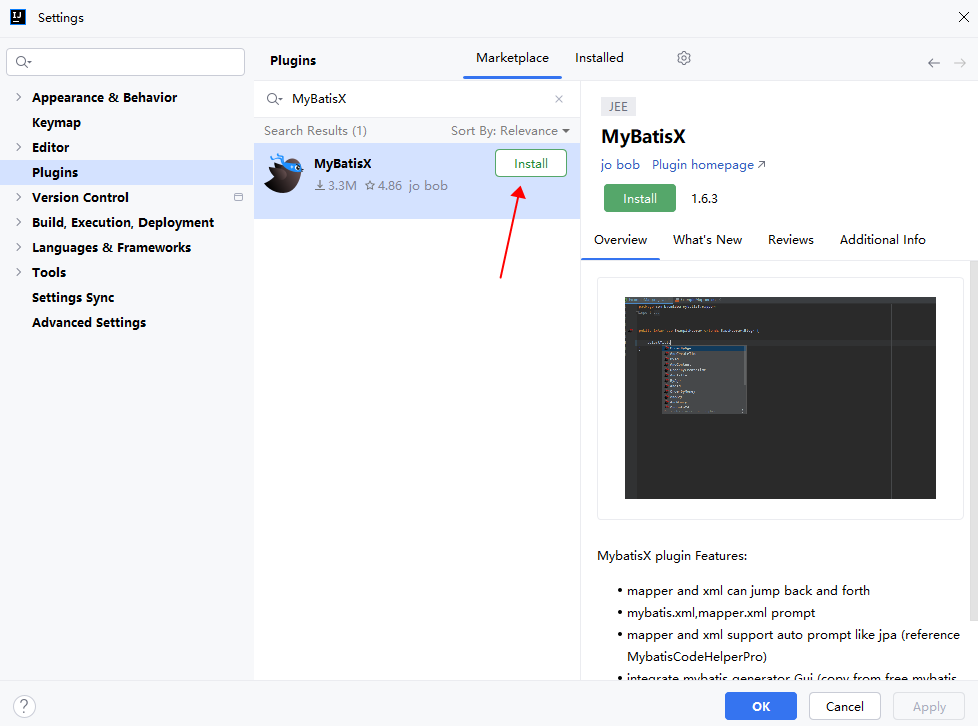
然后在VipMapper接口上：alt+enter
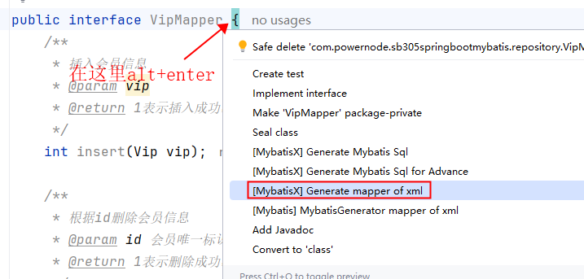
生成mapper of xml：需要选择一个生成的位置
...
接下来，你会看到Mapper接口中方法报错了，可以在错误的位置上使用alt+enter，选择Generate statement：
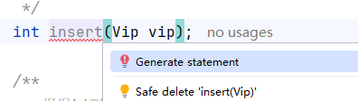
这个时候在mapper的xml配置文件中便生成了对应的配置，如下：
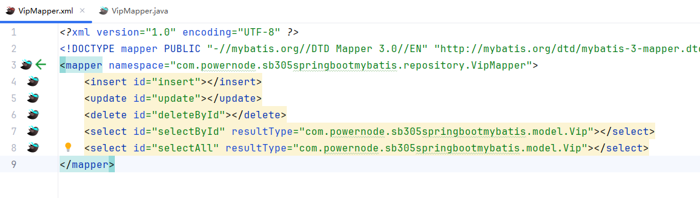

接下来就是编写SQL语句了，最终`VipMapper.xml`文件的配置如下：
```
<?xml version="1.0" encoding="UTF-8" ?>
<!DOCTYPE mapper PUBLIC "-//mybatis.org//DTD Mapper 3.0//EN" "http://mybatis.org/dtd/mybatis-3-mapper.dtd" >
<mapper namespace="com.powernode.sb305springbootmybatis.repository.VipMapper">
    <insert id="insert">
        insert into t_vip(id,name,card_number,birth) values(null,#{name},#{cardNumber},#{birth})
    </insert>

    <update id="update">
        update t_vip set name=#{name},card_number=#{cardNumber},birth=#{birth} where id=#{id}
    </update>

    <delete id="deleteById">
        delete from t_vip where id = #{id}
    </delete>

    <select id="selectById" resultType="com.powernode.sb305springbootmybatis.model.Vip">
        select * from t_vip where id=#{id}
    </select>

    <select id="selectAll" resultType="com.powernode.sb305springbootmybatis.model.Vip">
        select * from t_vip
    </select>

</mapper>

```

## 1.7添加Mapper的扫描
在Spring Boot的入口程序上添加如下的注解，来完成VipMapper接口的扫描：
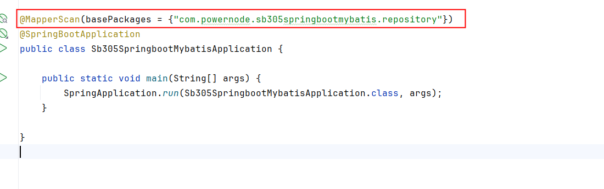

## 1.8告诉Mybatis框架MapperXML文件的位置
在application.properties配置文件中进行如下配置：
```
mybatis.mapper-locations=classpath:mapper/*.xml
```

## 1.9测试整合Mybatis是否成功
在Spring Boot主入口程序中获取Spring上下文对象ApplicationContext，从Spring容器中获取VipMapper对象，然后调用相关方法进行测试：
```
package com.powernode.sb305springbootmybatis;

import com.powernode.sb305springbootmybatis.model.Vip;
import com.powernode.sb305springbootmybatis.repository.VipMapper;
import org.mybatis.spring.annotation.MapperScan;
import org.springframework.boot.SpringApplication;
import org.springframework.boot.autoconfigure.SpringBootApplication;
import org.springframework.context.ConfigurableApplicationContext;

@MapperScan(basePackages = {"com.powernode.sb305springbootmybatis.repository"})
@SpringBootApplication
public class Sb305SpringbootMybatisApplication {

    public static void main(String[] args) {
        // 获取Spring上下文
        ConfigurableApplicationContext applicationContext = SpringApplication.run(Sb305SpringbootMybatisApplication.class, args);
        // 根据id获取容器中的对象
        VipMapper vipMapper = applicationContext.getBean("vipMapper", VipMapper.class);
        Vip vip = vipMapper.selectById(1L);
        System.out.println(vip);
        // 关闭Spring上下文
        applicationContext.close();
    }

}

```
测试...
测试结果中可以看到cardNumber属性没有赋值成功，原因是：表中的字段名叫做card_number，和实体类Vip的属性名cardNumber对应不上。解决办法两个：

第一种方式：查询语句使用as关键字起别名，让查询结果列名和实体类的属性名对应上。
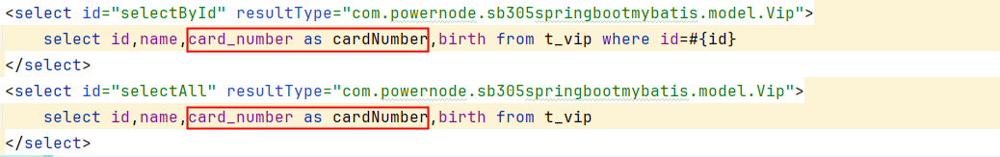
第二种方式：通过配置自动映射
在application.properties配置文件中进行如下配置：
```
mybatis.configuration.map-underscore-to-camel-case=true
```
map-underscore-to-camel-case 是一个配置项，主要用于处理数据库字段名与Java对象属性名之间的命名差异。在许多数据库中，字段名通常使用下划线（_）分隔单词，例如 first_name 或 last_name。而在Java代码中，变量名通常使用驼峰式命名法（camel case），如 firstName 和 lastName。
当使用MyBatis作为ORM框架时，默认情况下它会将SQL查询结果映射到Java对象的属性上。如果数据库中的字段名与Java对象的属性名不一致，那么就需要手动为每个字段指定相应的属性名，或者使用某种方式来自动转换这些名称。
map-underscore-to-camel-case 这个配置项的作用就是在查询结果映射到Java对象时，自动将下划线分隔的字段名转换成驼峰式命名法。这样可以减少手动映射的工作量，并提高代码的可读性和可维护性。

mapper的xml文件中的sql语句仍然使用*的方式：
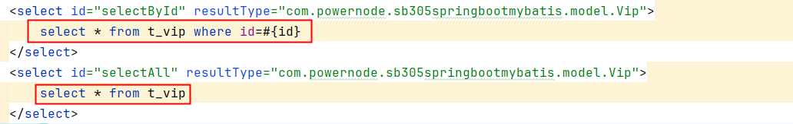
## 1.10测试其他方法是否正常
在主入口类中继续测试增删改操作：

```java
@MapperScan(basePackages = {"com.powernode.sb305springbootmybatis.repository"})
@SpringBootApplication
public class Sb305SpringbootMybatisApplication {

    public static void main(String[] args) {
        ConfigurableApplicationContext applicationContext = SpringApplication.run(Sb305SpringbootMybatisApplication.class, args);
        VipMapper vipMapper = applicationContext.getBean("vipMapper", VipMapper.class);

        // 增
        Vip vip = new Vip("张三", "123456789", "1990-01-01");
        int insertCount = vipMapper.insert(vip);
        System.out.println("插入结果：" + insertCount);

        // 查所有
        List<Vip> vips = vipMapper.selectAll();
        vips.forEach(System.out::println);

        // 改
        Vip updateVip = vips.get(0);
        updateVip.setName("张三丰");
        int updateCount = vipMapper.update(updateVip);
        System.out.println("更新结果：" + updateCount);

        // 删
        int deleteCount = vipMapper.deleteById(updateVip.getId());
        System.out.println("删除结果：" + deleteCount);

        applicationContext.close();
    }
}
```

## 1.11纯注解版MyBatis（无XML）

如果不想写XML映射文件，可以使用注解方式直接在Mapper接口上编写SQL：

```java
public interface VipMapper {

    @Insert("insert into t_vip(id,name,card_number,birth) values(null,#{name},#{cardNumber},#{birth})")
    int insert(Vip vip);

    @Delete("delete from t_vip where id = #{id}")
    int deleteById(Long id);

    @Update("update t_vip set name=#{name},card_number=#{cardNumber},birth=#{birth} where id=#{id}")
    int update(Vip vip);

    @Select("select * from t_vip where id=#{id}")
    Vip selectById(Long id);

    @Select("select * from t_vip")
    List<Vip> selectAll();
}
```

注解方式的优缺点：
- 优点：不需要XML文件，代码更简洁，适合简单SQL
- 缺点：复杂SQL（多表关联、动态条件）写在注解中可读性差，此时仍建议用XML

注意：使用注解方式时，`mybatis.mapper-locations` 配置可以省略，不再需要XML映射文件。

# 2.Lombok库

## 2.1Lombok的主要注解
@Data：
● 等价于 @ToString, @EqualsAndHashCode, @Getter，@Setter, @RequiredArgsConstructor.
● 用于生成：必要参数的构造方法、getter、setter、toString、equals 和 hashcode 方法。
@Getter / @Setter：
● 分别用于生成所有的 getter 和 setter 方法。
● 可以作用于整个类，也可以作用于特定的字段。
@NoArgsConstructor：
● 生成一个无参构造方法。
@AllArgsConstructor：
● 生成一个包含所有实例变量的构造器。
@RequiredArgsConstructor：
● 生成包含所有被 final 修饰符修饰的实例变量的构造方法。
● 如果没有**<font style="color:#DF2A3F;">final</font>**的实例变量，则自动生成无参数构造方法。
@ToString / @EqualsAndHashCode：
● 用于生成 toString 和 equals/hashCode 方法。
● 这两个注解都有**<font style="color:#DF2A3F;">exclude</font>**属性，通过这个属性可以定制toString、hashCode、equals方法。

## 2.2如何使用Lombok？
创建一个普通的Maven模块来快速测试一下Lombok库的使用
### 2.2.1添加依赖
在 Maven 的 pom.xml 文件中添加 Lombok 依赖：
```
<dependency>
    <groupId>org.projectlombok</groupId>

    <artifactId>lombok</artifactId>

    <version>1.18.34</version>

    <scope>provided</scope>

</dependency>

```
### 2.2.2IDEA中安装Lombok插件
高版本的IntelliJ IDEA工具默认都是绑定Lombok插件的，不需要再额外安装：
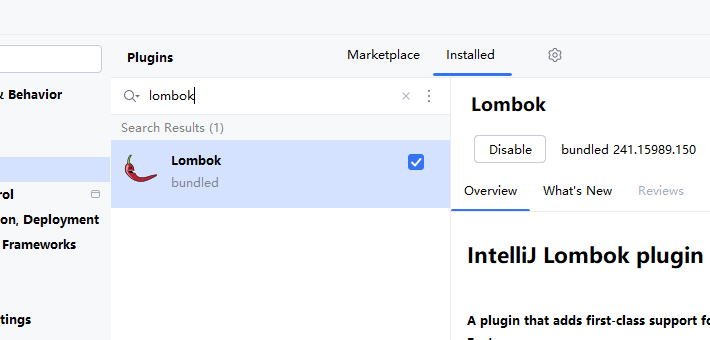
Lombok插件不是必须要安装的，为了提高开发效率以及开发者的体验，安装Lombok插件是有必要的。
也就是说安装了Lombok插件之后，编写代码的时候，才会有方法的提示功能。

当IDEA中没有安装lombok插件时：
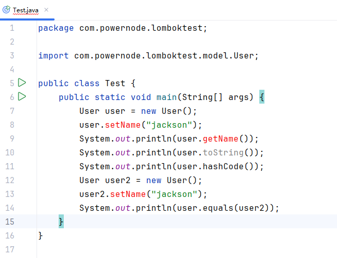
但是程序可以正常执行
如果在IDEA中安装了lombok插件：程序会有很好的提示功能。

### 2.2.3使用Lombok注解
在 Java 类中使用 Lombok 提供的注解。
```
import lombok.Data;

@Data
public class User {
    private String name;
}
```
编写测试程序：
```
package com.powernode.lomboktest;

import com.powernode.lomboktest.model.User;

public class Test {
    public static void main(String[] args) {
        User user = new User();
        user.setName("jackson");
        System.out.println(user.getName());
        System.out.println(user.toString());
        System.out.println(user.hashCode());
        User user2 = new User();
        user2.setName("jackson");
        System.out.println(user.equals(user2));
    }
}

```
以下的注解可以自行测试：
● @Getter
● @Setter
● @ToString【exclude属性】
● @EqualsAndHashCode【exclude属性】
● @NoArgsConstructor
● @AllArgsConstructor
● @RequiredArgsConstructor
注：Lombok只能帮助我们生成无参数构造方法和全参数构造方法，其他定制参数的构造方法无法生成。

## 2.3Lombok的其他常用注解
@Value
@Builder
@Singular
@Slf4j
......
### 2.3.1@Value
该注解会给所有属性添加final，给所有属性提供getter方法，自动生成toString、hashCode、equals
通过这个注解可以创建不可变对象。
```
package com.powernode.lomboktest.model;

import lombok.Value;

@Value
public class Customer {
    Long id;
    String name;
    String password;
}
```
测试程序：
```
package com.powernode.lomboktest;

import com.powernode.lomboktest.model.Customer;

public class CustomerTest {
    public static void main(String[] args) {
        Customer c1 = new Customer(1L, "jackson", "123");
        System.out.println(c1);
        System.out.println(c1.getId());
        System.out.println(c1.getName());
        System.out.println(c1.getPassword());
        System.out.println(c1.hashCode());
        Customer c2 = new Customer(1L, "jackson", "123");
        System.out.println(c1.equals(c2));
    }
}

```

可以查看一下字节码，你会发现，@Value注解的作用只会生成：全参数构造方法、getter方法、hashCode、equals、toString方法。（没有setter方法。）

### 2.3.2@Builder
GoF23种设计模式之一：建造模式
建造模式（Builder Pattern）属于创建型设计模式。GoF23种设计模式之一。
用于解决对象创建时参数过多的问题。它通过将对象的构造过程与其表示分离，使得构造过程可以逐步完成，而不是一次性提供所有参数。建造模式的主要目的是让对象的创建过程更加清晰、灵活和可控。
简而言之，建造模式用于：
1. 简化构造过程：通过逐步构造对象，避免构造函数参数过多。
2. 提高可读性和可维护性：让构造过程更加清晰和有序。
3. 增强灵活性：允许按需配置对象的不同部分。
这样可以更方便地创建复杂对象，并且使得代码更加易于理解和维护。

建造模式的代码
建造模式代码如下：
```
package com.powernode.lomboktest.model;

// 建造模式
public class Person {
    // 属性
    private final String name;
    private final int age;
    private final String email;

    // 私有的全参数构造方法
    private Person(String name, int age, String email) {
        this.name = name;
        this.age = age;
        this.email = email;
    }

    public String getName() {
        return name;
    }

    public int getAge() {
        return age;
    }

    public String getEmail() {
        return email;
    }

    public static PersonBuilder builder() {
        return new PersonBuilder();
    }

    // 静态内部类
    public static class PersonBuilder {
        private String name;
        private int age;
        private String email;

        public PersonBuilder name(String name) {
            this.name = name;
            return this;
        }

        public PersonBuilder age(int age) {
            this.age = age;
            return this;
        }

        public PersonBuilder email(String email) {
            this.email = email;
            return this;
        }

        // 建造对象的核心方法
        public Person build() {
            return new Person(name, age, email);
        }
    }

    @Override
    public String toString() {
        return "Person{" + "name='" + name + '\'' + ", age=" + age + ", email='" + email + '\'' + '}';
    }

    public static void main(String[] args) {
        Person person = Person.builder()
                .name("jackson")
                .age(20)
                .email("jackson@123.com")
                .build();
        System.out.println(person);
    }
}

```
使用@Builder注解自动生成建造模式的代码
该注解可以直接帮助我们生成以上的代码。使用@Builder注解改造以上代码。
```
package com.powernode.lomboktest.model;

import lombok.Builder;
import lombok.Data;

@Data
@Builder
// 建造模式
public class Person {
    // 属性
    private String name;
    private int age;
    private String email;

    public static void main(String[] args) {
        Person person = Person.builder()
                .name("jackson")
                .age(20)
                .email("jackson@123.com")
                .build();
        System.out.println(person);
    }
}

```
### 2.3.3@Singular
@Singular注解是辅助@Builder注解的。
当被建造的对象的属性是一个集合，这个集合属性使用@Singular注解进行标注的话，可以连续调用集合属性对应的方法完成多个元素的添加。如果没有这个注解，则无法连续调用方法完成多个元素的添加。代码如下：
```
package com.powernode.lomboktest.model;

import lombok.Builder;
import lombok.Data;
import lombok.Singular;

import java.util.List;

@Data
@Builder
// 建造模式
public class Person {
    // 属性
    private final String name;
    private final int age;
    private final String email;
    // Singular翻译为：单数。表示一条一条添加
    @Singular("addPhone")
    private final List<String> phones;

    public static void main(String[] args) {
        Person person = Person.builder()
                .name("jackson")
                .age(20)
                .email("jackson@123.com")
                .addPhone("15222020214")
                .addPhone("14875421424")
                .addPhone("16855241424")
                .build();
        System.out.println(person);
    }
}

```
### 2.3.4@Slf4j
Lombok 支持多种日志框架的注解，可以根据你使用的日志框架选择合适的注解。以下是 Lombok 提供的部分日志注解及其对应的日志框架：
1. @Log4j：
    ○ 自动生成一个 org.apache.log4j.Logger 对象。
    ○ 适用于 Apache Log4j 1.x 版本。
2. @Slf4j：
    ○ 自动生成一个 org.slf4j.Logger 对象。
    ○ 适用于 SLF4J（Simple Logging Facade for Java），这是一种日志门面，可以与多种实际的日志框架（如 Logback、Log4j 等）集成。
3. @Log4j2：
    ○ 自动生成一个 org.apache.logging.log4j.Logger 对象。
    ○ 适用于 Apache Log4j 2.x 版本。

使用示例
假设我们有一个类 ExampleClass，并且我们想要使用 SLF4J 作为日志框架，我们可以这样使用 @Slf4j 注解：
```
package com.powernode.lomboktest.service;

import lombok.extern.slf4j.Slf4j;

@Slf4j
public class UserService {
    public void login(){
        log.info("登录验证...");
    }
    // 测试
    public static void main(String[] args) {
        UserService userService = new UserService();
        userService.login();
    }
}
```
在这个例子中，log 是一个静态成员变量，表示一个 org.slf4j.Logger 对象。Lombok 自动生成了这个日志对象，并且你可以直接使用它来进行日志记录。

选择合适的注解
选择哪个注解取决于你使用的日志框架。例如：
● 如果你使用的是 SLF4J，可以选择 @Slf4j。
● 如果你使用的是 Log4j 1.x，可以选择 @Log4j。
● 如果你使用的是 Log4j 2.x，可以选择 @Log4j2。
注意事项
确保在使用这些注解之前，已经在项目中引入了相应的日志框架依赖。例如，如果你使用 SLF4J，你需要在项目中添加 SLF4J 的依赖，以及一个具体的日志实现（如 Logback）。对于其他日志框架，也需要相应地添加依赖。
示例依赖
如果你使用 Maven 项目，并且选择了 SLF4J + Logback 的组合，可以添加以下依赖：
```
<!--Slf4j日志规范-->
<dependency>
    <groupId>org.slf4j</groupId>

    <artifactId>slf4j-api</artifactId>

    <version>2.0.16</version>

</dependency>

<!--Slf4j日志实现：logback-->
<dependency>
    <groupId>ch.qos.logback</groupId>

    <artifactId>logback-classic</artifactId>

    <version>1.5.11</version>

</dependency>

```
通过这些日志注解，你可以方便地在类中使用日志记录功能，而无需手动创建日志对象。
# 3.Mybatis逆向生成
MyBatis逆向工程：使用IDEA插件可以根据数据库表的设计逆向生成MyBatis的Mapper接口 与 MapperXML文件。
## 3.1安装插件free mybatis tools
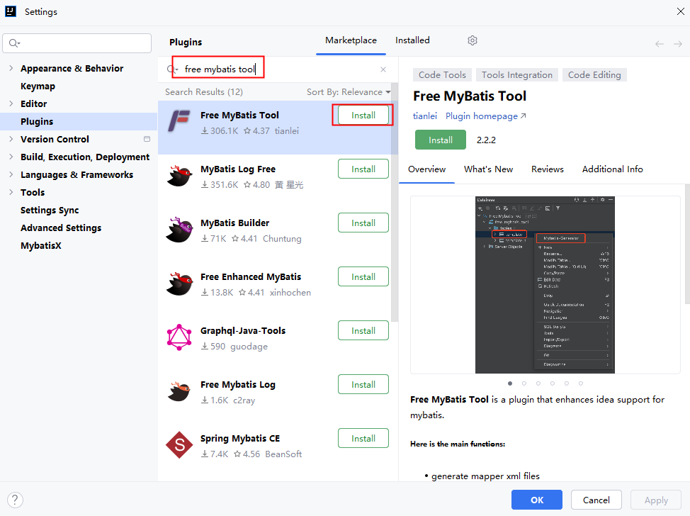

## 3.2在IDEA中配置数据源
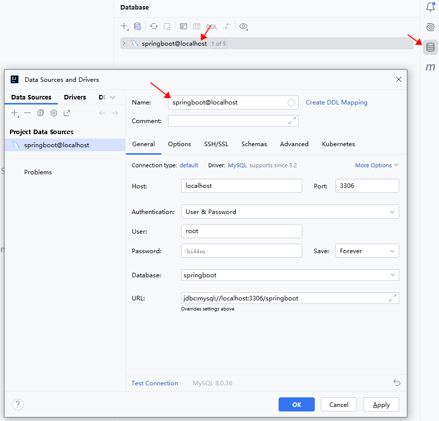

## 3.3创建数据库，创建表，准备数据
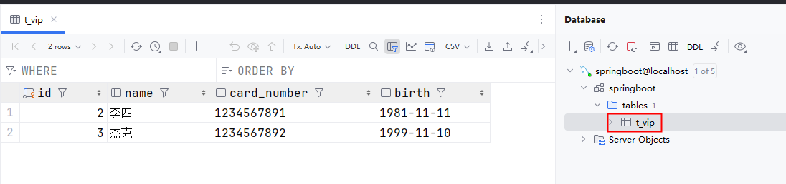

## 3.4使用脚手架创建Spring Boot项目
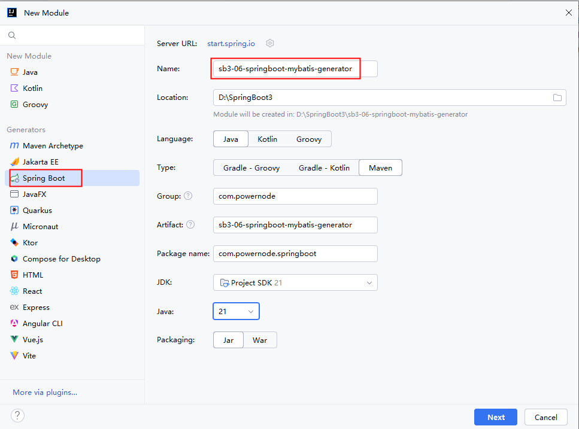
添加依赖：mybatis依赖、mysql驱动、Lombok库
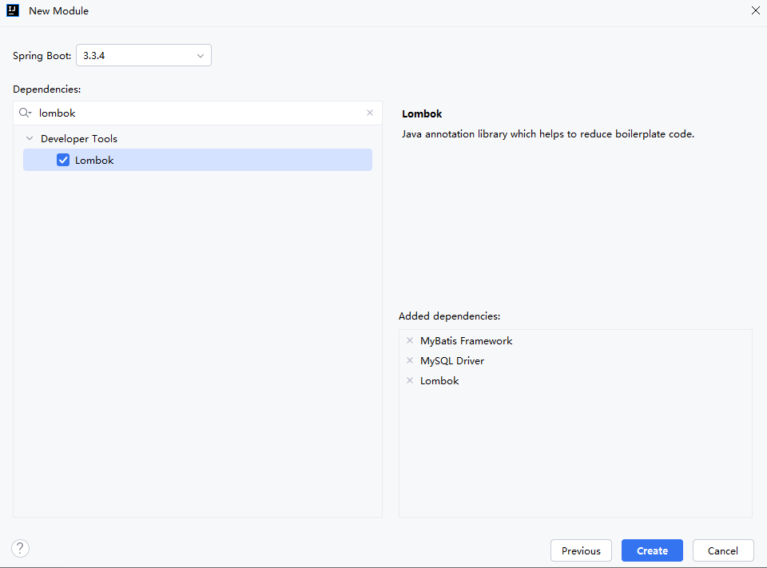

## 3.5生成Mybatis代码放到SpringBoot项目中
在表上右键：Mybatis-Generator
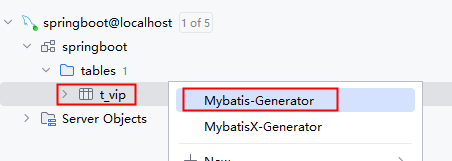
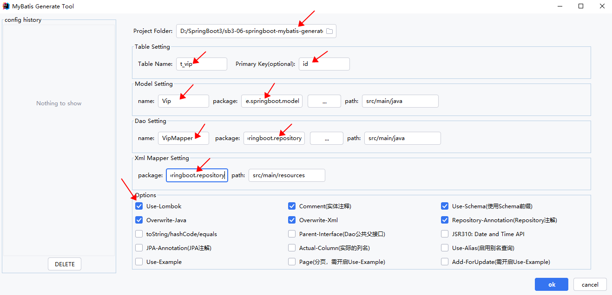
代码生成后，如果在IDEA中看不到，这样做（重新从硬盘加载）
注意：生成的**<font style="color:#DF2A3F;">VipMapper</font>**接口上自动添加了**<font style="color:#DF2A3F;">@Repository</font>**注解，这个注解没用，删除即可。


## 3.6编写mybatis相关配置
application.properties属性文件的配置：
```
spring.datasource.type=com.zaxxer.hikari.HikariDataSource
spring.datasource.driver-class-name=com.mysql.cj.jdbc.Driver
spring.datasource.url=jdbc:mysql://localhost:3306/springboot
spring.datasource.username=root
spring.datasource.password=123456

mybatis.mapper-locations=classpath:com/powernode/springboot/repository/*.xml
mybatis.configuration.map-underscore-to-camel-case=true
```
## 3.7编写测试程序
```
package com.powernode.springboot;

import com.powernode.springboot.model.Vip;
import com.powernode.springboot.repository.VipMapper;
import org.mybatis.spring.annotation.MapperScan;
import org.springframework.boot.SpringApplication;
import org.springframework.boot.autoconfigure.SpringBootApplication;
import org.springframework.context.ConfigurableApplicationContext;

@MapperScan(basePackages = "com.powernode.springboot.repository")
@SpringBootApplication
public class Sb306SpringbootMybatisGeneratorApplication {

    public static void main(String[] args) {
        ConfigurableApplicationContext applicationContext = SpringApplication.run(Sb306SpringbootMybatisGeneratorApplication.class, args);
        VipMapper vipMapper = applicationContext.getBean("vipMapper", VipMapper.class);
        // 增
        Vip vip = new Vip();
        vip.setName("孙悟空");
        vip.setBirth("1999-11-11");
        vip.setCardNumber("1234567894");
        vipMapper.insert(vip);
        // 查一个
        Vip vip1 = vipMapper.selectByPrimaryKey(2L);
        System.out.println(vip1);
        // 改
        vip1.setName("孙行者");
        vipMapper.updateByPrimaryKey(vip1);
        // 删
        vipMapper.deleteByPrimaryKey(1L);

        // 关闭Spring容器
        applicationContext.close();
    }
}
```
到此，Spring Boot整合MyBatis结束！
# 4.整合SpringMVC（SSM整合）
SSM整合：Spring + SpringMVC + MyBatis
Spring Boot项目本身就是基于Spring框架实现的。因此SSM整合时，只需要在整合MyBatis框架之后，引入web启动器即可完成SSM整合。
## 4.1使用脚手架创建SpringBoot项目
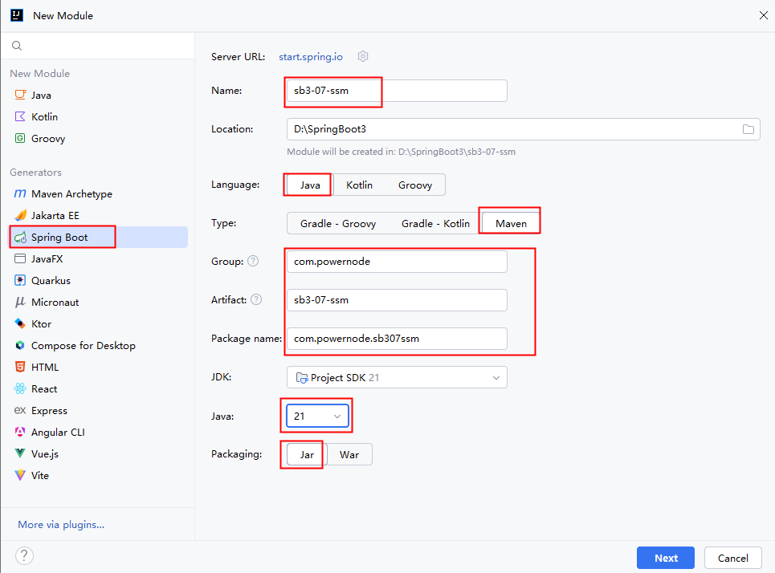
添加依赖：web启动器、mybatis启动器、mysql驱动依赖、lombok依赖
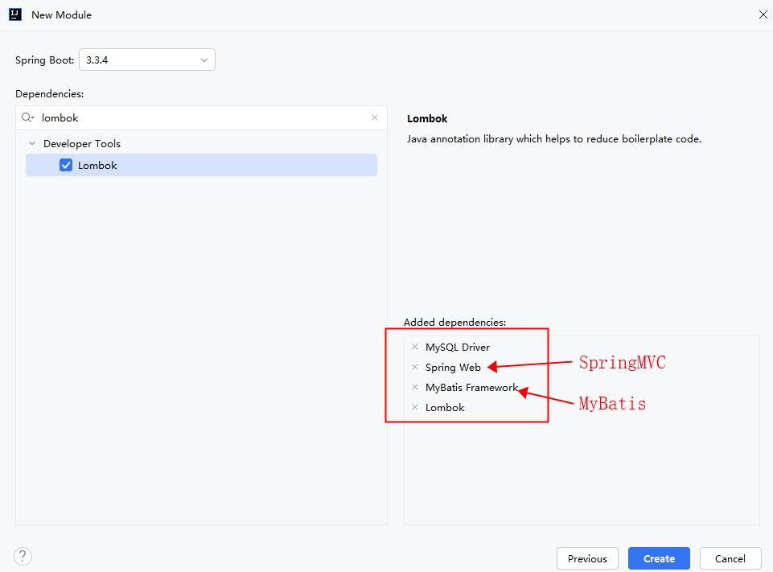

## 4.2使用free mybatis tool插件逆向生成Mybatis代码
将springboot数据库中的t_vip表逆向生成mybatis代码。这里不再赘述。

## 4.3整合Mybatis
编写数据源的配置
```
spring.datasource.driver-class-name=com.mysql.cj.jdbc.Driver
spring.datasource.url=jdbc:mysql://localhost:3306/springboot
spring.datasource.username=root
spring.datasource.password=123456
spring.datasource.type=com.zaxxer.hikari.HikariDataSource
```
编写mapper xml配置文件的位置
```
mybatis.mapper-locations=classpath:mapper/*.xml
mybatis.configuration.map-underscore-to-camel-case=true
```
在主入口类上添加@MapperScan注解
```
package com.powernode.sb307ssm;

import org.mybatis.spring.annotation.MapperScan;
import org.springframework.boot.SpringApplication;
import org.springframework.boot.autoconfigure.SpringBootApplication;

@MapperScan(basePackages = {"com.powernode.sb307ssm.repository"})
@SpringBootApplication
public class Sb307SsmApplication {

    public static void main(String[] args) {
        SpringApplication.run(Sb307SsmApplication.class, args);
    }

}
```
## 4.4编写Service
编写VipService接口：
```
package com.powernode.sb307ssm.service;

import com.powernode.sb307ssm.model.Vip;

public interface VipService {
    /**
     * 根据id获取会员信息
     * @param id 会员标识
     * @return 会员信息
     */
    Vip getById(Long id);
}

```
编写VipServiceImpl实现类：
```
package com.powernode.sb307ssm.service.impl;

import com.powernode.sb307ssm.model.Vip;
import com.powernode.sb307ssm.repository.VipMapper;
import com.powernode.sb307ssm.service.VipService;
import org.springframework.beans.factory.annotation.Autowired;
import org.springframework.stereotype.Service;

@Service("vipService")
public class VipServiceImpl implements VipService {

    @Autowired
    private VipMapper vipMapper;

    @Override
    public Vip getById(Long id) {
        return vipMapper.selectByPrimaryKey(id);
    }
}

```

## 4.5编写Controller
编写VipController，代码如下：
```
package com.powernode.sb307ssm.controller;

import com.powernode.sb307ssm.model.Vip;
import com.powernode.sb307ssm.service.VipService;
import org.springframework.beans.factory.annotation.Autowired;
import org.springframework.web.bind.annotation.GetMapping;
import org.springframework.web.bind.annotation.PathVariable;
import org.springframework.web.bind.annotation.RestController;

@RestController
public class VipController {
    
    @Autowired
    private VipService vipService;
    
    @GetMapping("/vip/{id}")
    public Vip detailById(@PathVariable("id") Long id){
        Vip vip = vipService.getById(id);
        return vip;
    }
}

```
提示：这里使用了RESTFul编程风格，这个内容在SpringMVC课程中已经讲过。忘了的同学可以回头观看一下。

## 4.6启动服务器测试
执行SpringBoot项目主入口的main方法，启动Tomcat服务器
