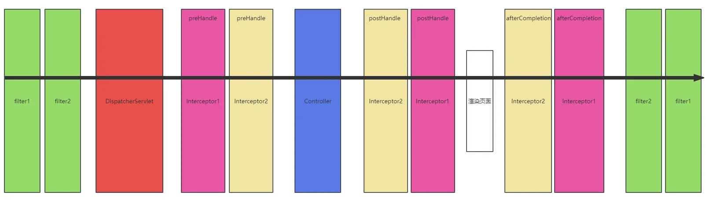
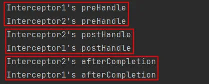
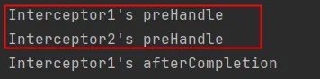

# 1. 拦截器概述
```
拦截器（Interceptor）类似于过滤器（Filter）
Spring MVC的拦截器作用是在请求到达控制器之前或之后进行拦截，可以对请求和响应进行一些特定的处理。
拦截器可以用于很多场景下：
1.  登录验证：对于需要登录才能访问的网址，使用拦截器可以判断用户是否已登录，如果未登录则跳转到登录页面。 
2.  权限校验：根据用户权限对部分网址进行访问控制，拒绝未经授权的用户访问。 
3.  请求日志：记录请求信息，例如请求地址、请求参数、请求时间等，用于排查问题和性能优化。 
4.  更改响应：可以对响应的内容进行修改，例如添加头信息、调整响应内容格式等。
拦截器和过滤器的区别在于它们的作用层面不同。
● 过滤器更注重在请求和响应的流程中进行处理，可以修改请求和响应的内容，例如设置编码和字符集、请求头、状态码等。
● 拦截器则更加侧重于对控制器进行前置或后置处理，在请求到达控制器之前或之后进行特定的操作，例如打印日志、权限验证等。
Filter、Servlet、Interceptor、Controller的执行顺序：
```



# 2. 拦截器的创建与基本配置

## 2.1 定义拦截器
```
实现org.springframework.web.servlet.HandlerInterceptor 接口，共有三个方法可以进行选择性的实现：
● preHandle：处理器方法调用之前执行
  ○ 只有该方法有返回值，返回值是布尔类型，true放行，false拦截。
● postHandle：处理器方法调用之后执行
● afterCompletion：渲染完成后执行
```
## 2.2 拦截器基本配置
```
在springmvc.xml文件中进行如下配置：
第一种方式：
<mvc:interceptors>
    <bean class="com.powernode.springmvc.interceptors.Interceptor1"/>
</mvc:interceptors>
第二种方式：
<mvc:interceptors>
    <ref bean="interceptor1"/>
</mvc:interceptors>
第二种方式的前提：
● 前提1：包扫描
● 前提2：使用 @Component 注解进行标注
注意：对于这种基本配置来说，拦截器是拦截所有请求的。
```
## 2.3 拦截器部分源码分析

### 2.3.1 方法执行顺序的源码分析
```
DispatcherServlet部分源码
public class DispatcherServlet extends FrameworkServlet {
    protected void doDispatch(HttpServletRequest request, HttpServletResponse response) throws Exception {
        // 调用所有拦截器的 preHandle 方法
        if (!mappedHandler.applyPreHandle(processedRequest, response)) {
            return;
        }
        // 调用处理器方法
        mv = ha.handle(processedRequest, response, mappedHandler.getHandler());
        // 调用所有拦截器的 postHandle 方法
        mappedHandler.applyPostHandle(processedRequest, response, mv);
        // 处理视图
        processDispatchResult(processedRequest, response, mappedHandler, mv, dispatchException);
    }

    private void processDispatchResult(HttpServletRequest request, HttpServletResponse response,
                                       @Nullable HandlerExecutionChain mappedHandler, @Nullable ModelAndView mv,
                                       @Nullable Exception exception) throws Exception {
        // 渲染页面
        render(mv, request, response);
        // 调用所有拦截器的 afterCompletion 方法
        mappedHandler.triggerAfterCompletion(request, response, null);
    }
}
```
### 2.3.2 拦截与放行的源码分析
```
DispatcherServlet部分源码
public class DispatcherServlet extends FrameworkServlet {
    protected void doDispatch(HttpServletRequest request, HttpServletResponse response) throws Exception {
        // 调用所有拦截器的 preHandle 方法
        if (!mappedHandler.applyPreHandle(processedRequest, response)) {
            // 如果 mappedHandler.applyPreHandle(processedRequest, response) 返回false，以下的return语句就会执行
            return;
        }
    }
}

HandlerExecutionChain部分源码
public class HandlerExecutionChain {
    boolean applyPreHandle(HttpServletRequest request, HttpServletResponse response) throws Exception {
        for (int i = 0; i < this.interceptorList.size(); i++) {
            HandlerInterceptor interceptor = this.interceptorList.get(i);
            if (!interceptor.preHandle(request, response, this.handler)) {
                triggerAfterCompletion(request, response, null);
                // 如果 interceptor.preHandle(request, response, this.handler) 返回 false，以下的 return false;就会执行。
                return false;
            }
            this.interceptorIndex = i;
        }
        return true;
    }
}
```
# 3. 拦截器的高级配置
```
采用以上基本配置方式，拦截器是拦截所有请求路径的。如果要针对某些路径进行拦截，某些路径不拦截，可以采用高级配置：

<mvc:interceptors>
    <mvc:interceptor>
        <!--拦截所有路径-->
        <mvc:mapping path="/**"/>
        <!--除 /test 路径之外-->
        <mvc:exclude-mapping path="/test"/>
        <!--拦截器-->
        <ref bean="interceptor1"/>
    </mvc:interceptor>
</mvc:interceptors>
以上的配置表示，除 /test 请求路径之外，剩下的路径全部拦截。
```
# 4. 拦截器的执行顺序
## 4.1 执行顺序
### 4.1.1 如果所有拦截器preHandle都返回true
```
按照springmvc.xml文件中配置的顺序，自上而下调用 preHandle：
<mvc:interceptors>
    <ref bean="interceptor1"/>
    <ref bean="interceptor2"/>
</mvc:interceptors>
执行顺序：
```



### 4.1.2 如果其中一个拦截器preHandle返回false
```
<mvc:interceptors>
    <ref bean="interceptor1"/>
    <ref bean="interceptor2"/>
</mvc:interceptors>
如果interceptor2的preHandle返回false，执行顺序：
```


```
规则：只要有一个拦截器preHandle返回false，任何postHandle都不执行。但返回false的拦截器的前面的拦截器按照逆序执行afterCompletion。注意只有返回false的拦截器执行afterCompletion
```
## 4.2 DispatcherServlet和 HandlerExecutionChain的部分源码
```
public class DispatcherServlet extends FrameworkServlet {
    protected void doDispatch(HttpServletRequest request, HttpServletResponse response) throws Exception {
        // 按照顺序执行所有拦截器的preHandle方法
        if (!mappedHandler.applyPreHandle(processedRequest, response)) {
            return;
        }
        // 执行处理器方法
        mv = ha.handle(processedRequest, response, mappedHandler.getHandler());
        // 按照逆序执行所有拦截器的 postHanle 方法
        mappedHandler.applyPostHandle(processedRequest, response, mv);
        // 处理视图
        processDispatchResult(processedRequest, response, mappedHandler, mv, dispatchException);
    }

    private void processDispatchResult(HttpServletRequest request, HttpServletResponse response,
                                       @Nullable HandlerExecutionChain mappedHandler, @Nullable ModelAndView mv,
                                       @Nullable Exception exception) throws Exception {
        // 渲染视图
        render(mv, request, response);
        // 按照逆序执行所有拦截器的 afterCompletion 方法
        mappedHandler.triggerAfterCompletion(request, response, null);
    }
}

public class HandlerExecutionChain {
    // 顺序执行 preHandle
    boolean applyPreHandle(HttpServletRequest request, HttpServletResponse response) throws Exception {
        for (int i = 0; i < this.interceptorList.size(); i++) {
            HandlerInterceptor interceptor = this.interceptorList.get(i);
            if (!interceptor.preHandle(request, response, this.handler)) {
                // 如果其中一个拦截器preHandle返回false
                // 将该拦截器前面的拦截器按照逆序执行所有的afterCompletion
                triggerAfterCompletion(request, response, null);
                return false;
            }
            this.interceptorIndex = i;
        }
        return true;
    }
    // 逆序执行 postHanle
    void applyPostHandle(HttpServletRequest request, HttpServletResponse response, @Nullable ModelAndView mv) 
                                                                            throws Exception {
        for (int i = this.interceptorList.size() - 1; i >= 0; i--) {
            HandlerInterceptor interceptor = this.interceptorList.get(i);
            interceptor.postHandle(request, response, this.handler, mv);
        }
    }
    // 逆序执行 afterCompletion
    void triggerAfterCompletion(HttpServletRequest request, HttpServletResponse response, @Nullable Exception ex) {
        for (int i = this.interceptorIndex; i >= 0; i--) {
            HandlerInterceptor interceptor = this.interceptorList.get(i);
            try {
                interceptor.afterCompletion(request, response, this.handler, ex);
            }
            catch (Throwable ex2) {
                logger.error("HandlerInterceptor.afterCompletion threw exception", ex2);
            }
        }
    }
}
```
# 5. 拦截器三个方法经典用法
| 方法              | 执行时机                | 经典作用               |
| --------------- | ------------------- | ------------------ |
| preHandle       | Controller 之前       | 权限校验 / 登录检查 / 放行控制 |
| postHandle      | Controller 之后，视图渲染前 | 修改 Model 数据        |
| afterCompletion | 整个请求完成后             | 资源释放 / 日志记录        |

# 6. 实战案例一：登录检查拦截器
```
这是一个最常见的拦截器应用场景：检查用户是否已登录，未登录则重定向到登录页。

public class LoginInterceptor implements HandlerInterceptor {

    @Override
    public boolean preHandle(HttpServletRequest request, HttpServletResponse response, Object handler) throws Exception {
        // 从Session中获取登录用户信息
        Object user = request.getSession().getAttribute("loginUser");
        if (user == null) {
            // 未登录，重定向到登录页面
            response.sendRedirect(request.getContextPath() + "/login");
            return false;  // 不放行
        }
        // 已登录，放行
        return true;
    }
}

拦截器配置（注意排除登录页面本身，否则会造成死循环）：
<mvc:interceptors>
    <mvc:interceptor>
        <mvc:mapping path="/**"/>
        <mvc:exclude-mapping path="/login"/>
        <mvc:exclude-mapping path="/register"/>
        <mvc:exclude-mapping path="/static/**"/>
        <bean class="com.powernode.springmvc.interceptor.LoginInterceptor"/>
    </mvc:interceptor>
</mvc:interceptors>
```

# 7. 实战案例二：请求耗时统计拦截器
```
记录每个请求的处理耗时，用于性能监控。

public class TimingInterceptor implements HandlerInterceptor {

    // ThreadLocal保证每个请求的startTime互不干扰
    private static final ThreadLocal<Long> START_TIME = new ThreadLocal<>();

    @Override
    public boolean preHandle(HttpServletRequest request, HttpServletResponse response, Object handler) {
        START_TIME.set(System.currentTimeMillis());
        return true;  // 始终放行
    }

    @Override
    public void afterCompletion(HttpServletRequest request, HttpServletResponse response, Object handler, Exception ex) {
        Long startTime = START_TIME.get();
        if (startTime != null) {
            long duration = System.currentTimeMillis() - startTime;
            String uri = request.getRequestURI();
            String method = request.getMethod();
            if (duration > 1000) {
                // 超过1秒的请求记录为慢查询
                System.out.println("[SLOW] " + method + " " + uri + " 耗时 " + duration + "ms");
            } else {
                System.out.println(method + " " + uri + " 耗时 " + duration + "ms");
            }
            START_TIME.remove();  // 清理ThreadLocal，防止内存泄漏
        }
    }
}

注意事项：
● 必须在afterCompletion中调用ThreadLocal.remove()，否则会导致内存泄漏
● ThreadLocal变量通常声明为static final
● 在afterCompletion中操作是安全的（即使发生异常，afterCompletion也保证会被调用）
```

# 8. ThreadLocal在拦截器中的典型使用模式
```
ThreadLocal经常配合拦截器使用，用于在请求处理链中传递上下文信息。

8.1 典型用法：传递当前登录用户信息
public class UserContext {
    private static final ThreadLocal<User> CURRENT_USER = new ThreadLocal<>();

    public static void setCurrentUser(User user) {
        CURRENT_USER.set(user);
    }

    public static User getCurrentUser() {
        return CURRENT_USER.get();
    }

    public static void clear() {
        CURRENT_USER.remove();
    }
}

// 拦截器中设置
public class UserContextInterceptor implements HandlerInterceptor {
    @Override
    public boolean preHandle(HttpServletRequest request, HttpServletResponse response, Object handler) {
        User user = (User) request.getSession().getAttribute("loginUser");
        UserContext.setCurrentUser(user);  // 设置到ThreadLocal
        return true;
    }

    @Override
    public void afterCompletion(HttpServletRequest request, HttpServletResponse response, Object handler, Exception ex) {
        UserContext.clear();  // 必须清理！
    }
}

// Controller或Service中直接获取（无需传参）
public class OrderService {
    public void createOrder() {
        User currentUser = UserContext.getCurrentUser();  // 直接获取当前用户
        System.out.println("当前操作用户：" + currentUser.getName());
    }
}

8.2 为什么使用ThreadLocal：
● 每个请求由独立的线程处理
● ThreadLocal保证了同一请求内的数据传递，不同请求间互不影响
● 避免了在每一层方法中手动传递参数的麻烦
● 配合拦截器的afterCompletion自动清理，防止内存泄漏
```

# 9. 拦截器对REST API的正确处理
```
对于返回JSON的@RestController，拦截器中的重定向（sendRedirect）不起作用。
前端Axios收到302重定向后，会跟随重定向并获取最终响应，但不会跳转页面。

正确做法：返回401 JSON错误响应

public class ApiAuthInterceptor implements HandlerInterceptor {

    @Override
    public boolean preHandle(HttpServletRequest request, HttpServletResponse response, Object handler) throws Exception {
        Object user = request.getSession().getAttribute("loginUser");
        if (user == null) {
            // 对于REST API，返回JSON错误而不是重定向
            response.setStatus(HttpServletResponse.SC_UNAUTHORIZED);  // 401
            response.setContentType("application/json; charset=UTF-8");
            response.setCharacterEncoding("UTF-8");

            PrintWriter writer = response.getWriter();
            writer.write("{\"code\":401,\"message\":\"请先登录\"}");
            writer.flush();
            return false;
        }
        return true;
    }
}

前端Axios统一拦截401响应：
axios.interceptors.response.use(
    response => response,
    error => {
        if (error.response && error.response.status === 401) {
            window.location.href = '/login';  // 前端跳转到登录页
        }
        return Promise.reject(error);
    }
);
```

# 10. 异步请求拦截器（AsyncHandlerInterceptor）
```
当Controller使用Callable或DeferredResult异步处理时，
标准的HandlerInterceptor行为会发生变化。

问题：
● postHandle在异步任务提交后就立即执行（而不是异步任务完成后）
● afterCompletion在异步任务提交后也可能立即执行

解决方案：使用AsyncHandlerInterceptor

public class AsyncLoggingInterceptor implements AsyncHandlerInterceptor {

    @Override
    public boolean preHandle(HttpServletRequest request, HttpServletResponse response, Object handler) {
        System.out.println("1. preHandle — 主线程：" + Thread.currentThread().getName());
        return true;
    }

    @Override
    public void postHandle(HttpServletRequest request, HttpServletResponse response, Object handler, ModelAndView mv) {
        // 注意：对于异步请求，这个方法在异步处理完成之前可能不会调用
        System.out.println("3. postHandle — 主线程：" + Thread.currentThread().getName());
    }

    @Override
    public void afterCompletion(HttpServletRequest request, HttpServletResponse response, Object handler, Exception ex) {
        System.out.println("4. afterCompletion — 主线程：" + Thread.currentThread().getName());
    }

    @Override
    public void afterConcurrentHandlingStarted(HttpServletRequest request, HttpServletResponse response, Object handler) {
        // 异步处理开始时调用（替代postHandle和afterCompletion的执行时机）
        // 适用于清理ThreadLocal等在主线程中设置的资源
        System.out.println("2. afterConcurrentHandlingStarted — 主线程：" + Thread.currentThread().getName());
        UserContext.clear();  // 在异步开始时清理ThreadLocal
    }
}

异步请求拦截器的执行顺序：
● 同步请求：preHandle → Controller → postHandle → 视图渲染 → afterCompletion
● 异步请求：preHandle → Controller返回Callable → afterConcurrentHandlingStarted* → 
                        (异步线程执行Callable) → Controller → postHandle → 视图渲染 → afterCompletion
* afterConcurrentHandlingStarted 是新增加的生命周期方法
```

# 11. 拦截器的Java Config配置
```
除了XML配置，拦截器也可以通过Java Config方式注册。

@Configuration
@EnableWebMvc
public class SpringMvcConfig implements WebMvcConfigurer {

    @Override
    public void addInterceptors(InterceptorRegistry registry) {
        // 方式一：直接new拦截器实例
        registry.addInterceptor(new LoginInterceptor())
                .addPathPatterns("/**")
                .excludePathPatterns("/login", "/register", "/static/**")
                .order(1);  // 设置拦截器执行顺序

        // 方式二：注入Spring管理的拦截器Bean
        registry.addInterceptor(timingInterceptor())
                .addPathPatterns("/**")
                .order(2);

        // 方式三：拦截器仅对特定HTTP方法生效
        registry.addInterceptor(new CsrfInterceptor())
                .addPathPatterns("/**")
                .excludePathPatterns("/api/**");  // REST API不需要CSRF
    }

    @Bean
    public TimingInterceptor timingInterceptor() {
        return new TimingInterceptor();
    }
}

拦截器排除路径的Ant模式说明：
● /** ：匹配所有路径
● /admin/** ：匹配/admin/开头的所有路径
● /user/* ：匹配/user/下的单层路径（如/user/edit，不匹配/user/info/detail）
● .excludePathPatterns("/static/**", "/error/**", "/favicon.ico")
```

# 12. 拦截器与过滤器的完整对比
```
| 对比维度 | 过滤器（Filter） | 拦截器（Interceptor） |
|----------|-----------------|---------------------|
| 规范 | Servlet规范（JavaEE） | Spring框架（SpringMVC） |
| 容器 | Servlet容器管理 | Spring IoC容器管理 |
| 可注入Spring Bean | 不可以（需额外配置） | 可以直接注入 |
| 拦截范围 | 所有请求（包括静态资源） | 仅拦截DispatcherServlet处理的请求 |
| 拦截粒度 | 只能拦截请求/响应 | 可以拦截Controller方法、ModelAndView |
| 执行时机 | Servlet之前 | HandlerAdapter之后、Controller之前 |
| 生命周期方法 | init、doFilter、destroy | preHandle、postHandle、afterCompletion |
| 是否依赖Servlet容器 | 是 | 否（纯Java） |
| 典型用途 | 编码、跨域、日志 | 权限、登录、性能监控 |

选择建议：
● 处理编码、跨域等基础设施层问题 → 用Filter
● 处理业务层权限、日志等与Spring Bean相关的问题 → 用Interceptor
```
