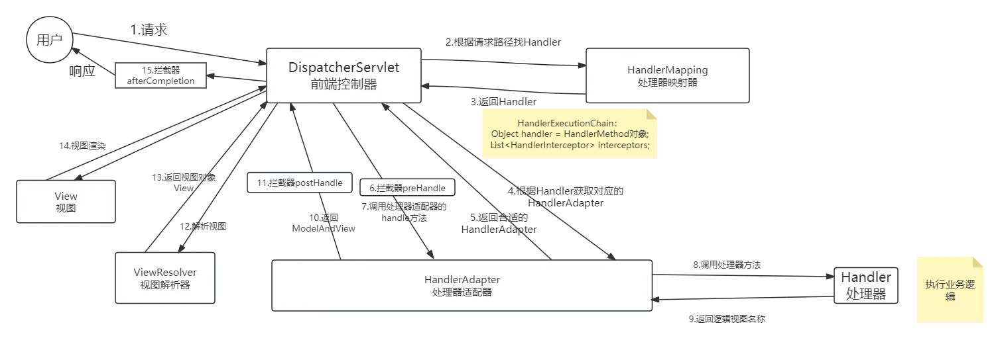
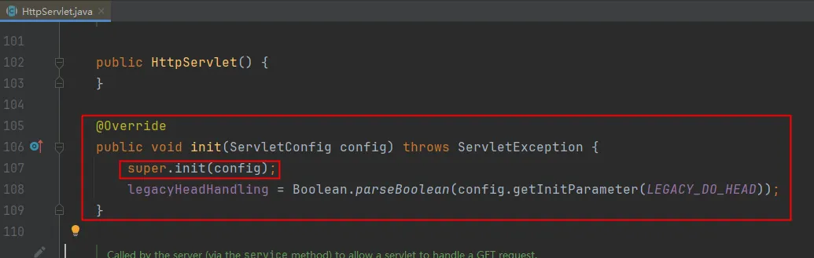
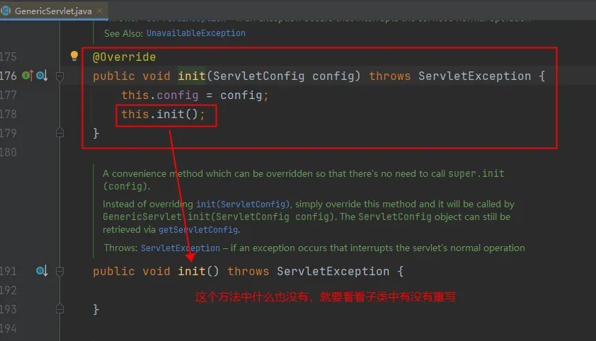
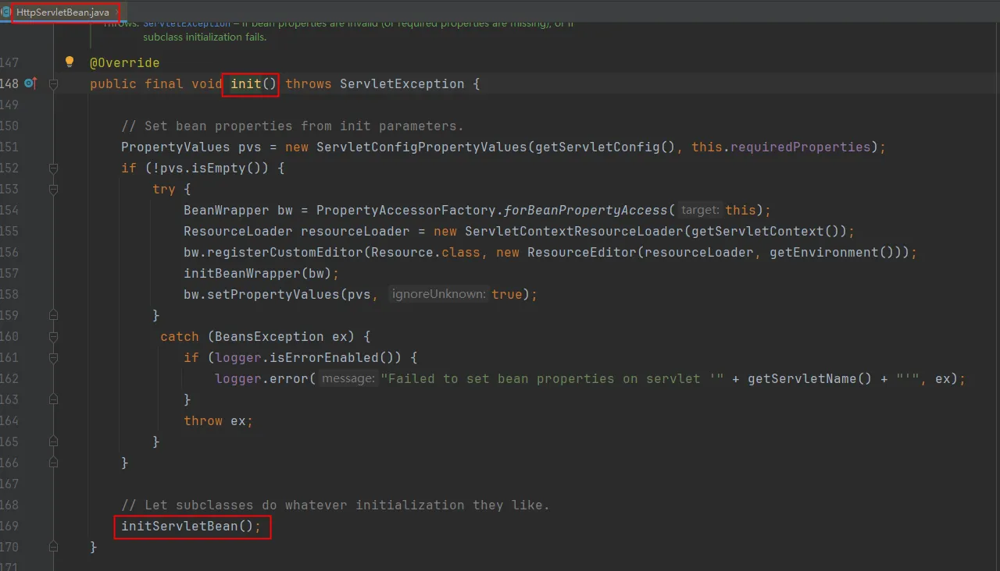
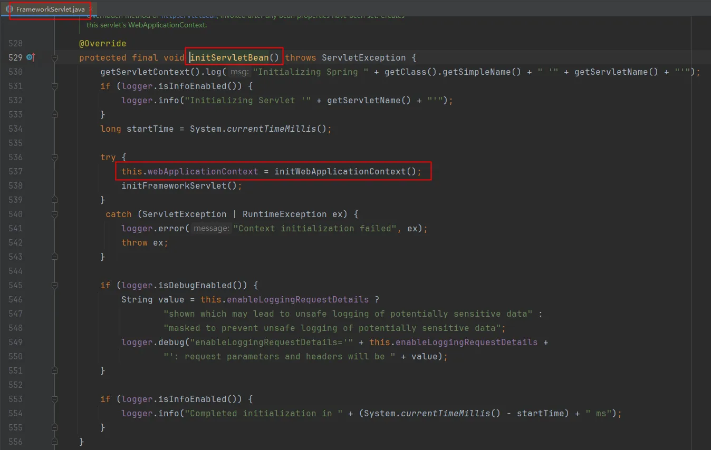
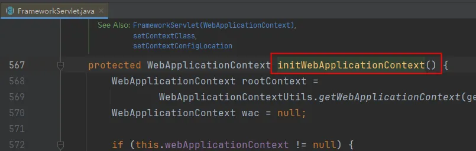
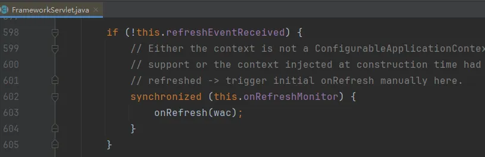
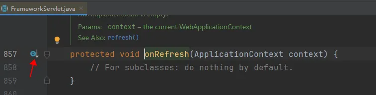
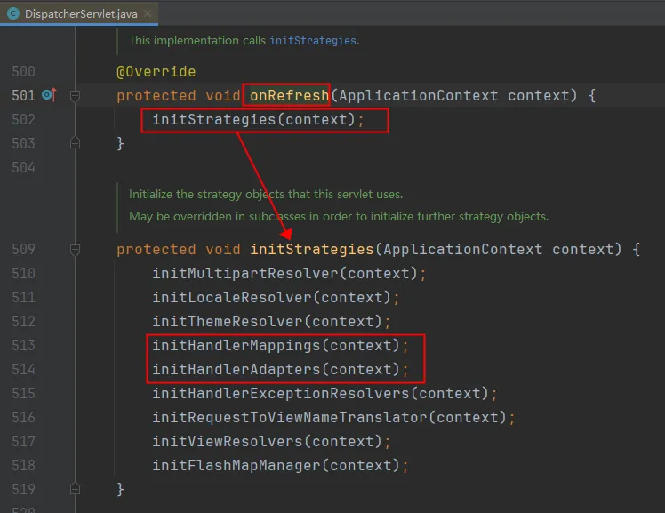

# 1.从源码角度看执行流程
```
以下是核心代码：
public class DispatcherServlet extends FrameworkServlet {
    protected void doDispatch(HttpServletRequest request, HttpServletResponse response) throws Exception {
        // 根据请求对象request获取
        // 这个对象是在每次发送请求时都创建一个，是请求级别的
        // 该对象中描述了本次请求应该执行的拦截器是哪些，顺序是怎样的，要执行的处理器是哪个
        HandlerExecutionChain mappedHandler = getHandler(processedRequest);

        // 根据处理器获取处理器适配器。（底层使用了适配器模式）
        // HandlerAdapter在web服务器启动的时候就创建好了。（启动时创建多个HandlerAdapter放在List集合中）
        // HandlerAdapter有多种类型：
        // RequestMappingHandlerAdapter：用于适配使用注解 @RequestMapping 标记的控制器方法
        // SimpleControllerHandlerAdapter：用于适配实现了 Controller 接口的控制器（早期使用，现已淘汰）
        // 注意：此时还没有进行数据绑定（也就是说，表单提交的数据，此时还没有转换为pojo对象。）
        HandlerAdapter ha = getHandlerAdapter(mappedHandler.getHandler());

        // 执行请求对应的所有拦截器中的 preHandle 方法
        if (!mappedHandler.applyPreHandle(processedRequest, response)) {
            return;
        }

        // 通过处理器适配器调用处理器方法
        // 在调用处理器方法之前会进行数据绑定，将表单提交的数据绑定到处理器方法上。（底层是通过WebDataBinder完成的）
        // 在数据绑定的过程中会使用到消息转换器：HttpMessageConverter
        // 结束后返回ModelAndView对象
        mv = ha.handle(processedRequest, response, mappedHandler.getHandler());

        //  执行请求对应的所有拦截器中的 postHandle 方法
        mappedHandler.applyPostHandle(processedRequest, response, mv);

        // 处理分发结果（在这个方法中完成了响应）
        processDispatchResult(processedRequest, response, mappedHandler, mv, dispatchException);
    }

    // 根据每一次的请求对象来获取处理器执行链对象
    protected HandlerExecutionChain getHandler(HttpServletRequest request) throws Exception {
        if (this.handlerMappings != null) {
            // HandlerMapping在服务器启动的时候就创建好了，放到了List集合中。HandlerMapping也有多种类型
            // RequestMappingHandlerMapping：将 URL 映射到使用注解 @RequestMapping 标记的控制器方法的处理器。
            // SimpleUrlHandlerMapping：将 URL 映射到处理器中指定的 URL 或 URL 模式的处理器。
            for (HandlerMapping mapping : this.handlerMappings) {
                // 重点：这是一次请求的开始，实际上是通过处理器映射器来获取的处理器执行链对象
                // 底层实际上会通过 HandlerMapping 对象获取 HandlerMethod对象，
                // 将HandlerMethod 对象传递给 HandlerExecutionChain对象。
                // 注意：HandlerMapping对象和HandlerMethod对象都是在服务器启动阶段创建的。
                // RequestMappingHandlerMapping对象中有多个HandlerMethod对象。
                HandlerExecutionChain handler = mapping.getHandler(request);
                if (handler != null) {
                    return handler;
                }
            }
        }
        return null;
    }

    private void processDispatchResult(HttpServletRequest request, HttpServletResponse response,
                                       @Nullable HandlerExecutionChain mappedHandler, @Nullable ModelAndView mv,
                                       @Nullable Exception exception) throws Exception {
        // 渲染
        render(mv, request, response);
        // 渲染完毕后，调用该请求对应的所有拦截器的 afterCompletion方法。
        mappedHandler.triggerAfterCompletion(request, response, null);
    }

    protected void render(ModelAndView mv, HttpServletRequest request, HttpServletResponse response) throws Exception {
        // 通过视图解析器返回视图对象
        view = resolveViewName(viewName, mv.getModelInternal(), locale, request);
        // 真正的渲染视图
        view.render(mv.getModelInternal(), request, response);
    }

    protected View resolveViewName(String viewName, @Nullable Map<String, Object> model,
			Locale locale, HttpServletRequest request) throws Exception {
        // 通过视图解析器返回视图对象
        View view = viewResolver.resolveViewName(viewName, locale);
	}
}

public interface ViewResolver {
    View resolveViewName(String viewName, Locale locale) throws Exception;
}

public interface View {
    void render(@Nullable Map<String, ?> model, HttpServletRequest request, HttpServletResponse response)
    throws Exception;
}
```
# 2.从图片角度看执行流程



# 3.WEB服务器启动时都做了什么
```
先搞明白核心类的继承关系：
DispatcherServlet extends FrameworkServlet extends HttpServletBean extends HttpServlet extends GenericServlet implements Servlet
服务器启动阶段完成了：
1. 初始化Spring上下文，也就是创建所有的bean，让IoC容器将其管理起来。
2. 初始化SpringMVC相关的对象：处理器映射器，处理器适配器等。
```

















# 4.处理器方法参数解析器体系（HandlerMethodArgumentResolver）
```
这是SpringMVC中最精妙的设计之一：如何将不同类型的请求参数自动注入到Controller方法参数中。

核心接口：
public interface HandlerMethodArgumentResolver {
    // 判断该解析器是否支持当前参数
    boolean supportsParameter(MethodParameter parameter);
    // 解析参数，从request中获取实际的值
    Object resolveArgument(MethodParameter parameter, ModelAndViewContainer mavContainer,
                          NativeWebRequest webRequest, WebDataBinderFactory binderFactory) throws Exception;
}

SpringMVC内置的参数解析器（按照执行顺序排列）：
| 解析器 | 处理的注解/类型 | 说明 |
|--------|---------------|------|
| RequestParamMethodArgumentResolver | @RequestParam | 处理URL查询参数和表单参数 |
| RequestParamMapMethodArgumentResolver | @RequestParam MultiValueMap | 将所有参数收集到Map |
| PathVariableMethodArgumentResolver | @PathVariable | 处理RESTful路径变量 |
| MatrixVariableMethodArgumentResolver | @MatrixVariable | 处理矩阵变量 |
| RequestResponseBodyMethodProcessor | @RequestBody | 处理JSON/XML请求体 |
| RequestHeaderMethodArgumentResolver | @RequestHeader | 处理请求头 |
| RequestCookieMethodArgumentResolver | @CookieValue | 处理Cookie |
| ModelAttributeMethodProcessor | @ModelAttribute | 处理POJO绑定 |
| MapMethodProcessor | Map参数 | 注入Model的Map |
| ModelMethodProcessor | Model参数 | 注入Model对象 |
| ServletModelAttributeMethodProcessor | POJO参数（无注解） | 简单类型当作@RequestParam，复杂类型当作@ModelAttribute |
| SessionAttributeMethodArguementResolver | @SessionAttribute | 从Session获取属性 |
| RequestAttributeMethodArgumentResolver | @RequestAttribute | 从Request属性获取 |
| ServletRequestMethodArgumentResolver | Servlet原生类型 | 注入HttpServletRequest/Response/Session等 |
| HandlerMethodArgumentResolverComposite | 组合解析器 | 聚合所有解析器，按序尝试 |

解析过程：
1. 遍历所有已注册的参数解析器
2. 调用每个解析器的supportsParameter()方法
3. 第一个返回true的解析器被选中
4. 调用该解析器的resolveArgument()方法获取参数值

举例说明：
@PostMapping("/user/{id}")
public String update(@PathVariable("id") Long id,     // → PathVariableMethodArgumentResolver
                     @RequestBody User user,           // → RequestResponseBodyMethodProcessor
                     HttpServletRequest request,       // → ServletRequestMethodArgumentResolver
                     Model model) {                    // → ModelMethodProcessor
    ...
}
每个参数都由不同的解析器负责处理，实现了关注点分离和可扩展性。
```

# 5.处理器方法返回值处理器体系（HandlerMethodReturnValueHandler）
```
与参数解析器对称，返回值处理器负责处理Controller方法的返回值。

核心接口：
public interface HandlerMethodReturnValueHandler {
    boolean supportsReturnType(MethodParameter returnType);
    void handleReturnValue(Object returnValue, MethodParameter returnType,
                          ModelAndViewContainer mavContainer, NativeWebRequest webRequest) throws Exception;
}

内置的返回值处理器：
| 处理器 | 处理的返回类型 | 说明 |
|--------|--------------|------|
| ModelAndViewMethodReturnValueHandler | ModelAndView | 直接使用返回的ModelAndView |
| ModelMethodProcessor | Model | 将返回值加入Model |
| ViewMethodReturnValueHandler | View | 直接渲染View |
| HttpEntityMethodProcessor | HttpEntity/ResponseEntity | 设置响应头、状态码、响应体 |
| RequestResponseBodyMethodProcessor | @ResponseBody | 通过HttpMessageConverter转换为JSON/XML |
| ViewNameMethodReturnValueHandler | String/void | 将字符串作为视图名 |
| MapMethodProcessor | Map | 将Map数据放入Model |
| DeferredResultMethodReturnValueHandler | DeferredResult | 异步请求处理 |
| CallableMethodReturnValueHandler | Callable | 异步请求处理 |
| StreamingResponseBodyReturnValueHandler | StreamingResponseBody | 流式响应 |
| ResponseBodyEmitterReturnValueHandler | ResponseBodyEmitter/SseEmitter | 服务端推送 |

当Controller方法返回String时：
@GetMapping("/index")
public String index() {
    return "index";   // → ViewNameMethodReturnValueHandler 将"index"作为视图名
}

当Controller方法返回@ResponseBody时：
@GetMapping("/api/user")
@ResponseBody
public User getUser() {
    return new User();  // → RequestResponseBodyMethodProcessor → HttpMessageConverter → JSON
}
```

# 6.doDispatch中的异常处理流程
```
当Controller方法执行过程中抛出异常时，DispatcherServlet的处理流程：

DispatcherServlet.doDispatch() 中的核心异常处理代码片段：
try {
    // 1. 执行拦截器的preHandle
    if (!mappedHandler.applyPreHandle(processedRequest, response)) return;

    // 2. 执行处理器方法
    mv = ha.handle(processedRequest, response, mappedHandler.getHandler());

    // 3. 执行拦截器的postHandle
    mappedHandler.applyPostHandle(processedRequest, response, mv);
} catch (Exception ex) {
    dispatchException = ex;  // 记录异常，不立即抛出
} catch (Throwable err) {
    dispatchException = new NestedServletException("Handler dispatch failed", err);
}
// 4. 处理分发结果（包含异常处理）
processDispatchResult(processedRequest, response, mappedHandler, mv, dispatchException);

processDispatchResult()中的异常处理：
if (exception != null) {
    if (exception instanceof ModelAndViewDefiningException) {
        // 特殊异常：直接使用其中的ModelAndView
        mv = ((ModelAndViewDefiningException) exception).getModelAndView();
    } else {
        // 遍历所有HandlerExceptionResolver
        for (HandlerExceptionResolver resolver : this.handlerExceptionResolvers) {
            mv = resolver.resolveException(request, response, handler, exception);
            if (mv != null) {
                break;  // 找到第一个能处理的异常处理器
            }
        }
    }
}

异常处理器的执行顺序：
1. @ExceptionHandler（Controller内部） — 优先级最高
2. @ControllerAdvice + @ExceptionHandler（全局） — 优先级第二
3. ResponseStatusExceptionResolver — 处理@ResponseStatus注解
4. DefaultHandlerExceptionResolver — 处理SpringMVC内部标准异常（如405、406）
5. SimpleMappingExceptionResolver — 将异常映射到错误页面

如果所有异常处理器都无法处理，异常最终会传播到Servlet容器，
触发web.xml中配置的<error-page>。
```

# 7.异步请求执行流程
```
SpringMVC支持异步处理请求，避免Servlet容器线程阻塞。

7.1 Callable异步处理：
@GetMapping("/async/callable")
public Callable<String> asyncCallable() {
    return () -> {
        // 这段代码在独立的线程中执行，不占用Tomcat的请求线程
        Thread.sleep(3000);  // 模拟耗时操作
        return "ok";  // 返回视图名
    };
}

Callable执行流程：
1. DispatcherServlet调用HandlerAdapter.handle()
2. HandlerAdapter检测到返回值是Callable
3. 将请求标记为异步：request.startAsync()
4. 将Callable提交给AsyncTaskExecutor执行
5. Servlet容器线程释放（可以处理其他请求）
6. Callable执行完毕后，DispatcherServlet再次接管请求
7. 继续执行视图渲染等后续步骤

7.2 DeferredResult异步处理（更灵活的异步控制）：
@GetMapping("/async/deferred")
public DeferredResult<String> asyncDeferred() {
    DeferredResult<String> result = new DeferredResult<>(5000L); // 5秒超时

    // 将DeferredResult保存起来（例如放在Map中）
    deferredResultMap.put("key", result);

    // 另一个线程（如消息队列消费者）在异步任务完成后设置结果
    new Thread(() -> {
        try {
            Thread.sleep(3000);
            result.setResult("处理完成");  // 触发响应
        } catch (Exception e) {
            result.setErrorResult(e);
        }
    }).start();

    return result;
}

7.3 异步拦截器（AsyncHandlerInterceptor）：
异步请求中，标准的HandlerInterceptor行为会有所不同。
需要使用AsyncHandlerInterceptor来处理异步场景：

public class AsyncLogInterceptor implements AsyncHandlerInterceptor {
    // 在异步处理开始前调用（preHandle之后、Controller方法返回Callable之前）
    @Override
    public void afterConcurrentHandlingStarted(HttpServletRequest request,
            HttpServletResponse response, Object handler) {
        // 此时可以记录日志、清理ThreadLocal等
        System.out.println("异步处理已开始，当前线程：" + Thread.currentThread().getName());
    }
}

7.4 异步请求的线程池配置：
@Configuration
@EnableWebMvc
public class SpringMvcConfig implements WebMvcConfigurer {
    @Override
    public void configureAsyncSupport(AsyncSupportConfigurer configurer) {
        configurer.setDefaultTimeout(10000);  // 异步请求超时时间（毫秒）
        configurer.setTaskExecutor(asyncTaskExecutor());  // 自定义线程池
    }

    @Bean
    public AsyncTaskExecutor asyncTaskExecutor() {
        ThreadPoolTaskExecutor executor = new ThreadPoolTaskExecutor();
        executor.setCorePoolSize(5);
        executor.setMaxPoolSize(20);
        executor.setQueueCapacity(100);
        executor.setThreadNamePrefix("async-");
        executor.initialize();
        return executor;
    }
}
```

# 8.类型转换与数据绑定流程
```
SpringMVC在进行参数绑定时，会经过一套完整的类型转换流程。

8.1 类型转换体系：
Spring的类型转换体系分为三层：

第一层：PropertyEditor（传统的JDK方式）
● 双向转换：String ↔ Object
● 线程不安全（有状态），不推荐在新项目中使用

第二层：Converter（Spring 3.0引入，推荐）
● 单向转换：S → T
● 线程安全，无状态
● 常用实现：StringToNumberConverter、NumberToStringConverter等

第三层：Formatter（Spring 3.0引入，格式化双向转换）
● 双向转换：String ↔ Object（增加了Locale上下文）
● 适合Web场景（有国际化需求）
● 常用实现：DateFormatter、NumberFormatter、CurrencyFormatter等

8.2 数据绑定流程（从请求参数到方法参数）：
1. 请求到达 → 参数名和参数值（都是String类型）
2. WebDataBinder将参数值绑定到目标对象
3. TypeConverter进行类型转换：String → Integer/Long/Date...
4. 如果转换失败 → TypeMismatchException（放入BindingResult）
5. @Valid/Bean Validation进行校验
6. 校验失败 → FieldError/ObjectError（放入BindingResult）
7. 最终参数绑定完成，传入Controller方法

8.3 自定义转换器：
@Component
public class StringToLocalDateConverter implements Converter<String, LocalDate> {
    @Override
    public LocalDate convert(String source) {
        return LocalDate.parse(source, DateTimeFormatter.ofPattern("yyyy-MM-dd"));
    }
}

// 注册到SpringMVC
@Configuration
public class SpringMvcConfig implements WebMvcConfigurer {
    @Override
    public void addFormatters(FormatterRegistry registry) {
        registry.addConverter(new StringToLocalDateConverter());
        registry.addFormatter(new DateFormatter("yyyy-MM-dd HH:mm:ss"));
    }
}

8.4 数据绑定流程图总结：
HTTP请求参数（String）
    │
    ▼
WebDataBinder（数据绑定器）
    │
    ├── PropertyEditor / Converter / Formatter（类型转换）
    │
    ▼
目标对象属性（Integer, Long, Date, POJO...）
    │
    ▼
@Valid Bean Validation（数据校验）
    │
    ├── 校验通过 → 传入Controller方法
    └── 校验失败 → BindingResult / MethodArgumentNotValidException
```