# 1.整个完整系统的参与者
```
对于一个完整的web项目参与者包括：
● Servlet规范的制定者（已有）
● 实现Servlet规范的Tomcat服务器（已有）
● Spring MVC框架的开发者（手写Spring MVC框架）
● 编写webapp的开发者（用Spring MVC框架的人）
```
# 2.基本结构搭建

## 2.1创建Maven模块
## 2.2引入Servlet依赖
```
<?xml version="1.0" encoding="UTF-8"?>
<project xmlns="http://maven.apache.org/POM/4.0.0"
         xmlns:xsi="http://www.w3.org/2001/XMLSchema-instance"
         xsi:schemaLocation="http://maven.apache.org/POM/4.0.0 http://maven.apache.org/xsd/maven-4.0.0.xsd">
    <modelVersion>4.0.0</modelVersion>

    <groupId>org.springmvc</groupId>
    <artifactId>myspringmvc</artifactId>
    <version>1.0-SNAPSHOT</version>
    <packaging>war</packaging>

    <dependencies>
        <!--servlet api-->
        <dependency>
            <groupId>jakarta.servlet</groupId>
            <artifactId>jakarta.servlet-api</artifactId>
            <version>6.0.0</version>
            <scope>provided</scope>
        </dependency>
    </dependencies>

    <properties>
        <maven.compiler.source>21</maven.compiler.source>
        <maven.compiler.target>21</maven.compiler.target>
        <project.build.sourceEncoding>UTF-8</project.build.sourceEncoding>
    </properties>

</project>
```
## 2.3配置Tomcat服务器
## 2.4添加web支持
```
web.xml
<?xml version="1.0" encoding="UTF-8"?>
<web-app xmlns="https://jakarta.ee/xml/ns/jakartaee"
         xmlns:xsi="http://www.w3.org/2001/XMLSchema-instance"
         xsi:schemaLocation="https://jakarta.ee/xml/ns/jakartaee https://jakarta.ee/xml/ns/jakartaee/web-app_6_0.xsd"
         version="6.0">
</web-app>
```
## 2.4创建基本类和接口
```
根据Spring MVC执行流程，目前先创建出以下的类和接口，后期如果需要其他的再添加：
```

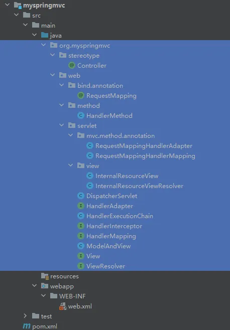
# 3.部分类和接口的完善
## 3.1@Controller注解
```
package org.myspringmvc.stereotype;

import java.lang.annotation.ElementType;
import java.lang.annotation.Retention;
import java.lang.annotation.RetentionPolicy;
import java.lang.annotation.Target;

/**
 * ClassName: Controller
 * Description: 用来标注处理器，被标注的处理器，纳入IoC容器的管理。该注解只允许出现在类上，另外可以被反射机制读取。
 * Datetime: 2024/4/2 9:01
 * Author: 老杜@动力节点
 * Version: 1.0
 */
@Target(ElementType.TYPE)
@Retention(RetentionPolicy.RUNTIME)
public @interface Controller {
}

```
## 3.2RequestMethod枚举（新建）
```
package org.myspringmvc.web.bind.annotation;

/**
 * ClassName: RequestMethod
 * Description: 请求方式枚举
 * Datetime: 2024/4/2 10:35
 * Author: 老杜@动力节点
 * Version: 1.0
 */
public enum RequestMethod {
    GET, POST
}

```
## 3.3@RequestMapping注解
```
package org.myspringmvc.web.bind.annotation;

import java.lang.annotation.ElementType;
import java.lang.annotation.Retention;
import java.lang.annotation.RetentionPolicy;
import java.lang.annotation.Target;

/**
 * ClassName: RequestMapping
 * Description: 用来标注处理器方法，允许标注方法和类，可以被反射机制读取。
 * Datetime: 2024/4/2 8:59
 * Author: 老杜@动力节点
 * Version: 1.0
 */
@Target({ElementType.TYPE, ElementType.METHOD})
@Retention(RetentionPolicy.RUNTIME)
public @interface RequestMapping {
    /**
     * 用来指定请求路径
     * @return
     */
    String[] value();

    /**
     * 用来指定请求方式
     * @return
     */
    RequestMethod method();
}

```
## 3.4HandlerMethod
```
package org.myspringmvc.web.method;

import java.lang.reflect.Method;

/**
 * ClassName: HandlerMethod
 * Description: 处理器方法
 * Datetime: 2024/4/2 8:53
 * Author: 老杜@动力节点
 * Version: 1.0
 */
public class HandlerMethod {
    /**
     * 处理器对象
     */
    private Object handler;
    /**
     * 要执行的方法
     */
    private Method method;

    public HandlerMethod() {
    }

    public HandlerMethod(Object handler, Method method) {
        this.handler = handler;
        this.method = method;
    }

    public Object getHandler() {
        return handler;
    }

    public void setHandler(Object handler) {
        this.handler = handler;
    }

    public Method getMethod() {
        return method;
    }

    public void setMethod(Method method) {
        this.method = method;
    }
}

```
## 3.5HandlerMapping接口
```
package org.myspringmvc.web.servlet;

import jakarta.servlet.http.HttpServletRequest;

/**
 * ClassName: HandlerMapping
 * Description: 主要是通过请求获取对应的处理器执行链。
 * Datetime: 2024/4/2 8:50
 * Author: 老杜@动力节点
 * Version: 1.0
 */
public interface HandlerMapping {
    /**
     * 根据请求获取处理器执行链。
     * @param request
     * @return
     * @throws Exception
     */
    HandlerExecutionChain getHandler(HttpServletRequest request) throws Exception;
}

```
## 3.6RequestMappingHandlerMapping
```
package org.myspringmvc.web.servlet.mvc.method.annotation;

import jakarta.servlet.http.HttpServletRequest;
import org.myspringmvc.web.servlet.HandlerExecutionChain;
import org.myspringmvc.web.servlet.HandlerMapping;

/**
 * ClassName: RequestMappingHandlerMapping
 * Description:
 * Datetime: 2024/4/2 9:44
 * Author: 老杜@动力节点
 * Version: 1.0
 */
public class RequestMappingHandlerMapping implements HandlerMapping {
    @Override
    public HandlerExecutionChain getHandler(HttpServletRequest request) throws Exception {
        return null;
    }
}

```
## 3.7HandlerAdapter接口
```
package org.myspringmvc.web.servlet;

import jakarta.servlet.http.HttpServletRequest;
import jakarta.servlet.http.HttpServletResponse;

/**
* ClassName: HandlerAdapter
* Description: 通过处理器适配器调用处理器方法
* Datetime: 2024/4/2 8:51
* Author: 老杜@动力节点
* Version: 1.0
*/
public interface HandlerAdapter {
    /**
                                 * 执行处理器方法
                                 * @param request
                                 * @param response
                                 * @param handler
                                 * @return
                                 * @throws Exception
                                 */
    ModelAndView handle(HttpServletRequest request, HttpServletResponse response, Object handler) throws Exception;
}

```
## 3.8RequestMappingHandlerAdapter
```
package org.myspringmvc.web.servlet.mvc.method.annotation;

import jakarta.servlet.http.HttpServletRequest;
import jakarta.servlet.http.HttpServletResponse;
import org.myspringmvc.web.servlet.HandlerAdapter;
import org.myspringmvc.web.servlet.ModelAndView;

/**
 * ClassName: RequestMappingHandlerAdapter
 * Description:
 * Datetime: 2024/4/2 9:44
 * Author: 老杜@动力节点
 * Version: 1.0
 */
public class RequestMappingHandlerAdapter implements HandlerAdapter {
    @Override
    public ModelAndView handle(HttpServletRequest request, HttpServletResponse response, Object handler) throws Exception {
        return null;
    }
}

```
## 3.9View接口
```
package org.myspringmvc.web.servlet;

import jakarta.servlet.http.HttpServletRequest;
import jakarta.servlet.http.HttpServletResponse;

import java.util.Map;

/**
 * ClassName: View
 * Description:
 * Datetime: 2024/4/2 8:58
 * Author: 老杜@动力节点
 * Version: 1.0
 */
public interface View {
    /**
     * 获取响应的内容类型
     * @return
     */
    String getContentType();

    /**
     * 渲染
     * @param model
     * @param request
     * @param response
     * @throws Exception
     */
    void render(Map<String, ?> model, HttpServletRequest request, HttpServletResponse response)
    throws Exception;
}

```
## 3.10InternalResourceView
```
package org.myspringmvc.web.servlet.view;

import jakarta.servlet.http.HttpServletRequest;
import jakarta.servlet.http.HttpServletResponse;
import org.myspringmvc.web.servlet.View;

import java.util.Map;

/**
 * ClassName: InternalResourceView
 * Description:
 * Datetime: 2024/4/2 10:17
 * Author: 老杜@动力节点
 * Version: 1.0
 */
public class InternalResourceView implements View {
    @Override
    public String getContentType() {
        return null;
    }

    @Override
    public void render(Map<String, ?> model, HttpServletRequest request, HttpServletResponse response) throws Exception {
    }
}

```
## 3.11ViewResolver接口
```
package org.myspringmvc.web.servlet;

import java.util.Locale;

/**
 * ClassName: ViewResolver
 * Description:解析逻辑视图名称，返回视图对象
 * Datetime: 2024/4/2 8:58
 * Author: 老杜@动力节点
 * Version: 1.0
 */
public interface ViewResolver {
    /**
     * 解析逻辑视图名称，返回视图对象
     * @param viewName
     * @param locale
     * @return
     * @throws Exception
     */
    View resolveViewName(String viewName, Locale locale) throws Exception;
}

```
## 3.12InternalResourceViewResolver
```
package org.myspringmvc.web.servlet.view;

import org.myspringmvc.web.servlet.View;
import org.myspringmvc.web.servlet.ViewResolver;

import java.util.Locale;

/**
 * ClassName: InternalResourceViewResolver
 * Description:
 * Datetime: 2024/4/2 9:45
 * Author: 老杜@动力节点
 * Version: 1.0
 */
public class InternalResourceViewResolver implements ViewResolver {
    @Override
    public View resolveViewName(String viewName, Locale locale) throws Exception {
        return null;
    }
}

```
## 3.13DispatcherServlet
```
package org.myspringmvc.web.servlet;

import jakarta.servlet.ServletException;
import jakarta.servlet.http.HttpServlet;
import jakarta.servlet.http.HttpServletRequest;
import jakarta.servlet.http.HttpServletResponse;

import java.io.IOException;

/**
 * ClassName: DispatcherServlet
 * Description:
 * Datetime: 2024/4/2 8:50
 * Author: 老杜@动力节点
 * Version: 1.0
 */
public class DispatcherServlet extends HttpServlet {
    @Override
    public void init() throws ServletException {

    }

    @Override
    protected void service(HttpServletRequest req, HttpServletResponse resp) throws ServletException, IOException {
        doDispatch(req, resp);
    }

    /**
     * 处理请求的核心方法
     * @param request
     * @param response
     * @throws ServletException
     * @throws IOException
     */
    private void doDispatch(HttpServletRequest request, HttpServletResponse response) throws ServletException, IOException {
    }
}

```
## 3.14HandlerExecutionChain
```
package org.myspringmvc.web.servlet;

import java.util.List;

/**
 * ClassName: HandlerExecutionChain
 * Description:
 * Datetime: 2024/4/2 8:55
 * Author: 老杜@动力节点
 * Version: 1.0
 */
public class HandlerExecutionChain {
    private Object handler;
    private List<HandlerInterceptor> interceptorList;
    private int interceptorIndex = -1;

    public HandlerExecutionChain() {
    }

    public HandlerExecutionChain(Object handler, List<HandlerInterceptor> interceptorList) {
        this.handler = handler;
        this.interceptorList = interceptorList;
    }

    public Object getHandler() {
        return handler;
    }

    public void setHandler(Object handler) {
        this.handler = handler;
    }

    public List<HandlerInterceptor> getInterceptorList() {
        return interceptorList;
    }

    public void setInterceptorList(List<HandlerInterceptor> interceptorList) {
        this.interceptorList = interceptorList;
    }

    public int getInterceptorIndex() {
        return interceptorIndex;
    }

    public void setInterceptorIndex(int interceptorIndex) {
        this.interceptorIndex = interceptorIndex;
    }
}

```
## 3.15HandlerInterceptor拦截器接口
```
package org.myspringmvc.web.servlet;

import jakarta.servlet.http.HttpServletRequest;
import jakarta.servlet.http.HttpServletResponse;

/**
 * ClassName: HandlerInterceptor
 * Description: 拦截器接口
 * Datetime: 2024/4/2 8:54
 * Author: 老杜@动力节点
 * Version: 1.0
 */
public interface HandlerInterceptor {
    default boolean preHandle(HttpServletRequest request, HttpServletResponse response, Object handler) throws Exception {
        return true;
    }

    default void postHandle(HttpServletRequest request, HttpServletResponse response, Object handler, 
                            ModelAndView modelAndView) throws Exception {
    }

    default void afterCompletion(HttpServletRequest request, HttpServletResponse response, Object handler, Exception ex) 
                            throws Exception {
    }
}

```
## 3.16ModelMap类（新建）
```
package org.myspringmvc.ui;

import java.util.LinkedHashMap;

/**
 * ClassName: ModelMap
 * Description: 将数据存储到域中。
 * Datetime: 2024/4/2 11:07
 * Author: 老杜@动力节点
 * Version: 1.0
 */
public class ModelMap extends LinkedHashMap<String, Object> {
    public ModelMap() {
    }

    public ModelMap addAttribute(String name, String value){
        this.put(name, value);
        return this;
    }
}

```
## 3.17ModelAndView
```
package org.myspringmvc.web.servlet;

import org.myspringmvc.ui.ModelMap;

/**
 * ClassName: ModelAndView
 * Description:
 * Datetime: 2024/4/2 8:57
 * Author: 老杜@动力节点
 * Version: 1.0
 */
public class ModelAndView {
    private Object view;
    private ModelMap model;

    public ModelAndView() {
    }

    public ModelAndView(Object view, ModelMap model) {
        this.view = view;
        this.model = model;
    }

    public Object getView() {
        return view;
    }

    public void setView(Object view) {
        this.view = view;
    }

    /**
     * 该方法待实现
     * @param viewName
     */
    public void setViewName(String viewName){
        // TODO
    }

    public ModelMap getModel() {
        return model;
    }

    public void setModel(ModelMap model) {
        this.model = model;
    }
}

```
# 4.webapp开发者写应用

## 4.1web.xml
```
<?xml version="1.0" encoding="UTF-8"?>
<web-app xmlns="https://jakarta.ee/xml/ns/jakartaee"
         xmlns:xsi="http://www.w3.org/2001/XMLSchema-instance"
         xsi:schemaLocation="https://jakarta.ee/xml/ns/jakartaee https://jakarta.ee/xml/ns/jakartaee/web-app_6_0.xsd"
         version="6.0">
    
    <!--配置前端控制器-->
    <servlet>
        <servlet-name>springmvc</servlet-name>
        <servlet-class>org.myspringmvc.web.servlet.DispatcherServlet</servlet-class>
        <init-param>
            <param-name>contextConfigLocation</param-name>
            <param-value>classpath:springmvc.xml</param-value>
        </init-param>
        <load-on-startup>1</load-on-startup>
    </servlet>
    <servlet-mapping>
        <servlet-name>springmvc</servlet-name>
        <url-pattern>/</url-pattern>
    </servlet-mapping>
    
</web-app>

DispatcherServlet的<init-param>的contextConfigLocation可以编写代码了：
@Override
public void init() throws ServletException {
ServletConfig servletConfig = this.getServletConfig();
String contextConfigLocation = servletConfig.getInitParameter(Constant.CONTEXT_CONFIG_LOCATION);
String springMvcXmlPath = getSpringMvcXmlPath(contextConfigLocation);
System.out.println("Spring MVC配置文件路径解析完成：" + springMvcXmlPath);
}

private String getSpringMvcXmlPath(String contextConfigLocation) throws UnsupportedEncodingException {
    if(contextConfigLocation.startsWith(Constant.CLASSPATH)){
        String path = contextConfigLocation.substring(Constant.CLASSPATH.length()).trim();
        String springMvcXmlPath = Thread.currentThread().getContextClassLoader().getResource(path).getPath();
        // 对路径解码，防止路径中有 % 等字符。
        return URLDecoder.decode(springMvcXmlPath, Charset.defaultCharset());
    }
    return null;
}

定义系统常量类：Constant
package org.myspringmvc.web.constant;

/**
 * ClassName: Constant
 * Description:SpringMVC系统常量类
 * Datetime: 2024/4/2 11:28
 * Author: 老杜@动力节点
 * Version: 1.0
 */
public class Constant {
    public static final String CONTEXT_CONFIG_LOCATION = "contextConfigLocation";
    public static final String CLASSPATH = "classpath:";
}

```
## 4.2编写处理器Controller
```
package com.powernode.springmvc.controller;

import org.myspringmvc.stereotype.Controller;
import org.myspringmvc.web.bind.annotation.RequestMapping;
import org.myspringmvc.web.bind.annotation.RequestMethod;

/**
 * ClassName: UserController
 * Description:
 * Datetime: 2024/4/2 11:38
 * Author: 老杜@动力节点
 * Version: 1.0
 */
@Controller
public class UserController {
    @RequestMapping(value = "/", method = RequestMethod.GET)
    public String index(){
        return "index";
    }
}

```
## 4.3编写拦截器
```
package com.powernode.springmvc.interceptors;

import jakarta.servlet.http.HttpServletRequest;
import jakarta.servlet.http.HttpServletResponse;
import org.myspringmvc.web.servlet.HandlerInterceptor;
import org.myspringmvc.web.servlet.ModelAndView;

/**
 * ClassName: Interceptor1
 * Description:
 * Datetime: 2024/4/2 11:40
 * Author: 老杜@动力节点
 * Version: 1.0
 */
public class Interceptor1 implements HandlerInterceptor {
    @Override
    public boolean preHandle(HttpServletRequest request, HttpServletResponse response, Object handler) throws Exception {
        System.out.println("Interceptor1's preHandle");
        return true;
    }

    @Override
    public void postHandle(HttpServletRequest request, HttpServletResponse response, Object handler, 
                           ModelAndView modelAndView) throws Exception {
        System.out.println("Interceptor1's postHandle");
    }

    @Override
    public void afterCompletion(HttpServletRequest request, HttpServletResponse response, Object handler, Exception ex) 
                            throws Exception {
        System.out.println("Interceptor1's afterCompletion");
    }
}

package com.powernode.springmvc.interceptors;

import jakarta.servlet.http.HttpServletRequest;
import jakarta.servlet.http.HttpServletResponse;
import org.myspringmvc.web.servlet.HandlerInterceptor;
import org.myspringmvc.web.servlet.ModelAndView;

/**
* ClassName: Interceptor2
* Description:
* Datetime: 2024/4/2 11:41
* Author: 老杜@动力节点
* Version: 1.0
*/
public class Interceptor2 implements HandlerInterceptor {
    @Override
    public boolean preHandle(HttpServletRequest request, HttpServletResponse response, Object handler) throws Exception {
        System.out.println("Interceptor2's preHandle");
        return true;
        }

    @Override
    public void postHandle(HttpServletRequest request, HttpServletResponse response, Object handler, 
                           ModelAndView modelAndView) throws Exception {
        System.out.println("Interceptor2's postHandle");
        }

    @Override
    public void afterCompletion(HttpServletRequest request, HttpServletResponse response, Object handler, Exception ex) 
                                        throws Exception {
        System.out.println("Interceptor2's afterCompletion");
        }
}

```
## 4.4springmvc.xml
```
<?xml version="1.0" encoding="UTF-8"?>
<beans>
    <!--组件扫描-->
    <component-scan base-package="com.powernode.springmvc.controller"/>
    <!--视图解析器-->
    <bean class="org.myspringmvc.web.servlet.view.InternalResourceViewResolver">
        <property name="prefix" value="/WEB-INF/jsp/"/>
        <property name="suffix" value=".jsp"/>
    </bean>
    <!--拦截器-->
    <interceptors>
        <bean class="com.powernode.springmvc.interceptors.Interceptor1"/>
        <bean class="com.powernode.springmvc.interceptors.Interceptor2"/>
    </interceptors>
</beans>

InternalResourceViewResolver类中添加属性：suffix和prefix
package org.myspringmvc.web.servlet.view;

import org.myspringmvc.web.servlet.View;
import org.myspringmvc.web.servlet.ViewResolver;

import java.util.Locale;

/**
 * ClassName: InternalResourceViewResolver
 * Description:
 * Datetime: 2024/4/2 9:45
 * Author: 老杜@动力节点
 * Version: 1.0
 */
public class InternalResourceViewResolver implements ViewResolver {
    private String suffix;
    private String prefix;

    public String getSuffix() {
        return suffix;
    }

    public void setSuffix(String suffix) {
        this.suffix = suffix;
    }

    public String getPrefix() {
        return prefix;
    }

    public void setPrefix(String prefix) {
        this.prefix = prefix;
    }

    @Override
    public View resolveViewName(String viewName, Locale locale) throws Exception {
        return null;
    }
}

```
## 4.5提供视图
```
<%@ page contentType="text/html;charset=UTF-8" language="java" %>
<html>
<head>
    <title>index jsp</title>
</head>
<body>
<h1>动力节点：手写Spring MVC框架</h1>
</body>
</html>
```
# 5.服务器启动阶段的处理
## 5.1分析服务器启动阶段都需要初始化什么
```
1. 初始化Spring容器
  a. 组件扫描包下的类纳入IoC容器的管理。
  b. 创建视图解析器对象
  c. 创建所有的拦截器对象
  d. 扫描这个包下所有的类：org.myspringmvc.web.servlet.mvc.method.annotation，全部实例化，纳入IoC容器管理
2. 初始化HandlerMapping
3. 初始化HandlerAdapter
4. 初始化ViewResolver
```
## 5.2 初始化Spring容器
```
Spring容器：ApplicationContext
Spring Web容器：WebApplicationContext
```
### 5.2.1组件扫描
```
添加解析xml文件的依赖
<!--dom4j-->
<dependency>
    <groupId>dom4j</groupId>
    <artifactId>dom4j</artifactId>
    <version>1.6.1</version>
</dependency>
<!--jaxen-->
<dependency>
    <groupId>jaxen</groupId>
    <artifactId>jaxen</artifactId>
    <version>1.1.6</version>
</dependency>

package org.myspringmvc.context;

import org.dom4j.Document;
import org.dom4j.Element;
import org.dom4j.io.SAXReader;

import java.io.File;
import java.lang.reflect.Constructor;
import java.net.URLDecoder;
import java.util.HashMap;
import java.util.Map;

/**
 * ClassName: ApplicationContext
 * Description: Spring容器，启动服务器时，初始化
 * Datetime: 2024/4/2 13:52
 * Author: 老杜@动力节点
 * Version: 1.0
 */
public class ApplicationContext {
    private Map<String, Object> beanMap = new HashMap<>();

    public ApplicationContext(String xmlPath) throws Exception {
        // 组件扫描
        SAXReader saxReader = new SAXReader();
        Document document = saxReader.read(new File(xmlPath));
        Element componentScanElement = (Element)document.selectSingleNode("/beans/context:component-scan");
        String basePackage = componentScanElement.attributeValue("base-package");
        System.out.println("组件扫描：" + basePackage);
        componentScan(basePackage);
        System.out.println("Spring Web容器当下状态：" + beanMap);
    }

    private void componentScan(String basePackage) throws Exception{
        String dirPath = Thread.currentThread().getContextClassLoader().getResource(basePackage.replace(".", "/")).getPath();
        File file = new File(URLDecoder.decode(dirPath));
        if(file.isDirectory()){
            File[] files = file.listFiles();
            for (File classFile : files){
                if(classFile.getName().endsWith(".class")){
                    String className = basePackage + "." + 
                                        classFile.getName().substring(0, classFile.getName().lastIndexOf("."));
                    Class<?> clazz = Class.forName(className);
                    Constructor<?> defaultCon = clazz.getDeclaredConstructor();
                    Object bean = defaultCon.newInstance();
                    beanMap.put(firstCharLowerCase(clazz.getSimpleName()), bean);
                }
            }
        }
    }

    private String firstCharLowerCase(String simpleName) {
        return simpleName.substring(0, 1).toLowerCase() + simpleName.substring(1);
    }

    public Object getBean(String beanName){
        return beanMap.get(beanName);
    }
}

package org.myspringmvc.context;

import jakarta.servlet.ServletContext;

/**
 * ClassName: WebApplicationContext
 * Description:
 * Datetime: 2024/4/2 14:24
 * Author: 老杜@动力节点
 * Version: 1.0
 */
public class WebApplicationContext extends ApplicationContext{

    private ServletContext servletContext;

    public WebApplicationContext(String xmlPath, ServletContext servletContext) throws Exception {
        super(xmlPath);
        this.servletContext = servletContext;
    }

    public ServletContext getServletContext() {
        return servletContext;
    }
}

在DispatcherServlet中添加如下代码：
```

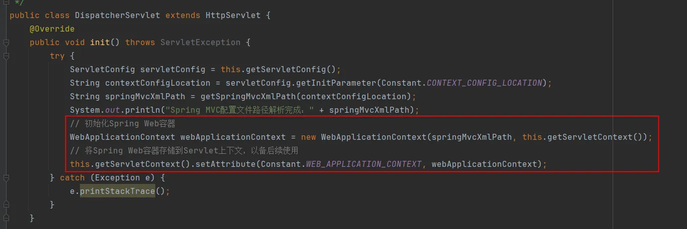

```
添加常量值：
```

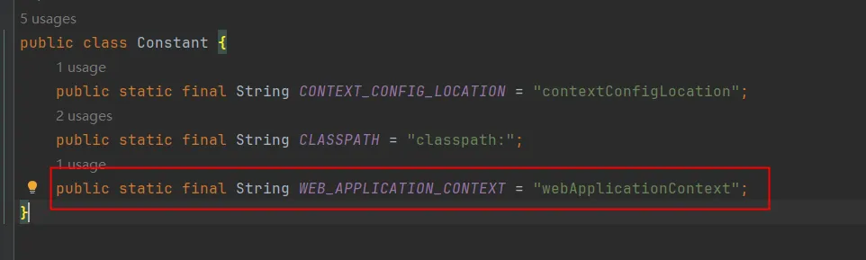

### 5.2.2创建视图解析器对象
```
InternalResourceViewResolver类代码改动，添加prefix和suffix属性：
package org.myspringmvc.web.servlet.view;

import org.myspringmvc.web.servlet.View;
import org.myspringmvc.web.servlet.ViewResolver;

import java.util.Locale;

/**
 * ClassName: InternalResourceViewResolver
 * Description:
 * Datetime: 2024/4/2 9:45
 * Author: 老杜@动力节点
 * Version: 1.0
 */
public class InternalResourceViewResolver implements ViewResolver {
    private String suffix;
    private String prefix;

    public String getSuffix() {
        return suffix;
    }

    public void setSuffix(String suffix) {
        this.suffix = suffix;
    }

    public String getPrefix() {
        return prefix;
    }

    public void setPrefix(String prefix) {
        this.prefix = prefix;
    }

    @Override
    public View resolveViewName(String viewName, Locale locale) throws Exception {
        return null;
    }
}

```

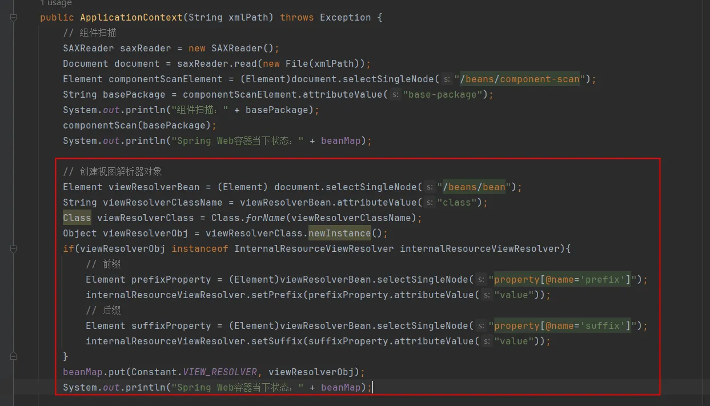

```
ApplicationContext构造方法中添加代码：
// 创建视图解析器对象
Element viewResolverBean = (Element) document.selectSingleNode("/beans/bean");
String viewResolverClassName = viewResolverBean.attributeValue("class");
Class viewResolverClass = Class.forName(viewResolverClassName);
Object viewResolverObj = viewResolverClass.newInstance();
if(viewResolverObj instanceof InternalResourceViewResolver internalResourceViewResolver){
    // 前缀
    Element prefixProperty = (Element)viewResolverBean.selectSingleNode("property[@name='prefix']");
    internalResourceViewResolver.setPrefix(prefixProperty.attributeValue("value"));
    // 后缀
    Element suffixProperty = (Element)viewResolverBean.selectSingleNode("property[@name='suffix']");
    internalResourceViewResolver.setSuffix(suffixProperty.attributeValue("value"));
}
beanMap.put(Constant.VIEW_RESOLVER, viewResolverObj);
System.out.println("Spring Web容器当下状态：" + beanMap);
```
### 5.2.3. 创建所有的拦截器对象

```
在ApplicationContext构造方法中继续添加如下代码：
```

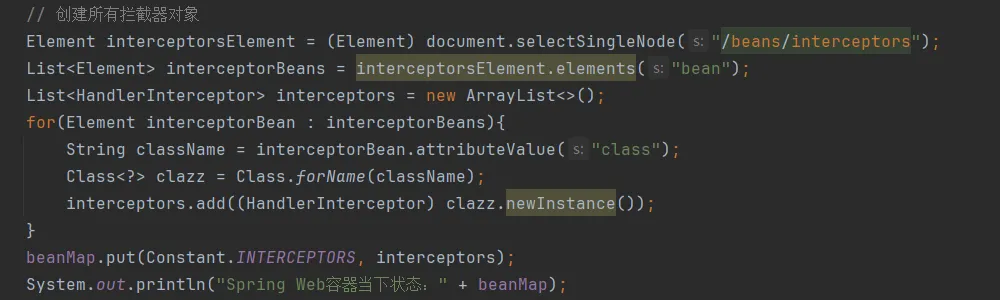

```
ApplicationContext构造方法中添加代码：
// 创建所有拦截器对象
Element interceptorsElement = (Element) document.selectSingleNode("/beans/interceptors");
List<Element> interceptorBeans = interceptorsElement.elements("bean");
List<HandlerInterceptor> interceptors = new ArrayList<>();
for(Element interceptorBean : interceptorBeans){
    String className = interceptorBean.attributeValue("class");
    Class<?> clazz = Class.forName(className);
    interceptors.add((HandlerInterceptor) clazz.newInstance());
}
beanMap.put(Constant.INTERCEPTORS, interceptors);
System.out.println("Spring Web容器当下状态：" + beanMap);
```
### 5.2.4初始化annotation包下所有类的实例

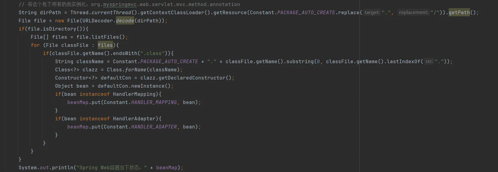

```
ApplicationContext构造方法中添加代码：
// 将这个包下所有的类实例化：org.myspringmvc.web.servlet.mvc.method.annotation
String dirPath = Thread.currentThread().getContextClassLoader()
                                                    .getResource(Constant.PACKAGE_AUTO_CREATE.replace(".", "/")).getPath();
File file = new File(URLDecoder.decode(dirPath));
if(file.isDirectory()){
    File[] files = file.listFiles();
    for (File classFile : files){
        if(classFile.getName().endsWith(".class")){
            String className = Constant.PACKAGE_AUTO_CREATE + "." + 
                                        classFile.getName().substring(0, classFile.getName().lastIndexOf("."));
            Class<?> clazz = Class.forName(className);
            Constructor<?> defaultCon = clazz.getDeclaredConstructor();
            Object bean = defaultCon.newInstance();
            if(bean instanceof HandlerMapping){
                beanMap.put(Constant.HANDLER_MAPPING, bean);
            }
            if(bean instanceof HandlerAdapter){
                beanMap.put(Constant.HANDLER_ADAPTER, bean);
            }
        }
    }
}
System.out.println("Spring Web容器当下状态：" + beanMap);
```
## 5.3初始化HandlerMapping
```
```


## 5.4 初始化HandlerAdapter

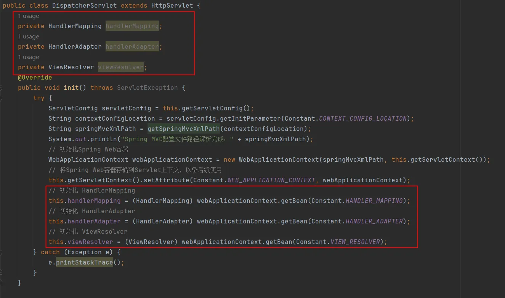

## 5.5初始化ViewResolver
```
```


# 6.根据请求流程补充代码
## 6.1根据请求获取处理器执行链
```
DispatcherServlet中doDispatch方法：
private void doDispatch(HttpServletRequest request, HttpServletResponse response) throws ServletException, IOException {
    try {
        // 根据请求获取处理器执行链
        HandlerExecutionChain mappedHandler = handlerMapping.getHandler(request);
        System.out.println(mappedHandler);
    } catch (Exception e) {
        e.printStackTrace();
    }
}

package org.myspringmvc.web.servlet.mvc.method.annotation;

import jakarta.servlet.http.HttpServletRequest;
import org.myspringmvc.context.WebApplicationContext;
import org.myspringmvc.web.constant.Constant;
import org.myspringmvc.web.method.HandlerMethod;
import org.myspringmvc.web.servlet.HandlerExecutionChain;
import org.myspringmvc.web.servlet.HandlerInterceptor;
import org.myspringmvc.web.servlet.HandlerMapping;
import org.myspringmvc.web.servlet.mvc.RequestMappingInfo;

import java.util.HashMap;
import java.util.List;
import java.util.Map;

/**
 * ClassName: RequestMappingHandlerMapping
 * Description:
 * Datetime: 2024/4/2 9:44
 * Author: 老杜@动力节点
 * Version: 1.0
 */
public class RequestMappingHandlerMapping implements HandlerMapping {

    private Map<RequestMappingInfo, HandlerMethod> map;

    public RequestMappingHandlerMapping(Map<RequestMappingInfo, HandlerMethod> map) {
        this.map = map;
    }

    @Override
    public HandlerExecutionChain g
    etHandler(HttpServletRequest request) throws Exception {
        RequestMappingInfo requestMappingInfo = new RequestMappingInfo(request.getServletPath(), request.getMethod());
        HandlerExecutionChain handlerExecutionChain = new HandlerExecutionChain();
        handlerExecutionChain.setHandler(map.get(requestMappingInfo));
        WebApplicationContext wac = (WebApplicationContext) request.getServletContext()
                                                                     .getAttribute(Constant.WEB_APPLICATION_CONTEXT);
        handlerExecutionChain.setInterceptorList((List<HandlerInterceptor>)wac.getBean(Constant.INTERCEPTORS));
        return handlerExecutionChain;
    }
}

ApplicationContext中以下方法改造：
private Map<RequestMappingInfo, HandlerMethod> componentScan(String basePackage) throws Exception{
    // 初始化HandlerMethod
    Map<RequestMappingInfo, HandlerMethod> handlerMethodMap = new HashMap<>();

    String dirPath = Thread.currentThread().getContextClassLoader().getResource(basePackage.replace(".", "/")).getPath();
    File file = new File(URLDecoder.decode(dirPath));
    if(file.isDirectory()){
        File[] files = file.listFiles();
        for (File classFile : files){
            if(classFile.getName().endsWith(".class")){
                String className = basePackage + "." + classFile.getName().substring(0, classFile.getName().lastIndexOf("."));
                Class<?> clazz = Class.forName(className);
                Constructor<?> defaultCon = clazz.getDeclaredConstructor();
                Object bean = defaultCon.newInstance();
                beanMap.put(firstCharLowerCase(clazz.getSimpleName()), bean);
                // 如果clazz被@Controller注解标注
                if(clazz.isAnnotationPresent(Controller.class)){
                    // 获取该类中所有的方法
                    Method[] methods = clazz.getDeclaredMethods();
                    for(Method method : methods){
                        if(method.isAnnotationPresent(RequestMapping.class)){
                            RequestMapping requestMapping = method.getAnnotation(RequestMapping.class);
                            // 创建RequestMappingInfo对象
                            RequestMappingInfo requestMappingInfo = new RequestMappingInfo();
                            requestMappingInfo.setRequestURI(requestMapping.value()[0]);
                            requestMappingInfo.setRequestMethod(requestMapping.method().toString());
                            // 创建HandlerMethod对象
                            HandlerMethod handlerMethod = new HandlerMethod();
                            handlerMethod.setMethod(method);
                            handlerMethod.setHandler(bean);

                            handlerMethodMap.put(requestMappingInfo, handlerMethod);
                        }
                    }
                }
            }
        }
    }
    return handlerMethodMap;
}

ApplicationContext代码还有以下改造：
```

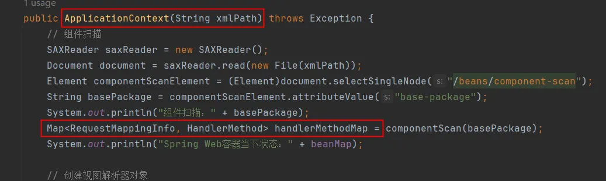

```
添加一个新的类：RequestMappingInfo
package org.myspringmvc.web.servlet.mvc;

import java.util.Objects;

/**
 * ClassName: RequestMappingInfo
 * Description:
 * Datetime: 2024/4/2 17:58
 * Author: 老杜@动力节点
 * Version: 1.0
 */
public class RequestMappingInfo {
    private String requestURI;
    private String requestMethod;

    public RequestMappingInfo() {
    }

    public RequestMappingInfo(String requestURI, String requestMethod) {
        this.requestURI = requestURI;
        this.requestMethod = requestMethod;
    }

    public String getRequestURI() {
        return requestURI;
    }

    public void setRequestURI(String requestURI) {
        this.requestURI = requestURI;
    }

    public String getRequestMethod() {
        return requestMethod;
    }

    public void setRequestMethod(String requestMethod) {
        this.requestMethod = requestMethod;
    }


    @Override
    public boolean equals(Object o) {
        if (this == o) return true;
        if (o == null || getClass() != o.getClass()) return false;
        RequestMappingInfo that = (RequestMappingInfo) o;
        return Objects.equals(requestURI, that.requestURI) && Objects.equals(requestMethod, that.requestMethod);
    }

    @Override
    public int hashCode() {
        return Objects.hash(requestURI, requestMethod);
    }

    @Override
    public String toString() {
        return "RequestMappingInfo{" +
        "requestURI='" + requestURI + '\'' +
        ", requestMethod='" + requestMethod + '\'' +
        '}';
    }
}

```
## 6.2执行拦截器的preHandle
```
添加以下代码：
```

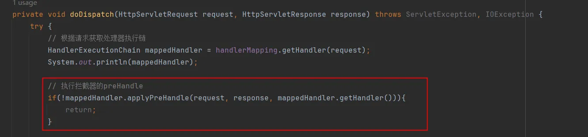

```
HandlerExecutionChain添加以下代码：
public boolean applyPreHandle(HttpServletRequest request, HttpServletResponse response, Object handler) throws Exception {
    for (int i = 0; i < interceptorList.size(); i++) {
        HandlerInterceptor handlerInterceptor = interceptorList.get(i);
        boolean result = handlerInterceptor.preHandle(request, response, handler);
        if(!result){
            return false;
        }
        interceptorIndex = i;
    }
    return true;
}
```
## 6.3执行处理器方法
```
DispatcherServlet中的doDispatch方法：
```

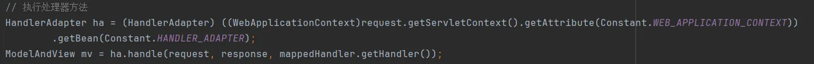

```
先让handle方法返回一个固定的ModelAndView，后期在详细编写 handle 方法：
```

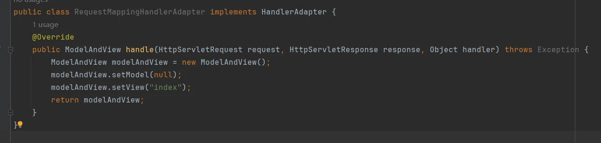
## 6.4执行拦截器的postHandle
```
DispatcherServlet的doDispatch方法中：
```
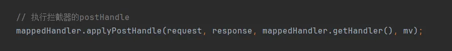
```
HandlerExecutionChain的方法：
```
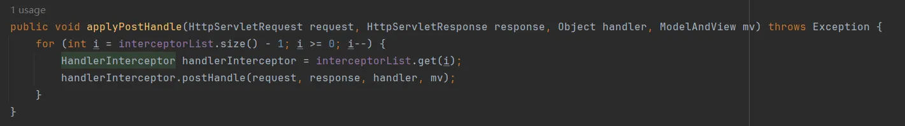

## 6.5处理响应
```
在DispatcherServlet的 doDispatch方法中：
```

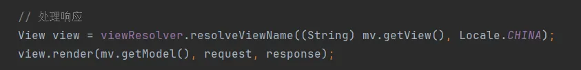
```
package org.myspringmvc.web.servlet.view;

import org.myspringmvc.web.servlet.View;
import org.myspringmvc.web.servlet.ViewResolver;

import java.util.Locale;

/**
 * ClassName: InternalResourceViewResolver
 * Description:
 * Datetime: 2024/4/2 9:45
 * Author: 老杜@动力节点
 * Version: 1.0
 */
public class InternalResourceViewResolver implements ViewResolver {
    private String suffix;
    private String prefix;

    public String getSuffix() {
        return suffix;
    }

    public void setSuffix(String suffix) {
        this.suffix = suffix;
    }

    public String getPrefix() {
        return prefix;
    }

    public void setPrefix(String prefix) {
        this.prefix = prefix;
    }

    @Override
    public View resolveViewName(String viewName, Locale locale) throws Exception {
        return new InternalResourceView("text/html;charset=UTF-8", prefix + viewName + suffix);
    }
}

package org.myspringmvc.web.servlet.view;

import jakarta.servlet.http.HttpServletRequest;
import jakarta.servlet.http.HttpServletResponse;
import org.myspringmvc.web.servlet.View;

import java.util.Map;

/**
 * ClassName: InternalResourceView
 * Description:
 * Datetime: 2024/4/2 10:17
 * Author: 老杜@动力节点
 * Version: 1.0
 */
public class InternalResourceView implements View {

    private String contentType;
    private String path;

    public InternalResourceView(String contentType, String path) {
        this.contentType = contentType;
        this.path = path;
    }

    public String getPath() {
        return path;
    }

    public void setPath(String path) {
        this.path = path;
    }

    public void setContentType(String contentType) {
        this.contentType = contentType;
    }

    @Override
    public String getContentType() {
        return contentType;
    }

    @Override
    public void render(Map<String, ?> model, HttpServletRequest request, HttpServletResponse response) throws Exception {
        // 设置响应内容类型
        response.setContentType(getContentType());
        // 向request域中绑定数据
        if(model != null){
            model.forEach(request::setAttribute);    
        }
        // 转发
        request.getRequestDispatcher(path).forward(request, response);
    }
}

```
## 6.6执行拦截器的afterCompletion
```
在DispatcherServlet类的doDispatch方法中：
```
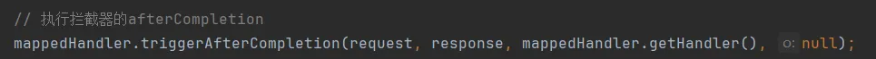

```
在HandlerExecutionChain中：
```
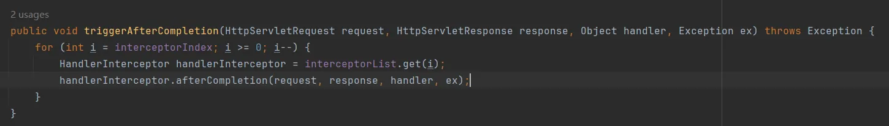

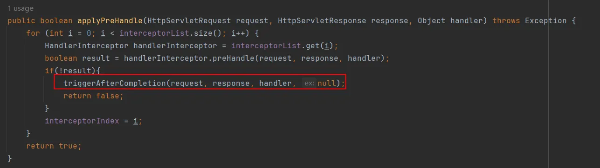
## 6.7初步测试

# 7.调用处理器方法
## 7.0新增注解定义
```
在调用处理器方法时需要通过反射获取方法的参数信息，因此需要新增两个注解：
@RequestParam 用于标注普通请求参数
@PathVariable 用于标注路径变量

1. @RequestParam注解：
package org.myspringmvc.web.bind.annotation;

import java.lang.annotation.ElementType;
import java.lang.annotation.Retention;
import java.lang.annotation.RetentionPolicy;
import java.lang.annotation.Target;

/**
 * 标注方法参数来源于请求参数
 */
@Target(ElementType.PARAMETER)
@Retention(RetentionPolicy.RUNTIME)
public @interface RequestParam {
    String value() default "";
}

2. @PathVariable注解：
package org.myspringmvc.web.bind.annotation;

import java.lang.annotation.ElementType;
import java.lang.annotation.Retention;
import java.lang.annotation.RetentionPolicy;
import java.lang.annotation.Target;

/**
 * 标注方法参数来源于路径变量
 * 例如：/user/{id} 中的 {id}
 */
@Target(ElementType.PARAMETER)
@Retention(RetentionPolicy.RUNTIME)
public @interface PathVariable {
    String value() default "";
}
```
## 7.1参数解析器设计
```
在调用处理器方法之前，需要将HTTP请求中的参数解析为Java方法的参数。
SpringMVC中大量使用了策略模式，每种参数类型对应一种解析器。
这里我们实现一个简化版的参数解析系统，支持@RequestParam、@PathVariable、HttpServletRequest和基础类型参数。

首先定义参数解析器接口：
package org.myspringmvc.web.method.support;

import jakarta.servlet.http.HttpServletRequest;
import jakarta.servlet.http.HttpServletResponse;

/**
 * 方法参数解析器接口
 */
public interface HandlerMethodArgumentResolver {

    /**
     * 判断当前解析器是否支持该参数类型
     */
    boolean supportsParameter(MethodParameter parameter);

    /**
     * 解析参数，从request中获取对应的值
     */
    Object resolveArgument(MethodParameter parameter, HttpServletRequest request, HttpServletResponse response) throws Exception;
}

MethodParameter用于封装方法参数的元数据：
package org.myspringmvc.web.method.support;

import java.lang.annotation.Annotation;
import java.lang.reflect.Method;
import java.lang.reflect.Parameter;

/**
 * 封装方法参数的元数据
 */
public class MethodParameter {

    private Method method;
    private Parameter parameter;
    private Class<?> parameterType;
    private int parameterIndex;
    private Annotation[] annotations;

    public MethodParameter(Method method, int index) {
        this.method = method;
        this.parameter = method.getParameters()[index];
        this.parameterType = method.getParameterTypes()[index];
        this.parameterIndex = index;
        this.annotations = method.getParameterAnnotations()[index];
    }

    public Method getMethod() { return method; }
    public Parameter getParameter() { return parameter; }
    public Class<?> getParameterType() { return parameterType; }
    public int getParameterIndex() { return parameterIndex; }
    public Annotation[] getAnnotations() { return annotations; }
    public String getParameterName() { return parameter.getName(); }

    @SuppressWarnings("unchecked")
    public <T extends Annotation> T getAnnotation(Class<T> annotationClass) {
        for (Annotation annotation : annotations) {
            if (annotation.annotationType().equals(annotationClass)) {
                return (T) annotation;
            }
        }
        return null;
    }
}
```
## 7.2实现各种参数解析器
```
1. HttpServletRequest参数解析器（直接将原生的request对象注入）：
package org.myspringmvc.web.method.support;

import jakarta.servlet.http.HttpServletRequest;
import jakarta.servlet.http.HttpServletResponse;

public class HttpServletRequestArgumentResolver implements HandlerMethodArgumentResolver {
    @Override
    public boolean supportsParameter(MethodParameter parameter) {
        return parameter.getParameterType().equals(HttpServletRequest.class);
    }

    @Override
    public Object resolveArgument(MethodParameter parameter, HttpServletRequest request, HttpServletResponse response) {
        return request;
    }
}

2. HttpServletResponse参数解析器：
package org.myspringmvc.web.method.support;

import jakarta.servlet.http.HttpServletRequest;
import jakarta.servlet.http.HttpServletResponse;

public class HttpServletResponseArgumentResolver implements HandlerMethodArgumentResolver {
    @Override
    public boolean supportsParameter(MethodParameter parameter) {
        return parameter.getParameterType().equals(HttpServletResponse.class);
    }

    @Override
    public Object resolveArgument(MethodParameter parameter, HttpServletRequest request, HttpServletResponse response) {
        return response;
    }
}

3. @RequestParam参数解析器：
package org.myspringmvc.web.method.support;

import jakarta.servlet.http.HttpServletRequest;
import jakarta.servlet.http.HttpServletResponse;
import org.myspringmvc.web.annotation.RequestParam;

public class RequestParamArgumentResolver implements HandlerMethodArgumentResolver {
    @Override
    public boolean supportsParameter(MethodParameter parameter) {
        return parameter.getAnnotation(RequestParam.class) != null;
    }

    @Override
    public Object resolveArgument(MethodParameter parameter, HttpServletRequest request, HttpServletResponse response) {
        RequestParam requestParam = parameter.getAnnotation(RequestParam.class);
        String paramName = requestParam.value();
        // 如果value为空，使用参数名
        if (paramName == null || paramName.isEmpty()) {
            paramName = parameter.getParameterName();
        }
        String paramValue = request.getParameter(paramName);

        // 类型转换
        Class<?> paramType = parameter.getParameterType();
        if (paramType == String.class) {
            return paramValue;
        } else if (paramType == Integer.class || paramType == int.class) {
            return paramValue != null ? Integer.parseInt(paramValue) : null;
        } else if (paramType == Long.class || paramType == long.class) {
            return paramValue != null ? Long.parseLong(paramValue) : null;
        } else if (paramType == Double.class || paramType == double.class) {
            return paramValue != null ? Double.parseDouble(paramValue) : null;
        } else if (paramType == Boolean.class || paramType == boolean.class) {
            return paramValue != null ? Boolean.parseBoolean(paramValue) : null;
        }
        return paramValue;
    }
}

4. @PathVariable参数解析器（需要配合URL路径解析）：
package org.myspringmvc.web.method.support;

import jakarta.servlet.http.HttpServletRequest;
import jakarta.servlet.http.HttpServletResponse;
import org.myspringmvc.web.annotation.PathVariable;

import java.util.Map;

public class PathVariableArgumentResolver implements HandlerMethodArgumentResolver {
    @Override
    public boolean supportsParameter(MethodParameter parameter) {
        return parameter.getAnnotation(PathVariable.class) != null;
    }

    @Override
    public Object resolveArgument(MethodParameter parameter, HttpServletRequest request, HttpServletResponse response) {
        @SuppressWarnings("unchecked")
        Map<String, String> pathVariableMap = (Map<String, String>) request.getAttribute("org.myspringmvc.pathVariables");
        if (pathVariableMap == null) {
            return null;
        }
        // 从映射中获取路径变量的值
        String pathVariableValue = pathVariableMap.get(parameter.getParameterName());

        // 类型转换
        Class<?> paramType = parameter.getParameterType();
        if (paramType == Integer.class || paramType == int.class) {
            return pathVariableValue != null ? Integer.parseInt(pathVariableValue) : null;
        } else if (paramType == Long.class || paramType == long.class) {
            return pathVariableValue != null ? Long.parseLong(pathVariableValue) : null;
        }
        return pathVariableValue;
    }
}
```
## 7.3编写参数解析器组合器
```
将所有参数解析器组合在一起，按顺序尝试解析：

package org.myspringmvc.web.method.support;

import jakarta.servlet.http.HttpServletRequest;
import jakarta.servlet.http.HttpServletResponse;

import java.util.ArrayList;
import java.util.List;

/**
 * 将多个参数解析器组合使用
 */
public class HandlerMethodArgumentResolverComposite implements HandlerMethodArgumentResolver {

    private final List<HandlerMethodArgumentResolver> resolvers = new ArrayList<>();

    public HandlerMethodArgumentResolverComposite() {
        // 注册各种参数解析器，顺序很重要
        resolvers.add(new HttpServletRequestArgumentResolver());
        resolvers.add(new HttpServletResponseArgumentResolver());
        resolvers.add(new RequestParamArgumentResolver());
        resolvers.add(new PathVariableArgumentResolver());
    }

    @Override
    public boolean supportsParameter(MethodParameter parameter) {
        // 只要有一个解析器支持即可
        return getArgumentResolver(parameter) != null;
    }

    @Override
    public Object resolveArgument(MethodParameter parameter, HttpServletRequest request, HttpServletResponse response) throws Exception {
        HandlerMethodArgumentResolver resolver = getArgumentResolver(parameter);
        if (resolver == null) {
            return null;
        }
        return resolver.resolveArgument(parameter, request, response);
    }

    /**
     * 找到第一个支持该参数类型的解析器
     */
    private HandlerMethodArgumentResolver getArgumentResolver(MethodParameter parameter) {
        for (HandlerMethodArgumentResolver resolver : resolvers) {
            if (resolver.supportsParameter(parameter)) {
                return resolver;
            }
        }
        return null;
    }
}
```
## 7.4完善请求路径匹配（支持@PathVariable）
```
在第六章中，HandlerMapping.getHandler是将请求URI和RequestMappingInfo中的requestURI直接equals比较的。
但RESTful风格的路径包含变量（如 /user/{id}），不能直接equals比较。
因此需要在RequestMappingHandlerMapping.getHandler方法中增加路径模式匹配逻辑。

在RequestMappingHandlerMapping中添加路径模式匹配方法（新建PathMatcher工具类）：
package org.myspringmvc.web.util;

import java.util.ArrayList;
import java.util.HashMap;
import java.util.List;
import java.util.Map;
import java.util.regex.Matcher;
import java.util.regex.Pattern;

/**
 * 路径匹配工具类
 * 将 /user/{id} 转换为正则表达式 /user/([^/]+)
 * 然后和实际请求路径进行匹配
 */
public class PathMatcher {

    /**
     * 将带有{...}的路径模式转换为正则表达式
     * 例如：/user/{id} -> /user/(?<id>[^/]+)
     */
    public static String toRegex(String pattern) {
        return pattern.replaceAll("\\{(\\w+)\\}", "(?<$1>[^/]+)");
    }

    /**
     * 判断请求路径是否匹配路径模式，并提取路径变量
     * @param pattern 路径模式，如 /user/{id}
     * @param requestPath 实际请求路径，如 /user/123
     * @return 路径变量映射，如果不匹配返回null
     */
    public static Map<String, String> match(String pattern, String requestPath) {
        String regex = toRegex(pattern);
        Pattern p = Pattern.compile(regex);
        Matcher m = p.matcher(requestPath);
        if (m.matches()) {
            Map<String, String> result = new HashMap<>();
            // 提取路径变量名
            List<String> varNames = extractVariableNames(pattern);
            for (int i = 0; i < varNames.size(); i++) {
                result.put(varNames.get(i), m.group(varNames.get(i)));
            }
            return result;
        }
        return null;
    }

    /**
     * 提取模式中的变量名列表
     */
    private static List<String> extractVariableNames(String pattern) {
        List<String> names = new ArrayList<>();
        Pattern varPattern = Pattern.compile("\\{(\\w+)\\}");
        Matcher m = varPattern.matcher(pattern);
        while (m.find()) {
            names.add(m.group(1));
        }
        return names;
    }
}

然后修改RequestMappingHandlerMapping中的getHandler方法，支持路径模式匹配：
```
## 7.5完善HandlerAdapter.handle方法
```
现在可以完成RequestMappingHandlerAdapter.handle方法的完整实现了：

package org.myspringmvc.web.servlet;

import jakarta.servlet.http.HttpServletRequest;
import jakarta.servlet.http.HttpServletResponse;
import org.myspringmvc.web.method.HandlerMethod;
import org.myspringmvc.web.method.support.HandlerMethodArgumentResolverComposite;
import org.myspringmvc.web.method.support.MethodParameter;

import java.util.Map;

/**
 * RequestMapping处理器适配器
 * 负责调用实际的处理器方法（通过反射）
 */
public class RequestMappingHandlerAdapter implements HandlerAdapter {

    private HandlerMethodArgumentResolverComposite argumentResolverComposite;

    public RequestMappingHandlerAdapter() {
        this.argumentResolverComposite = new HandlerMethodArgumentResolverComposite();
    }

    @Override
    public boolean supports(Object handler) {
        return handler instanceof HandlerMethod;
    }

    @Override
    public ModelAndView handle(HttpServletRequest request, HttpServletResponse response, Object handler) throws Exception {
        HandlerMethod handlerMethod = (HandlerMethod) handler;

        // 1. 获取目标方法
        java.lang.reflect.Method method = handlerMethod.getMethod();

        // 2. 获取方法的所有参数
        java.lang.reflect.Parameter[] parameters = method.getParameters();

        // 3. 准备实际参数数组
        Object[] args = new Object[parameters.length];

        // 4. 逐个解析参数
        for (int i = 0; i < parameters.length; i++) {
            MethodParameter methodParameter = new MethodParameter(method, i);
            if (argumentResolverComposite.supportsParameter(methodParameter)) {
                args[i] = argumentResolverComposite.resolveArgument(methodParameter, request, response);
            } else {
                // 不支持的类型，传null
                args[i] = null;
            }
        }

        // 5. 通过反射调用目标方法
        Object result = method.invoke(handlerMethod.getController(), args);

        // 6. 处理返回值
        if (result == null) {
            return null;
        }

        if (result instanceof ModelAndView) {
            return (ModelAndView) result;
        }

        if (result instanceof String) {
            // 将String类型的返回值包装成ModelAndView
            ModelAndView mv = new ModelAndView();
            mv.setViewName((String) result);
            return mv;
        }

        // 其他返回值类型，放入Model中
        ModelAndView mv = new ModelAndView();
        mv.getModel().put("result", result);
        return mv;
    }
}
```
## 7.6完善DispatcherServlet.doDispatch方法（整合路径变量）
```
在doDispatch方法中，通过getHandler获取HandlerMethod之后，
需要将路径变量保存到request属性中，供PathVariable参数解析器使用。

在DispatcherServlet的doDispatch方法中，getHandler返回后添加：

// 将路径变量存入request属性
String requestURI = request.getRequestURI();
String contextPath = request.getContextPath();
String path = requestURI.substring(contextPath.length());

// 遍历所有HandlerMapping中的映射，找到匹配的路径变量
for (Map.Entry<RequestMappingInfo, HandlerMethod> entry : handlerMappingMap.entrySet()) {
    RequestMappingInfo info = entry.getKey();
    Map<String, String> pathVariables = PathMatcher.match(info.getRequestURI(), path);
    if (pathVariables != null) {
        request.setAttribute("org.myspringmvc.pathVariables", pathVariables);
        break;
    }
}

这样，当Controller方法中使用@PathVariable获取路径变量时，
PathVariableArgumentResolver就能从request属性中拿到对应的值。
```
## 7.7测试验证
```
创建一个测试Controller，验证参数解析和方法调用：

package com.powernode.myspringmvc.controller;

import org.myspringmvc.web.annotation.Controller;
import org.myspringmvc.web.annotation.RequestMapping;
import org.myspringmvc.web.annotation.RequestMethod;
import org.myspringmvc.web.annotation.RequestParam;
import org.myspringmvc.web.annotation.PathVariable;
import org.myspringmvc.web.servlet.ModelAndView;

import jakarta.servlet.http.HttpServletRequest;

@Controller
public class TestController {

    @RequestMapping(value = "/test/hello", method = RequestMethod.GET)
    public String hello(@RequestParam("name") String name, HttpServletRequest request) {
        System.out.println("请求参数 name = " + name);
        System.out.println("请求URI = " + request.getRequestURI());
        return "hello";  // 逻辑视图名，由ViewResolver解析
    }

    @RequestMapping(value = "/test/user/{id}", method = RequestMethod.GET)
    public ModelAndView getUser(@PathVariable("id") Integer id) {
        System.out.println("查询用户，id = " + id);
        ModelAndView mv = new ModelAndView();
        mv.setViewName("user_detail");
        mv.addObject("userId", id);
        mv.addObject("userName", "张三");
        return mv;
    }

    @RequestMapping(value = "/test/add", method = RequestMethod.POST)
    public String addUser(@RequestParam("username") String username,
                          @RequestParam("age") Integer age) {
        System.out.println("添加用户: " + username + ", 年龄: " + age);
        return "ok";
    }
}

启动Tomcat，浏览器访问：
GET http://localhost:8080/myspringmvc/test/hello?name=杜老师
控制台输出：请求参数 name = 杜老师

GET http://localhost:8080/myspringmvc/test/user/123
控制台输出：查询用户，id = 123
视图页面展示userId=123, userName=张三

至此，手写SpringMVC框架的处理器方法调用部分已完成。
从请求映射 -> 拦截器 -> 参数解析 -> 反射调用 -> 视图渲染，形成了一个完整的请求处理链路。
```