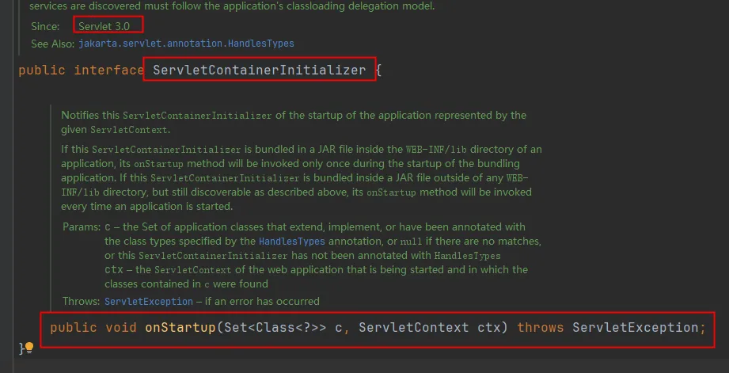
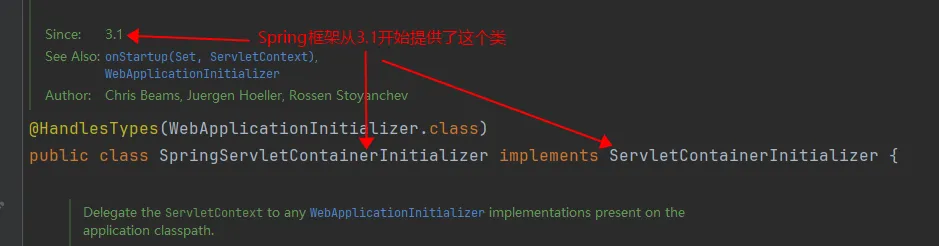
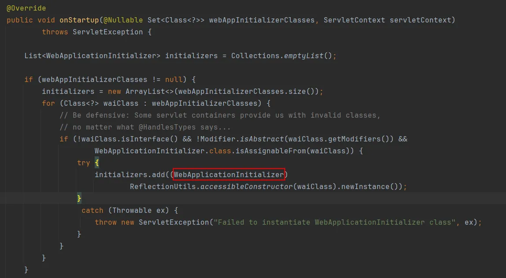
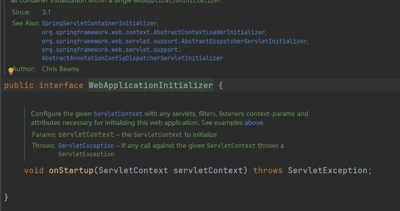
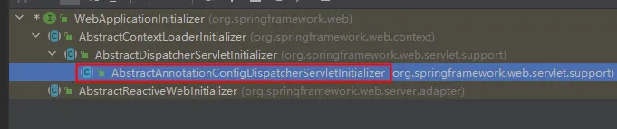
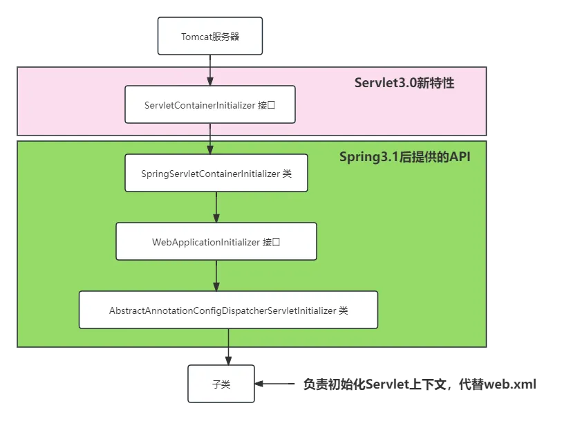

# 1.web.xml文件的替代
## 1.1Servlet3.0新特性
```
Servlet3.0新特性：web.xml文件可以不写了
在Servlet3.0的时候，规范中提供了一个接口：
```


```
服务器在启动的时候会自动从容器中找 ServletContainerInitializer接口的实现类，自动调用它的onStartup方法来完成Servlet上下文的初始化。
在Spring3.1版本的时候，提供了这样一个类，实现以上的接口：
```



```
它的核心方法如下：
```



```
可以看到在服务器启动的时候，它会去加载所有实现WebApplicationInitializer接口的类：
```



```
这个接口下有一个子类是我们需要的：AbstractAnnotationConfigDispatcherServletInitializer
```



```
当我们编写类继承AbstractAnnotationConfigDispatcherServletInitializer之后，web服务器在启动的时候会根据它来初始化Servlet上下文。
```


## 1.2编写WebAppInitializer
```
以下这个类就是用来代替web.xml文件的：
package com.powernode.springmvc.config;

import jakarta.servlet.Filter;
import org.springframework.web.filter.CharacterEncodingFilter;
import org.springframework.web.filter.HiddenHttpMethodFilter;
import org.springframework.web.servlet.support.AbstractAnnotationConfigDispatcherServletInitializer;

/**
 * ClassName: WebAppInitializer
 * Description:
 * Datetime: 2024/3/29 16:50
 * Author: 老杜@动力节点
 * Version: 1.0
 */
public class WebAppInitializer extends AbstractAnnotationConfigDispatcherServletInitializer {
    /**
     * Spring的配置
     * @return
     */
    @Override
    protected Class<?>[] getRootConfigClasses() {
        return new Class[]{SpringConfig.class};
    }

    /**
     * SpringMVC的配置
     * @return
     */
    @Override
    protected Class<?>[] getServletConfigClasses() {
        return new Class[]{SpringMVCConfig.class};
    }

    /**
     * 用于配置 DispatcherServlet 的映射路径
     * @return
     */
    @Override
    protected String[] getServletMappings() {
        return new String[]{"/"};
    }

    /**
     * 配置过滤器
     * @return
     */
    @Override
    protected Filter[] getServletFilters() {
        CharacterEncodingFilter characterEncodingFilter = new CharacterEncodingFilter();
        characterEncodingFilter.setEncoding("UTF-8");
        characterEncodingFilter.setForceRequestEncoding(true);
        characterEncodingFilter.setForceResponseEncoding(true);
        HiddenHttpMethodFilter hiddenHttpMethodFilter = new HiddenHttpMethodFilter();
        return new Filter[]{characterEncodingFilter, hiddenHttpMethodFilter};
    }
}

Spring配置如下：
package com.powernode.springmvc.config;

import org.springframework.context.annotation.Configuration;

/**
 * ClassName: SpringConfig
 * Description:
 * Datetime: 2024/3/29 17:03
 * Author: 老杜@动力节点
 * Version: 1.0
 */
@Configuration // 使用该注解指定这是一个配置类
public class SpringConfig {
}

SpringMVC配置如下：
package com.powernode.springmvc.config;

import org.springframework.context.annotation.Configuration;

/**
 * ClassName: SpringMVCConfig
 * Description:
 * Datetime: 2024/3/29 17:03
 * Author: 老杜@动力节点
 * Version: 1.0
 */
@Configuration
public class SpringMVCConfig implements WebMvcConfigurer{
}

```
# 2.Spring MVC的配置
## 2.1组件扫描
```
// 指定该类是一个配置类，可以当配置文件使用
@Configuration
// 开启组件扫描
@ComponentScan("com.powernode.springmvc.controller")
public class SpringMVCConfig {
}
```
## 2.2开启注解驱动（@EnableWebMvc）
```
// 指定该类是一个配置类，可以当配置文件使用
@Configuration
// 开启组件扫描
@ComponentScan("com.powernode.springmvc.controller")
// 开启注解驱动
@EnableWebMvc
public class SpringMVCConfig {
}
```
## 2.3视图解析器
```
// 指定该类是一个配置类，可以当配置文件使用
@Configuration
// 开启组件扫描
@ComponentScan("com.powernode.springmvc.controller")
// 开启注解驱动
@EnableWebMvc
public class SpringMVCConfig {

    @Bean
    public ThymeleafViewResolver getViewResolver(SpringTemplateEngine springTemplateEngine) {
        ThymeleafViewResolver resolver = new ThymeleafViewResolver();
        resolver.setTemplateEngine(springTemplateEngine);
        resolver.setCharacterEncoding("UTF-8");
        resolver.setOrder(1);
        return resolver;
    }

    @Bean
    public SpringTemplateEngine templateEngine(ITemplateResolver iTemplateResolver) {
        SpringTemplateEngine templateEngine = new SpringTemplateEngine();
        templateEngine.setTemplateResolver(iTemplateResolver);
        return templateEngine;
    }

    @Bean
    public ITemplateResolver templateResolver(ApplicationContext applicationContext) {
        SpringResourceTemplateResolver resolver = new SpringResourceTemplateResolver();
        resolver.setApplicationContext(applicationContext);
        resolver.setPrefix("/WEB-INF/thymeleaf/");
        resolver.setSuffix(".html");
        resolver.setTemplateMode(TemplateMode.HTML);
        resolver.setCharacterEncoding("UTF-8");
        resolver.setCacheable(false);//开发时关闭缓存，改动即可生效
        return resolver;
    }
}
```
## 2.4开启默认Servlet处理
```
让SpringMVCConfig类实现这个接口：WebMvcConfigurer
并且重写以下的方法：
@Override
public void configureDefaultServletHandling(DefaultServletHandlerConfigurer configurer) {
    configurer.enable();
}
```
## 2.5view-controller
```
重写以下方法
@Override
public void addViewControllers(ViewControllerRegistry registry) {
    registry.addViewController("/test").setViewName("test");
}
```
## 2.6异常处理器
```
重写以下方法：
@Override
public void configureHandlerExceptionResolvers(List<HandlerExceptionResolver> resolvers) {
    SimpleMappingExceptionResolver resolver = new SimpleMappingExceptionResolver();
    Properties prop = new Properties();
    prop.setProperty("java.lang.Exception", "tip");
    resolver.setExceptionMappings(prop);
    resolver.setExceptionAttribute("yiChang");
    resolvers.add(resolver);
}
```
## 2.7拦截器
```
重写以下方法：
@Override
public void addInterceptors(InterceptorRegistry registry) {
    MyInterceptor myInterceptor = new MyInterceptor();
    registry.addInterceptor(myInterceptor).addPathPatterns("/**").excludePathPatterns("/test");
}
```

# 3.根容器与Servlet容器架构详解
```
在SpringMVC项目中存在两层IoC容器（也叫父子容器）：

┌────────────────────────────────────────┐
│          Root ApplicationContext       │
│          （根容器 / 父容器）            │
│   管理：Service、Dao、DataSource等      │
│   创建者：ContextLoaderListener         │
│   配置文件：SpringConfig.class          │
└────────────────────────────────────────┘
              ▲ (子容器可以访问父容器)
              │ (父容器不能访问子容器)
┌────────────────────────────────────────┐
│      Servlet ApplicationContext        │
│        （Servlet容器 / 子容器）          │
│   管理：Controller、ViewResolver、       │
│         HandlerMapping、拦截器等         │
│   创建者：DispatcherServlet              │
│   配置文件：SpringMvcConfig.class        │
└────────────────────────────────────────┘

为什么要分成两个容器？
1. 职责分离：业务逻辑和Web层解耦
2. 复用性：多个DispatcherServlet可以共享同一个根容器
3. 安全性：Web层无法直接访问数据访问层的Bean
4. 分层架构：符合"分层"的设计思想

在WebAppInitializer中的体现：
public class WebAppInitializer extends AbstractAnnotationConfigDispatcherServletInitializer {

    // 根容器（父容器）的配置
    @Override
    protected Class<?>[] getRootConfigClasses() {
        return new Class[]{SpringConfig.class};  // Service、Dao、事务等
    }

    // Servlet容器（子容器）的配置
    @Override
    protected Class<?>[] getServletConfigClasses() {
        return new Class[]{SpringMvcConfig.class};  // Controller、视图等
    }
}

注意事项：
● 如果@ComponentScan范围重叠，可能导致Bean被重复创建
● 建议按职责划分扫描范围：
  - SpringConfig扫描：com.powernode.ssm.service, com.powernode.ssm.dao
  - SpringMvcConfig扫描：com.powernode.ssm.handler (Controller)
● 小型项目也可以将所有的配置放在一个容器中
```

# 4.WebMvcConfigurer接口方法大全
```
WebMvcConfigurer是SpringMVC注解配置的核心接口，提供了所有可定制的方法。

完整方法列表（常用的用★标注）：

@Configuration
@EnableWebMvc
public class SpringMvcConfig implements WebMvcConfigurer {

    // ★ 配置路径匹配规则（Spring 6中URL匹配行为）
    @Override
    public void configurePathMatch(PathMatchConfigurer configurer) {
        configurer.setUseTrailingSlashMatch(true);  // 结尾斜杠匹配
    }

    // ★ 配置消息转换器（替换默认列表）
    @Override
    public void configureMessageConverters(List<HttpMessageConverter<?>> converters) {
        // 添加自定义HttpMessageConverter
    }

    // ★ 扩展消息转换器（在默认列表基础上追加，推荐）
    @Override
    public void extendMessageConverters(List<HttpMessageConverter<?>> converters) {
        // 添加自定义HttpMessageConverter
    }

    // ★ 配置异步支持（超时、线程池）
    @Override
    public void configureAsyncSupport(AsyncSupportConfigurer configurer) {
        configurer.setDefaultTimeout(10000);
        configurer.setTaskExecutor(taskExecutor());
    }

    // ★ 配置内容协商（根据Accept/扩展名/参数选择响应格式）
    @Override
    public void configureContentNegotiation(ContentNegotiationConfigurer configurer) {
        configurer.favorParameter(true)
                  .parameterName("format")
                  .defaultContentType(MediaType.APPLICATION_JSON)
                  .mediaType("json", MediaType.APPLICATION_JSON)
                  .mediaType("xml", MediaType.APPLICATION_XML);
    }

    // ★ 配置CORS跨域（全局）
    @Override
    public void addCorsMappings(CorsRegistry registry) {
        registry.addMapping("/api/**")
                .allowedOrigins("http://localhost:3000")
                .allowedMethods("GET", "POST", "PUT", "DELETE")
                .allowCredentials(true);
    }

    // ★ 配置视图控制器
    @Override
    public void addViewControllers(ViewControllerRegistry registry) {
        registry.addViewController("/").setViewName("index");
    }

    // ★ 配置视图解析器
    @Override
    public void configureViewResolvers(ViewResolverRegistry registry) {
        registry.jsp("/WEB-INF/jsp/", ".jsp");
    }

    // ★ 配置静态资源处理
    @Override
    public void addResourceHandlers(ResourceHandlerRegistry registry) {
        registry.addResourceHandler("/static/**")
                .addResourceLocations("/static/");
    }

    // ★ 配置默认Servlet处理
    @Override
    public void configureDefaultServletHandling(DefaultServletHandlerConfigurer configurer) {
        configurer.enable();
    }

    // ★ 配置拦截器
    @Override
    public void addInterceptors(InterceptorRegistry registry) {
        registry.addInterceptor(new LoginInterceptor())
                .addPathPatterns("/**")
                .excludePathPatterns("/login", "/static/**");
    }

    // ★ 配置格式化器和转换器
    @Override
    public void addFormatters(FormatterRegistry registry) {
        registry.addFormatter(new DateFormatter("yyyy-MM-dd"));
    }

    // ★ 配置自定义参数解析器
    @Override
    public void addArgumentResolvers(List<HandlerMethodArgumentResolver> resolvers) {
        resolvers.add(new CustomArgumentResolver());
    }

    // ★ 配置自定义返回值处理器
    @Override
    public void addReturnValueHandlers(List<HandlerMethodReturnValueHandler> handlers) {
        handlers.add(new CustomReturnValueHandler());
    }

    // ★ 配置异常处理器
    @Override
    public void configureHandlerExceptionResolvers(List<HandlerExceptionResolver> resolvers) {
        SimpleMappingExceptionResolver resolver = new SimpleMappingExceptionResolver();
        Properties mappings = new Properties();
        mappings.setProperty("java.lang.Exception", "error");
        resolver.setExceptionMappings(mappings);
        resolvers.add(resolver);
    }

    // 配置校验器
    @Override
    public Validator getValidator() {
        return new LocalValidatorFactoryBean();
    }
}
```

# 5.@EnableWebMvc深层剖析
```
@EnableWebMvc注解的作用远不止替代<mvc:annotation-driven/>，它背后做了大量工作。

@EnableWebMvc的源代码：
@Retention(RetentionPolicy.RUNTIME)
@Target(ElementType.TYPE)
@Documented
@Import(DelegatingWebMvcConfiguration.class)
public @interface EnableWebMvc {
}

核心：@Import(DelegatingWebMvcConfiguration.class)

DelegatingWebMvcConfiguration继承自WebMvcConfigurationSupport，后者负责：

1. 注册HandlerMapping：
   ● RequestMappingHandlerMapping（处理@RequestMapping注解）
   ● BeanNameUrlHandlerMapping
   ● RouterFunctionMapping（支持函数式路由）

2. 注册HandlerAdapter：
   ● RequestMappingHandlerAdapter（处理@RequestMapping注解的方法）
   ● HttpRequestHandlerAdapter
   ● SimpleControllerHandlerAdapter

3. 注册HandlerExceptionResolver：
   ● ExceptionHandlerExceptionResolver（处理@ExceptionHandler注解）
   ● ResponseStatusExceptionResolver（处理@ResponseStatus注解）
   ● DefaultHandlerExceptionResolver（处理SpringMVC内部标准异常）

4. 注册HttpMessageConverter（根据classpath自动选择）：
   ● 有jackson-databind → MappingJackson2HttpMessageConverter
   ● 有jackson-dataformat-xml → MappingJackson2XmlHttpMessageConverter
   ● 始终注册：StringHttpMessageConverter、ByteArrayHttpMessageConverter等

5. 注册HandlerMethodArgumentResolver和HandlerMethodReturnValueHandler

6. 创建默认的ConversionService（类型转换服务）

7. 创建Validator（Bean Validation支持）

总结：@EnableWebMvc是一个"一键式"注解，开启后SpringMVC的所有核心功能全部就绪。
如果SpringMvcConfig上没有@EnableWebMvc，上述组件都不会被注册，框架无法正常运行。
```

# 6.HiddenHttpMethodFilter原理解析
```
HTML表单只能发送GET和POST请求，但RESTful API需要PUT、DELETE、PATCH等方法。
HiddenHttpMethodFilter通过"伪装请求方法"解决了这个限制。

工作原理：
1. 前端表单发送POST请求，同时附带隐藏字段 _method=put
2. HiddenHttpMethodFilter拦截请求
3. 检测到是POST请求且包含_method参数
4. 创建一个包装的HttpServletRequest（HttpMethodRequestWrapper）
5. 该包装类重写了getMethod()方法，返回_method参数的值（大写）
6. 后续的SpringMVC处理流程看到的就是PUT/DELETE/PATCH请求了

在注解配置中注册HiddenHttpMethodFilter：
@Override
protected Filter[] getServletFilters() {
    HiddenHttpMethodFilter hiddenHttpMethodFilter = new HiddenHttpMethodFilter();
    return new Filter[]{characterEncodingFilter, hiddenHttpMethodFilter};
}

前端表单示例：
<form method="post" action="/api/user/1">
    <input type="hidden" name="_method" value="delete">
    <button type="submit">删除</button>
</form>

重要注意事项：
● HiddenHttpMethodFilter必须在CharacterEncodingFilter之后配置
  （因为HiddenHttpMethodFilter会调用request.getParameter()，
   如果在设置编码之前调用，会导致乱码问题）
● _method参数名可以通过setMethodParam()自定义
● 只对POST请求有效，GET请求携带_method不会被处理
● Tomcat 8+中，只允许_method的值为PUT、DELETE、PATCH
```

# 7.文件上传的注解配置
```
在注解配置方式中，文件上传的配置不再通过web.xml的<multipart-config>，而是通过编程方式。

在WebAppInitializer中重写customizeRegistration方法：
public class WebAppInitializer extends AbstractAnnotationConfigDispatcherServletInitializer {

    // ... 其他方法

    // 配置DispatcherServlet的Multipart支持
    @Override
    protected void customizeRegistration(ServletRegistration.Dynamic registration) {
        registration.setMultipartConfig(new MultipartConfigElement(
            "",                    // 临时目录（空表示使用系统默认）
            10 * 1024 * 1024,      // 单个文件最大10MB
            50 * 1024 * 1024,      // 整个请求最大50MB 
            1024 * 1024            // 文件大小阈值（超过该大小写入临时文件）
        ));
    }
}

或者在SpringMvcConfig中注册MultipartResolver：
@Bean
public MultipartResolver multipartResolver() {
    StandardServletMultipartResolver resolver = new StandardServletMultipartResolver();
    return resolver;
}

注意：
● SpringMVC 6中已废弃CommonsMultipartResolver，使用StandardServletMultipartResolver
● StandardServletMultipartResolver基于Servlet 3.0的multipart支持，无需额外依赖
● 文件大小限制主要在customizeRegistration中设置
```

# 8.多环境Profile配置
```
在实际开发中，开发环境、测试环境、生产环境的配置往往不同。
使用@Profile注解可以实现环境隔离。

8.1 定义环境相关的配置类：
@Configuration
@Profile("dev")  // 开发环境
public class DevConfig {
    @Bean
    public DataSource dataSource() {
        return new EmbeddedDatabaseBuilder()
                .setType(EmbeddedDatabaseType.H2)
                .build();
    }
}

@Configuration
@Profile("prod")  // 生产环境
public class ProdConfig {
    @Bean
    public DataSource dataSource() {
        DruidDataSource ds = new DruidDataSource();
        ds.setUrl("jdbc:mysql://prod-server:3306/mydb");
        return ds;
    }
}

8.2 激活Profile的方式：
方式一：在WebAppInitializer中设置：
@Override
public void onStartup(ServletContext servletContext) throws ServletException {
    super.onStartup(servletContext);
    servletContext.setInitParameter("spring.profiles.active", "dev");
}

方式二：设置JVM参数：-Dspring.profiles.active=prod

方式三：在web.xml中设置：
<context-param>
    <param-name>spring.profiles.active</param-name>
    <param-value>dev</param-value>
</context-param>

8.3 @Profile在@Bean上的使用：
@Configuration
public class AppConfig {

    @Bean
    @Profile("dev")
    public MockService mockService() {
        return new MockServiceImpl();
    }

    @Bean
    @Profile("!dev")  // ! 表示取反
    public RealService realService() {
        return new RealServiceImpl();
    }
}
```