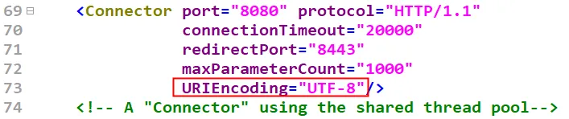
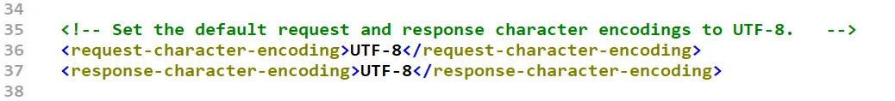

```
假设有这样一个请求：http://localhost:8080/springmvc/register?name=zhangsan&password=123&email=zhangsan@powernode.com
在SpringMVC中应该如何获取请求提交的数据呢？
在SpringMVC中又应该如何获取请求头信息呢？
在SpringMVC中又应该如何获取客户端提交的Cookie数据呢？
```
# 1. 准备

## 1.1 创建模块，添加依赖
```
<?xml version="1.0" encoding="UTF-8"?>
<project xmlns="http://maven.apache.org/POM/4.0.0"
         xmlns:xsi="http://www.w3.org/2001/XMLSchema-instance"
         xsi:schemaLocation="http://maven.apache.org/POM/4.0.0 http://maven.apache.org/xsd/maven-4.0.0.xsd">
    <modelVersion>4.0.0</modelVersion>

    <groupId>com.powernode.springmvc</groupId>
    <artifactId>springmvc-003</artifactId>
    <version>1.0-SNAPSHOT</version>
    <packaging>war</packaging>

    <dependencies>
        <!--springmvc依赖-->
        <dependency>
            <groupId>org.springframework</groupId>
            <artifactId>spring-webmvc</artifactId>
            <version>6.1.4</version>
        </dependency>
        <!--logback依赖-->
        <dependency>
            <groupId>ch.qos.logback</groupId>
            <artifactId>logback-classic</artifactId>
            <version>1.5.3</version>
        </dependency>
        <!--servlet依赖-->
        <dependency>
            <groupId>jakarta.servlet</groupId>
            <artifactId>jakarta.servlet-api</artifactId>
            <version>6.0.0</version>
            <scope>provided</scope>
        </dependency>
        <!--thymeleaf和spring6整合的依赖-->
        <dependency>
            <groupId>org.thymeleaf</groupId>
            <artifactId>thymeleaf-spring6</artifactId>
            <version>3.1.2.RELEASE</version>
        </dependency>
    </dependencies>

    <properties>
        <maven.compiler.source>21</maven.compiler.source>
        <maven.compiler.target>21</maven.compiler.target>
        <project.build.sourceEncoding>UTF-8</project.build.sourceEncoding>
    </properties>

</project>
```
## 1.2 添加web支持
```
```
## 1.3 编写web.xml文件
```
<?xml version="1.0" encoding="UTF-8"?>
<web-app xmlns="https://jakarta.ee/xml/ns/jakartaee"
         xmlns:xsi="http://www.w3.org/2001/XMLSchema-instance"
         xsi:schemaLocation="https://jakarta.ee/xml/ns/jakartaee https://jakarta.ee/xml/ns/jakartaee/web-app_6_0.xsd"
         version="6.0">

    <!--前端控制器-->
    <servlet>
        <servlet-name>springmvc</servlet-name>
        <servlet-class>org.springframework.web.servlet.DispatcherServlet</servlet-class>
        <!--通过初始化参数来指定springmvc配置文件的路径和名字。-->
        <init-param>
            <param-name>contextConfigLocation</param-name>
            <param-value>classpath:springmvc.xml</param-value>
        </init-param>
        <!--在服务器启动的时候初始化DispatcherServlet，提高第一次访问的效率-->
        <load-on-startup>1</load-on-startup>
    </servlet>
    <servlet-mapping>
        <servlet-name>springmvc</servlet-name>
        <url-pattern>/</url-pattern>
    </servlet-mapping>

</web-app>
```
## 1.4 创建UserController
```
package com.powernode.springmvc.controller;

import org.springframework.stereotype.Controller;
import org.springframework.web.bind.annotation.RequestMapping;

/**
 * ClassName: UserController
 * Description:
 * Datetime: 2024/3/14 20:05
 * Author: 老杜@动力节点
 * Version: 1.0
 */
@Controller
public class UserController {
    @RequestMapping("/")
    public String toRegisterPage(){
        return "register";
    }
}
```
## 1.5 编写springmvc.xml
```
<?xml version="1.0" encoding="UTF-8"?>
<beans xmlns="http://www.springframework.org/schema/beans"
       xmlns:xsi="http://www.w3.org/2001/XMLSchema-instance"
       xmlns:context="http://www.springframework.org/schema/context"
       xsi:schemaLocation="http://www.springframework.org/schema/beans 
      http://www.springframework.org/schema/beans/spring-beans.xsd http://www.springframework.org/schema/context 
      https://www.springframework.org/schema/context/spring-context.xsd">

    <!--组件扫描-->
    <context:component-scan base-package="com.powernode.springmvc.controller"/>

    <!--视图解析器-->
    <bean id="thymeleafViewResolver" class="org.thymeleaf.spring6.view.ThymeleafViewResolver">
        <!--作用于视图渲染的过程中，可以设置视图渲染后输出时采用的编码字符集-->
        <property name="characterEncoding" value="UTF-8"/>
        <!--如果配置多个视图解析器，它来决定优先使用哪个视图解析器，它的值越小优先级越高-->
        <property name="order" value="1"/>
        <!--当 ThymeleafViewResolver 渲染模板时，会使用该模板引擎来解析、编译和渲染模板-->
        <property name="templateEngine">
            <bean class="org.thymeleaf.spring6.SpringTemplateEngine">
                <!--用于指定 Thymeleaf 模板引擎使用的模板解析器。模板解析器负责根据模板位置、
                                        模板资源名称、文件编码等信息，加载模板并对其进行解析-->
                <property name="templateResolver">
                    <bean class="org.thymeleaf.spring6.templateresolver.SpringResourceTemplateResolver">
                        <!--设置模板文件的位置（前缀）-->
                        <property name="prefix" value="/WEB-INF/templates/"/>
                        <!--设置模板文件后缀（后缀），Thymeleaf文件扩展名不一定是html，也可以是其他，例如txt，大部分都是html-->
                        <property name="suffix" value=".html"/>
                        <!--设置模板类型，例如：HTML,TEXT,JAVASCRIPT,CSS等-->
                        <property name="templateMode" value="HTML"/>
                        <!--用于模板文件在读取和解析过程中采用的编码字符集-->
                        <property name="characterEncoding" value="UTF-8"/>
                    </bean>
                </property>
            </bean>
        </property>
    </bean>

</beans>
```
## 1.6 编写register.html文件（放到WEB-INF/templates/下）
```
<!DOCTYPE html>
<html lang="en" xmlns:th="http://www.thymeleaf.org">
<head>
    <meta charset="UTF-8">
    <title>用户注册</title>
</head>
<body>
<h3>用户注册</h3>
<hr>
</body>
</html>
```
## 1.7 部署测试
```
```
# 2. 使用原生的Servlet API获取
```
原生的Servlet API指的是：HttpServletRequest
在SpringMVC当中，一个Controller类中的方法参数上如果有HttpServletRequest，SpringMVC会自动将当前请求对象传递给这个参数，因此我们可以通过这个参数来获取请求提交的数据。测试一下。
在 register.html 中准备一个注册的表单：
<!DOCTYPE html>
<html lang="en" xmlns:th="http://www.thymeleaf.org">
<head>
    <meta charset="UTF-8">
    <title>用户注册</title>
</head>
<body>
<h3>用户注册</h3>
<hr>
<form th:action="@{/register}" method="post">
    用户名：<input type="text" name="username"><br>
    密码：<input type="password" name="password"><br>
    性别：
        男 <input type="radio" name="sex" value="1">
        女 <input type="radio" name="sex" value="0">
        <br>
    爱好：
        抽烟 <input type="checkbox" name="hobby" value="smoke">
        喝酒 <input type="checkbox" name="hobby" value="drink">
        烫头 <input type="checkbox" name="hobby" value="perm">
        <br>
    简介：<textarea rows="10" cols="60" name="intro"></textarea><br>
    <input type="submit" value="注册">
</form>
</body>
</html>
先测试这个页面是否可以正常打开，是否可以正常提交数据：
点击注册：F12的方式查看是否提交了数据：
通过测试得知：可以正常提交数据。

接下来在控制器添加一个方法来处理这个注册的请求：
@PostMapping(value="/register")
public String register(HttpServletRequest request){
    // 通过当前请求对象获取提交的数据
    String username = request.getParameter("username");
    String password = request.getParameter("password");
    String sex = request.getParameter("sex");
    String[] hobbies = request.getParameterValues("hobby");
    String intro = request.getParameter("intro");
    System.out.println(username + "," + password + "," + sex + "," + Arrays.toString(hobbies) + "," + intro);
    return "success";
}

提供视图页面：
<!DOCTYPE html>
<html lang="en" xmlns:th="http://www.thymeleaf.org">
<head>
    <meta charset="UTF-8">
    <title>注册成功</title>
</head>
<body>
<h1>注册成功</h1>
</body>
</html>

测试：ok

这样通过Servlet原生的API获取到提交的数据。但是这种方式不建议使用，因为方法的参数依赖Servlet原生API，Controller的测试将不能单独测试，必须依赖WEB服务器才能测试。另外，换句话说，如果在SpringMVC中使用了原生的Servlet，你为什么还要用SpringMVC框架呢！！！！！
```
# 3. 使用RequestParam注解标注
```
```

## 3.1 RequestParam注解的基本使用
```
RequestParam注解作用：将请求参数与方法上的形参映射。
@PostMapping(value = "/register")
public String register(
    @RequestParam(value="username")
    String a,
    @RequestParam(value="password")
    String b,
    @RequestParam(value="sex")
    String c,
    @RequestParam(value="hobby")
    String[] d,
    @RequestParam(name="intro")
    String e) {
    System.out.println(a);
    System.out.println(b);
    System.out.println(c);
    System.out.println(Arrays.toString(d));
    System.out.println(e);
    return "success";
}
注意：对于@RequestParam注解来说，属性有value和name，这两个属性的作用相同，都是用来指定提交数据的name。
@Target(ElementType.PARAMETER)
@Retention(RetentionPolicy.RUNTIME)
@Documented
public @interface RequestParam {
	@AliasFor("name")
	String value() default "";
	
	@AliasFor("value")
	String name() default "";

	boolean required() default true;

	String defaultValue() default ValueConstants.DEFAULT_NONE;
}

例如：发送请求时提交的数据是：name1=value1&name2=value2，则这个注解应该这样写：@RequestParam(value="name1")、@RequestParam(value="name2")

一定要注意： @RequestParam(value="name2") 中value一定不要写错，写错就会出现以下问题：
404：Required parameter 'ida' is not present.
```
## 3.2 RequestParam注解的required属性
```
required属性用来设置该方法参数是否为必须的。
默认情况下，这个参数为 true，表示方法参数是必需的。如果请求中缺少对应的参数，则会抛出异常。
可以将其设置为false，false表示不是必须的，如果请求中缺少对应的参数，则方法的参数为null。
测试，修改register方法

添加了一个 age 形参，没有指定 required 属性时，默认是true，表示必需的，但前端表单中没有年龄age，我们来看报错信息：
错误信息告诉我们：参数age是必需的。没有提供这个请求参数，HTTP状态码 400

如果将 required 属性设置为 false。则该参数则不是必须的，如果请求参数仍然未提供时，我们来看结果：
通过测试得知，如果一个参数被设置为不是必需的，当没有提交对应的请求参数时，形参默认值null。
当然，如果请求参数中提供了age，则age为真实提交的数据
```
## 3.3 RequestParam注解的defaultValue属性
```
defaultValue属性用来设置形参的默认值，当没有提供对应的请求参数或者请求参数的值是空字符串""的时候，方法的形参会采用默认值。
```
# 4. 依靠控制器方法上的形参名来接收
```
@RequestParam 这个注解是可以省略的，如果方法形参的名字和提交数据时的name相同，则 @RequestParam 可以省略。
但有一个前提：如果你采用的是Spring6+版本，你需要在pom.xml文件中指定编译参数'-parameter'，配置如下：
<project>
    <build>
        <plugins>
            <plugin>
                <groupId>org.apache.maven.plugins</groupId>
                <artifactId>maven-compiler-plugin</artifactId>
                <version>3.12.1</version>
                <configuration>
                    <source>21</source>
                    <target>21</target>
                    <compilerArgs>
                        <arg>-parameters</arg>
                    </compilerArgs>
                </configuration>
            </plugin>
        </plugins>
    </build>
</project>
注意：如果你使用的是Spring5的版本，以上的配置是不需要的。
Controller中的方法只需要这样写：形参的名字必须和提交的数据的name一致！！！！！
@PostMapping(value="/register")
public String register(String username, String password, String sex, String[] hobby, String intro){
    System.out.println(username + "," + password + "," + sex + "," + Arrays.toString(hobby) + "," + intro);
    return "success";
}

如果形参名和提交的数据的name不一致时：不报错，为null
另外，还有一点，对于提交的hobby数据，也可以采用String来接收，不一定使用数组方式：
@PostMapping(value="/register")
public String register(String username, String password, String sex, String hobby, String intro){
    System.out.println(username + "," + password + "," + sex + "," + hobby + "," + intro);
    return "success";
}
根据输出结果可以看到多个hobby是采用“,”进行连接的。

```
# 5. 使用POJO类/JavaBean接收请求参数
```
以上方式大家可以看到，当提交的数据非常多时，方法的形参个数会非常多，这不是很好的设计。在SpringMVC中也可以使用POJO类/JavaBean来接收请求参数。不过有一个非常重要的要求：POJO类的属性名必须和请求参数的参数名保持一致。提供以下的JavaBean：
package com.powernode.springmvc.pojo;

import java.util.Arrays;

/**
 * ClassName: User
 * Description:
 * Datetime: 2024/3/15 10:51
 * Author: 老杜@动力节点
 * Version: 1.0
 */
public class User {
    private Long id;
    private String username;
    private String password;
    private String sex;
    private String[] hobby;
    private String intro;

    public User() {
    }

    public User(Long id, String username, String password, String sex, String[] hobby, String intro) {
        this.id = id;
        this.username = username;
        this.password = password;
        this.sex = sex;
        this.hobby = hobby;
        this.intro = intro;
    }

    public Long getId() {
        return id;
    }

    public void setId(Long id) {
        this.id = id;
    }

    public String getUsername() {
        return username;
    }

    public void setUsername(String username) {
        this.username = username;
    }

    public String getPassword() {
        return password;
    }

    public void setPassword(String password) {
        this.password = password;
    }

    public String getSex() {
        return sex;
    }

    public void setSex(String sex) {
        this.sex = sex;
    }

    public String[] getHobby() {
        return hobby;
    }

    public void setHobby(String[] hobby) {
        this.hobby = hobby;
    }

    public String getIntro() {
        return intro;
    }

    public void setIntro(String intro) {
        this.intro = intro;
    }

    @Override
    public String toString() {
        return "User{" +
        "id=" + id +
        ", username='" + username + '\'' +
        ", password='" + password + '\'' +
        ", sex='" + sex + '\'' +
        ", hobby=" + Arrays.toString(hobby) +
        ", intro='" + intro + '\'' +
        '}';
    }
}

在控制器方法的形参位置上使用javabean来接收请求参数：
@PostMapping("/register")
public String register(User user){
System.out.println(user);
return "success";
}

底层的实现原理：反射机制。先获取请求参数的名字，因为请求参数的名字就是JavaBean的属性名，通过这种方式给对应的属性赋值。
我们来测试一下：当JavaBean的属性名和请求参数的参数名不一致时，会出现什么问题？（注意：getter和setter的方法名不修改，只修改属性名）
package com.powernode.springmvc.pojo;

import java.util.Arrays;

/**
 * ClassName: User
 * Description:
 * Datetime: 2024/3/15 10:51
 * Author: 老杜@动力节点
 * Version: 1.0
 */
public class User {
    private Long id;
    private String uname;
    private String upwd;
    private String usex;
    private String[] uhobby;
    private String uintro;

    public User() {
    }

    public User(Long id, String username, String password, String sex, String[] hobby, String intro) {
        this.id = id;
        this.uname = username;
        this.upwd = password;
        this.usex = sex;
        this.uhobby = hobby;
        this.uintro = intro;
    }

    public Long getId() {
        return id;
    }

    public void setId(Long id) {
        this.id = id;
    }

    public String getUsername() {
        return uname;
    }

    public void setUsername(String username) {
        this.uname = username;
    }

    public String getPassword() {
        return upwd;
    }

    public void setPassword(String password) {
        this.upwd = password;
    }

    public String getSex() {
        return usex;
    }

    public void setSex(String sex) {
        this.usex = sex;
    }

    public String[] getHobby() {
        return uhobby;
    }

    public void setHobby(String[] hobby) {
        this.uhobby = hobby;
    }

    public String getIntro() {
        return uintro;
    }

    public void setIntro(String intro) {
        this.uintro = intro;
    }

    @Override
    public String toString() {
        return "User{" +
        "id=" + id +
        ", username='" + uname + '\'' +
        ", password='" + upwd + '\'' +
        ", sex='" + usex + '\'' +
        ", hobby=" + Arrays.toString(uhobby) +
        ", intro='" + uintro + '\'' +
        '}';
    }
}
通过测试，我们得知：请求参数名可以和JavaBean的属性名不一致。
我们继续将其中一个属性的setter和getter方法名修改一下：
...
通过测试可以看到：username属性没有赋上值。可见请求参数是否可以赋值到JavaBean对应的属性上，不是取决于属性名，而是setter方法名。
```
# 6. RequestHeader注解
```
该注解的作用是：将请求头信息映射到方法的形参上。
和RequestParam注解功能相似，RequestParam注解的作用：将请求参数映射到方法的形参上。
当然，对于RequestHeader注解来说，也有三个属性：value、required、defaultValue，和RequestParam一样，这里就不再赘述了。
测试：
@PostMapping("/register")
public String register(User user, 
                       @RequestHeader(value="Referer", required = false, defaultValue = "") 
                       String referer){
    System.out.println(user);
    System.out.println(referer);
    return "success";
}
```
# 7. CookieValue注解
```
该注解的作用：将请求提交的Cookie数据映射到方法形参上
同样是有三个属性：value、required、defaultValue
前端页面中编写发送cookie的代码：
<script type="text/javascript">
    function sendCookie(){
        document.cookie = "id=123456789; expires=Thu, 18 Dec 2025 12:00:00 UTC; path=/";
        document.location = "/springmvc/register";
    }
</script>
<button onclick="sendCookie()">向服务器端发送Cookie</button>

后端UserController代码：
@GetMapping("/register")
public String register(User user,
                       @RequestHeader(value="Referer", required = false, defaultValue = "")
                       String referer,
                       @CookieValue(value="id", required = false, defaultValue = "2222222222")
                       String id){
    System.out.println(user);
    System.out.println(referer);
    System.out.println(id);
    return "success";
}
```

# 8. 请求的中文乱码
```
```

## 8.1 get请求乱码
```
get请求数据在URI后面提交，这个乱码问题怎么解决呢？解决办法是找到 CATALINA_HOME/config/server.xml文件，找到其中配置端口号的标签<Connector>，在该标签中添加  URIEncoding="UTF-8"。但是对于高版本的Tomcat服务器来说，是不需要设置的，例如Tomcat10，Tomcat9，有如下的默认配置，在默认情况下URIEncoding使用的就是UTF-8的编码方式。

但对于低版本的Tomcat服务器，例如：Tomcat8。URIEncoding的默认配置是ISO-8859-1，因此在Tomcat8中需要手动配置server.xml文件
```


## 8.2 post请求乱码
```
post请求是解决请求体的中文乱码问题。解决办法大家都知道：
request.setCharacterEncoding("UTF-8");

同样，对于高版本的Tomcat10服务器来说，针对请求体中的字符编码也是配置好的，默认也是采用了UTF-8，中文乱码问题也解决了，在这个文件中配置的：apache-tomcat-10.1.19\conf\web.xml
配置内容如下：
```


```
通过以上配置可以看到，Tomcat10对请求和响应都设置了默认的字符编码方式为UTF-8
一定要注意：Tomcat9以及之前的版本，以上的配置是没有的。
我们来测试一下，针对Tomcat10来说，SpringMVC会不会有乱码问题：
<form th:action="@{/register}" method="post">
    用户名：<input type="text" name="username"><br>
    密码：<input type="password" name="password"><br>
    性别：
        男 <input type="radio" name="sex" value="1">
        女 <input type="radio" name="sex" value="0">
        <br>
    爱好：
        抽烟 <input type="checkbox" name="hobby" value="smoke">
        喝酒 <input type="checkbox" name="hobby" value="drink">
        烫头 <input type="checkbox" name="hobby" value="perm">
        <br>
    简介：<textarea rows="10" cols="60" name="intro"></textarea><br>
    <input type="submit" value="注册">
</form>
    
注意：以上表单已经修改为post请求
@PostMapping("/register")
public String register(User user, HttpServletRequest request) throws UnsupportedEncodingException {
    System.out.println(user);
    return "success";
}
通过测试可以看到在Tomcat10当中，默认SpringMVC，发送POST请求，是不会出现乱码问题的。

有可能很多同学使用的不是Tomcat10，如果不是Tomcat10，则会出现乱码问题，我们来模拟一下乱码的产生，将apache-tomcat-10.1.19\conf\web.xml文件中的UTF-8配置修改为ISO-8859-1

一定要重启Tomcat10，新的配置才能生效，来测试一下是否存在乱码

那么，在SpringMVC中如何解决请求体的中文乱码问题呢？当然，还是使用request.setCharacterEncoding("UTF-8")
使用它有一个前提条件，要想解决请求体乱码问题，以上代码必须在 request.getParameter("username")执行之前执行才有效。

也就是说以上代码如果放在Controller的相关方法中执行是无效的，因为Controller的方法在执行之前 DispatcherServlet已经调用了 request.getParameter("username")方法。因此在Controller方法中使用request.setCharacterEncoding("UTF-8");无效
我们来测试一下：
<form th:action="@{/register}" method="post">
    用户名：<input type="text" name="username"><br>
    密码：<input type="password" name="password"><br>
    性别：
        男 <input type="radio" name="sex" value="1">
        女 <input type="radio" name="sex" value="0">
        <br>
    爱好：
        抽烟 <input type="checkbox" name="hobby" value="smoke">
        喝酒 <input type="checkbox" name="hobby" value="drink">
        烫头 <input type="checkbox" name="hobby" value="perm">
        <br>
    简介：<textarea rows="10" cols="60" name="intro"></textarea><br>
    <input type="submit" value="注册">
</form>

注意：以上表单已经修改为post请求
@PostMapping("/register")
public String register(User user, HttpServletRequest request) throws UnsupportedEncodingException {
    request.setCharacterEncoding("UTF-8");
    System.out.println(user);
    return "success";
}
通过测试可以看到：在Controller当中调用request.setCharacterEncoding("UTF-8")是无法解决POST乱码问题的。

那怎么办呢？怎么样才能在DispatcherServlet之前执行request.setCharacterEncoding("UTF-8")呢？没错，我相信大家想到了：过滤器Filter。过滤器Filter可以在Servlet执行之前执行。有同学又说了：监听器不行吗？不行。因为我们需要对每一次请求解决乱码，而监听器只在服务器启动阶段执行一次。因此这里解决每一次请求的乱码问题，应该使用过滤器Filter。并且，告诉大家一个好消息，SpringMVC已经将这个字符编码的过滤器提前写好了，我们直接配置好即可：CharacterEncodingFilter，我们一起看一下它的源码：
/*
 * Copyright 2002-2018 the original author or authors.
 *
 * Licensed under the Apache License, Version 2.0 (the "License");
 * you may not use this file except in compliance with the License.
 * You may obtain a copy of the License at
 *
 *      https://www.apache.org/licenses/LICENSE-2.0
 *
 * Unless required by applicable law or agreed to in writing, software
 * distributed under the License is distributed on an "AS IS" BASIS,
 * WITHOUT WARRANTIES OR CONDITIONS OF ANY KIND, either express or implied.
 * See the License for the specific language governing permissions and
 * limitations under the License.
 */

package org.springframework.web.filter;

import java.io.IOException;

import jakarta.servlet.FilterChain;
import jakarta.servlet.ServletException;
import jakarta.servlet.http.HttpServletRequest;
import jakarta.servlet.http.HttpServletResponse;

import org.springframework.lang.Nullable;
import org.springframework.util.Assert;

/**
 * Servlet Filter that allows one to specify a character encoding for requests.
 * This is useful because current browsers typically do not set a character
 * encoding even if specified in the HTML page or form.
 *
 * <p>This filter can either apply its encoding if the request does not already
 * specify an encoding, or enforce this filter's encoding in any case
 * ("forceEncoding"="true"). In the latter case, the encoding will also be
 * applied as default response encoding (although this will usually be overridden
 * by a full content type set in the view).
 *
 * @author Juergen Hoeller
 * @since 15.03.2004
 * @see #setEncoding
 * @see #setForceEncoding
 * @see jakarta.servlet.http.HttpServletRequest#setCharacterEncoding
 * @see jakarta.servlet.http.HttpServletResponse#setCharacterEncoding
 */
public class CharacterEncodingFilter extends OncePerRequestFilter {

    @Nullable
    private String encoding;

    private boolean forceRequestEncoding = false;

    private boolean forceResponseEncoding = false;


    /**
	 * Create a default {@code CharacterEncodingFilter},
	 * with the encoding to be set via {@link #setEncoding}.
	 * @see #setEncoding
	 */
    public CharacterEncodingFilter() {
    }

    /**
	 * Create a {@code CharacterEncodingFilter} for the given encoding.
	 * @param encoding the encoding to apply
	 * @since 4.2.3
	 * @see #setEncoding
	 */
    public CharacterEncodingFilter(String encoding) {
        this(encoding, false);
    }

    /**
	 * Create a {@code CharacterEncodingFilter} for the given encoding.
	 * @param encoding the encoding to apply
	 * @param forceEncoding whether the specified encoding is supposed to
	 * override existing request and response encodings
	 * @since 4.2.3
	 * @see #setEncoding
	 * @see #setForceEncoding
	 */
    public CharacterEncodingFilter(String encoding, boolean forceEncoding) {
        this(encoding, forceEncoding, forceEncoding);
    }

    /**
	 * Create a {@code CharacterEncodingFilter} for the given encoding.
	 * @param encoding the encoding to apply
	 * @param forceRequestEncoding whether the specified encoding is supposed to
	 * override existing request encodings
	 * @param forceResponseEncoding whether the specified encoding is supposed to
	 * override existing response encodings
	 * @since 4.3
	 * @see #setEncoding
	 * @see #setForceRequestEncoding(boolean)
	 * @see #setForceResponseEncoding(boolean)
	 */
	public CharacterEncodingFilter(String encoding, boolean forceRequestEncoding, boolean forceResponseEncoding) {
		Assert.hasLength(encoding, "Encoding must not be empty");
		this.encoding = encoding;
		this.forceRequestEncoding = forceRequestEncoding;
		this.forceResponseEncoding = forceResponseEncoding;
	}


	/**
	 * Set the encoding to use for requests. This encoding will be passed into a
	 * {@link jakarta.servlet.http.HttpServletRequest#setCharacterEncoding} call.
	 * <p>Whether this encoding will override existing request encodings
	 * (and whether it will be applied as default response encoding as well)
	 * depends on the {@link #setForceEncoding "forceEncoding"} flag.
	 */
	public void setEncoding(@Nullable String encoding) {
		this.encoding = encoding;
	}

	/**
	 * Return the configured encoding for requests and/or responses.
	 * @since 4.3
	 */
	@Nullable
	public String getEncoding() {
		return this.encoding;
	}

	/**
	 * Set whether the configured {@link #setEncoding encoding} of this filter
	 * is supposed to override existing request and response encodings.
	 * <p>Default is "false", i.e. do not modify the encoding if
	 * {@link jakarta.servlet.http.HttpServletRequest#getCharacterEncoding()}
	 * returns a non-null value. Switch this to "true" to enforce the specified
	 * encoding in any case, applying it as default response encoding as well.
	 * <p>This is the equivalent to setting both {@link #setForceRequestEncoding(boolean)}
	 * and {@link #setForceResponseEncoding(boolean)}.
	 * @see #setForceRequestEncoding(boolean)
	 * @see #setForceResponseEncoding(boolean)
	 */
	public void setForceEncoding(boolean forceEncoding) {
		this.forceRequestEncoding = forceEncoding;
		this.forceResponseEncoding = forceEncoding;
	}

	/**
	 * Set whether the configured {@link #setEncoding encoding} of this filter
	 * is supposed to override existing request encodings.
	 * <p>Default is "false", i.e. do not modify the encoding if
	 * {@link jakarta.servlet.http.HttpServletRequest#getCharacterEncoding()}
	 * returns a non-null value. Switch this to "true" to enforce the specified
	 * encoding in any case.
	 * @since 4.3
	 */
	public void setForceRequestEncoding(boolean forceRequestEncoding) {
		this.forceRequestEncoding = forceRequestEncoding;
	}

	/**
	 * Return whether the encoding should be forced on requests.
	 * @since 4.3
	 */
	public boolean isForceRequestEncoding() {
		return this.forceRequestEncoding;
	}

	/**
	 * Set whether the configured {@link #setEncoding encoding} of this filter
	 * is supposed to override existing response encodings.
	 * <p>Default is "false", i.e. do not modify the encoding.
	 * Switch this to "true" to enforce the specified encoding
	 * for responses in any case.
	 * @since 4.3
	 */
	public void setForceResponseEncoding(boolean forceResponseEncoding) {
		this.forceResponseEncoding = forceResponseEncoding;
	}

	/**
	 * Return whether the encoding should be forced on responses.
	 * @since 4.3
	 */
	public boolean isForceResponseEncoding() {
		return this.forceResponseEncoding;
	}


	@Override
	protected void doFilterInternal(
			HttpServletRequest request, HttpServletResponse response, FilterChain filterChain)
			throws ServletException, IOException {

		String encoding = getEncoding();
		if (encoding != null) {
			if (isForceRequestEncoding() || request.getCharacterEncoding() == null) {
				request.setCharacterEncoding(encoding);
			}
			if (isForceResponseEncoding()) {
				response.setCharacterEncoding(encoding);
			}
		}
		filterChain.doFilter(request, response);
	}

}

最核心的方法是：
@Override
protected void doFilterInternal(
    HttpServletRequest request, HttpServletResponse response, FilterChain filterChain)
throws ServletException, IOException {

    String encoding = getEncoding();
    if (encoding != null) {
        if (isForceRequestEncoding() || request.getCharacterEncoding() == null) {
            request.setCharacterEncoding(encoding);
        }
        if (isForceResponseEncoding()) {
            response.setCharacterEncoding(encoding);
        }
    }
    filterChain.doFilter(request, response);
}

分析以上核心方法得知该过滤器对请求和响应都设置了字符编码方式。
	当强行使用请求字符编码方式为true时，或者请求对象的字符编码方式为null时，设置请求的字符编码方式。
	当强行使用响应字符编码方式为true时，设置响应的字符编码方式。
	
根据以上代码，可以得出以下配置信息，在web.xml文件中对过滤器进行如下配置：
<!--字符编码过滤器-->
<filter>
    <filter-name>characterEncodingFilter</filter-name>
    <filter-class>org.springframework.web.filter.CharacterEncodingFilter</filter-class>
    <init-param>
        <param-name>encoding</param-name>
        <param-value>UTF-8</param-value>
    </init-param>
    <init-param>
        <param-name>forceRequestEncoding</param-name>
        <param-value>true</param-value>
    </init-param>
    <init-param>
        <param-name>forceResponseEncoding</param-name>
        <param-value>true</param-value>
    </init-param>
</filter>
<filter-mapping>
    <filter-name>characterEncodingFilter</filter-name>
    <url-pattern>/*</url-pattern>
</filter-mapping>

我们再来测试，重启Tomcat10，解决
注意：针对于我们当前的Tomcat10的配置来说，它有默认的字符集ISO-8859-1，因此以下在web.xml文件中的配置是不能缺少的：
<init-param>
    <param-name>forceRequestEncoding</param-name>
    <param-value>true</param-value>
</init-param>
如果缺少它，仍然是会存在乱码问题的。自行测试一下！！！！
```

# 9. 日期和数字格式化（@DateTimeFormat / @NumberFormat）
```
SpringMVC提供了数据格式化注解，可以将字符串类型的请求参数自动转换为日期、数字等类型。

8.1 @DateTimeFormat（日期格式化）：
可以将请求参数中的日期字符串自动转换为java.util.Date或java.time.LocalDate等类型。

@Controller
public class OrderController {

    // pattern指定日期格式
    @RequestMapping("/order")
    public String queryOrder(
            @RequestParam("date") @DateTimeFormat(pattern = "yyyy-MM-dd") Date date,
            @RequestParam("time") @DateTimeFormat(pattern = "yyyy-MM-dd HH:mm:ss") LocalDateTime time) {
        System.out.println("查询日期：" + date);
        System.out.println("查询时间：" + time);
        return "order";
    }
}

请求示例：/order?date=2024-03-15&time=2024-03-15 14:30:00

也可以标注在POJO属性上：
public class Order {
    @DateTimeFormat(pattern = "yyyy-MM-dd")
    private Date createDate;

    @DateTimeFormat(pattern = "yyyy-MM-dd HH:mm:ss")
    private LocalDateTime createTime;

    // getter/setter省略
}

@RequestMapping("/order/save")
public String saveOrder(Order order) {
    System.out.println(order.getCreateDate());  // 自动转换
    return "ok";
}

8.2 @NumberFormat（数字格式化）：
可以将请求参数格式化为指定格式的数字（如百分比、货币等）。

public class Product {
    @NumberFormat(pattern = "#,###.##")
    private Double price;

    @NumberFormat(style = NumberFormat.Style.PERCENT)
    private Double discount;

    // 请求：price=1,999.99&discount=20%
    // price = 1999.99, discount = 0.2
}

8.3 类型转换失败的异常处理：
当字符串无法转换为目标类型时，SpringMVC会抛出TypeMismatchException。
可以在@ControllerAdvice中统一处理：

@ControllerAdvice
public class GlobalExceptionHandler {
    @ExceptionHandler(TypeMismatchException.class)
    public String handleTypeMismatch(TypeMismatchException e, Model model) {
        model.addAttribute("msg", "参数类型不匹配：" + e.getPropertyName());
        return "error";
    }
}
```

# 10. 枚举类型绑定
```
SpringMVC可以自动将字符串参数绑定到Java枚举类型。

9.1 定义枚举：
public enum Gender {
    MALE, FEMALE
}

public enum OrderStatus {
    PENDING("待处理"),
    PROCESSING("处理中"),
    COMPLETED("已完成"),
    CANCELLED("已取消");

    private final String description;
    OrderStatus(String description) { this.description = description; }
    public String getDescription() { return description; }
}

9.2 Controller接收枚举参数：
@RequestMapping("/user/register")
public String register(@RequestParam("gender") Gender gender,
                       @RequestParam("status") OrderStatus status) {
    // 请求：/user/register?gender=MALE&status=PROCESSING
    // SpringMVC自动将字符串"MALE"转为Gender.MALE
    System.out.println(gender);  // MALE
    return "ok";
}

9.3 枚举大小写处理：
SpringMVC默认是大小写敏感的：
● 请求 gender=male → 转换失败（TypeMismatchException）
● 请求 gender=MALE → 转换成功

如果需要大小写不敏感，可以自定义Converter：
@Component
public class StringToGenderConverter implements Converter<String, Gender> {
    @Override
    public Gender convert(String source) {
        return Gender.valueOf(source.toUpperCase());  // 转为大写再匹配
    }
}

注意：自定义Converter需要在SpringMVC配置中注册（见@InitBinder章节）。
```

# 11. 嵌套POJO绑定
```
当POJO中包含另一个POJO作为属性时，前端使用"点号表示法"传递参数。

10.1 定义嵌套POJO：
public class User {
    private String name;
    private Integer age;
    private Address address;  // 嵌套对象
    // getter/setter...
}

public class Address {
    private String province;
    private String city;
    private String street;
    // getter/setter...
}

10.2 前端表单（点号表示法）：
<form th:action="@{/user/save}" method="post">
    姓名：<input type="text" name="name"><br>
    年龄：<input type="number" name="age"><br>
    省份：<input type="text" name="address.province"><br>
    城市：<input type="text" name="address.city"><br>
    街道：<input type="text" name="address.street"><br>
    <input type="submit" value="提交">
</form>

10.3 Controller接收：
@RequestMapping("/user/save")
public String save(User user) {  // 自动绑定嵌套属性
    System.out.println(user.getAddress().getProvince());  // 正常获取
    System.out.println(user.getAddress().getCity());
    return "ok";
}

10.4 多级嵌套也支持：
// Address中再嵌套Detail
public class Address {
    private Detail detail;  // 继续嵌套
}
// 前端使用：address.detail.zipCode

注意：嵌套对象会由SpringMVC自动创建（调用无参构造），即使前端没有传该对象的任何字段，
嵌套对象也不会为null（但属性值都是null/默认值）。
```

# 12. 集合类型绑定
```
SpringMVC支持将请求参数绑定到List、Set、Map等集合类型。

11.1 绑定到List（使用下标）：
Controller方法：
@RequestMapping("/user/batchSave")
public String batchSave(@RequestParam("names") List<String> names) {
    System.out.println(names);  // [张三, 李四, 王五]
    return "ok";
}

前端表单（同名参数）：
<input type="text" name="names" value="张三">
<input type="text" name="names" value="李四">
<input type="text" name="names" value="王五">

11.2 绑定到List<POJO>（动态表单行）：
POJO类：
public class OrderItem {
    private String productName;
    private Integer quantity;
    private Double price;
    // getter/setter...
}

Controller方法：
@RequestMapping("/order/saveItems")
public String saveItems(OrderForm form) {
    for (OrderItem item : form.getItems()) {
        System.out.println(item.getProductName() + " x" + item.getQuantity());
    }
    return "ok";
}

public class OrderForm {
    private List<OrderItem> items;
    // getter/setter...
}

前端表单（下标+点号）：
<!-- 第一行 -->
<input type="text" name="items[0].productName" value="商品A">
<input type="number" name="items[0].quantity" value="1">
<input type="number" name="items[0].price" value="99.00">
<!-- 第二行 -->
<input type="text" name="items[1].productName" value="商品B">
<input type="number" name="items[1].quantity" value="2">
<input type="number" name="items[1].price" value="199.00">

11.3 绑定到Map：
@RequestMapping("/user/save")
public String save(@RequestParam Map<String, String> params) {
    // 所有请求参数自动收集到Map中
    System.out.println(params);  // {name=张三, age=25, city=北京}
    return "ok";
}

11.4 绑定到数组：
@RequestMapping("/user/deleteBatch")
public String deleteBatch(@RequestParam("ids") Long[] ids) {
    System.out.println("批量删除：" + Arrays.toString(ids));
    return "ok";
}
// 前端同名参数：ids=1&ids=2&ids=3
```

# 13. @InitBinder与WebDataBinder
```
@InitBinder用于自定义数据绑定规则，在Controller级别生效。

12.1 日期格式全局设置：
@Controller
public class UserController {

    @InitBinder
    public void initBinder(WebDataBinder binder) {
        // 注册自定义日期格式
        DateFormat dateFormat = new SimpleDateFormat("yyyy-MM-dd");
        dateFormat.setLenient(false);  // 严格模式
        binder.registerCustomEditor(Date.class, new CustomDateEditor(dateFormat, true));
    }

    // 该Controller中所有方法都会使用上面注册的日期格式
    @RequestMapping("/user/query")
    public String query(@RequestParam("birthday") Date birthday) {
        return "ok";
    }
}

12.2 注册全局格式器（推荐，替代PropertyEditor）：
使用Formatter替代PropertyEditor（更加现代和类型安全）：

在SpringMvcConfig中注册全局格式器：
@Configuration
public class SpringMvcConfig implements WebMvcConfigurer {
    @Override
    public void addFormatters(FormatterRegistry registry) {
        registry.addFormatter(new DateFormatter("yyyy-MM-dd"));
        registry.addFormatter(new DateFormatter("yyyy-MM-dd HH:mm:ss"));
    }
}

12.3 限制允许绑定的字段（安全建议）：
@InitBinder
public void initBinder(WebDataBinder binder) {
    // 只允许绑定name和age字段，其他字段会被忽略
    binder.setAllowedFields("name", "age");
    // 或者禁止绑定特定字段
    binder.setDisallowedFields("id", "role", "isAdmin");
}

为什么需要限制绑定字段：
防止"Mass Assignment"攻击。例如，用户提交表单时恶意添加了 role=admin 参数，
如果没有限制，该参数会被自动绑定到User对象的role属性，导致权限提升。
```

# 14. @ModelAttribute标注在方法上
```
@ModelAttribute除了用于方法参数外，还可以标注在方法上。
这通常用于在多个处理器方法之间共享公共数据。

13.1 在Controller内部共享数据：
@Controller
@RequestMapping("/user")
public class UserController {

    // this method will be executed before every handler method in this Controller
    @ModelAttribute("genders")
    public List<String> populateGenders() {
        // 该方法在每个处理器方法执行前被调用
        // 返回值自动放入Model中
        return Arrays.asList("男", "女", "其他");
    }

    @RequestMapping("/add")
    public String addUser(Model model) {
        // 此时Model中已自动包含 genders 属性
        // 无需在每个方法中重复添加
        return "user_form";
    }

    @RequestMapping("/edit")
    public String editUser(Model model) {
        // Model中同样自动包含 genders 属性
        return "user_form";
    }
}

在Thymeleaf视图中使用genders数据：
<select name="gender">
    <option th:each="g : ${genders}" th:value="${g}" th:text="${g}"></option>
</select>

13.2 @ModelAttribute + @RequestMapping 组合：
@ModelAttribute("user")
public User preloadUser(@RequestParam(value = "id", required = false) Long id) {
    if (id != null) {
        return userService.findById(id);  // 预先从数据库加载
    }
    return new User();  // 新增时返回空对象
}

@RequestMapping("/edit")
public String editUser(@ModelAttribute("user") User user) {
    // user已被@ModelAttribute方法预填充（从数据库加载）
    // 表单提交的参数会覆盖对应的属性值
    user.setName(request.getParameter("name"));
    userService.update(user);
    return "ok";
}

13.3 @ModelAttribute方法的数据类型与视图展示：
@ModelAttribute方法可以返回任意类型的数据，Model的key默认为返回类型的首字母小写类名：

@ModelAttribute
public String currentTime() {
    return LocalDateTime.now().format(DateTimeFormatter.ofPattern("yyyy-MM-dd HH:mm:ss"));
}
// Model key = "string"（String类型首字母小写）→ 不太友好

@ModelAttribute("currentTime")  // 显式指定key
public String currentTime() {
    return LocalDateTime.now().format(DateTimeFormatter.ofPattern("yyyy-MM-dd HH:mm:ss"));
}
// Model key = "currentTime" → 清晰明确
```