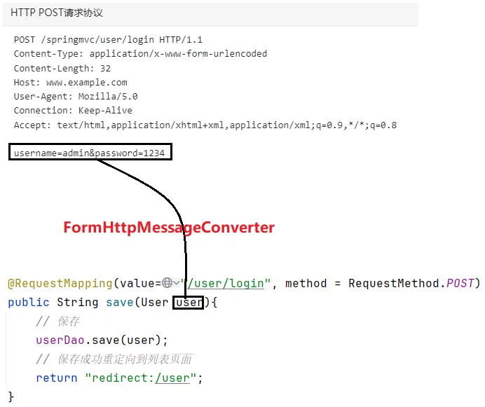
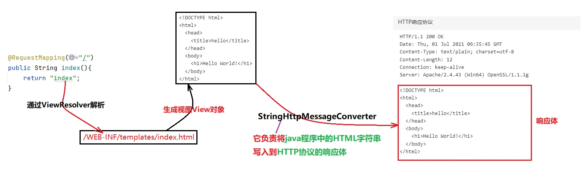
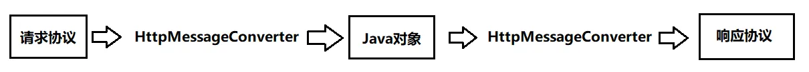

# 1.HttpMessageConverter
```
HttpMessageConverter是Spring MVC中非常重要的一个接口，翻译为：HTTP消息转换器，该接口提供了很多实现类，不同实现类有不同的转换方式。
```
## 1.1什么是HTTP消息
```
HTTP消息其实就是HTTP协议。HTTP协议包括请求协议和响应协议。
```
## 1.2转换器转换的是什么
```
转换的是HTTP协议与Java程序中的对象之间的互相转换。请看下图：
```

```
上图是我们之前经常写的代码。请求体中的数据是如何转换成user对象的，底层实际上使用了HttpMessageConverter接口的其中一个实现类FormHttpMessageConverter。
通过上图可以看出FormHttpMessageConverter是负责将请求协议转换为Java对象的。
再看下图：
```



```
上图的代码也是之前我们经常写的，Controller返回值看做逻辑视图名称，视图解析器将其转换成物理视图名称，生成视图对象，StringHttpMessageConverter负责将视图对象中的HTML字符串写入到HTTP协议的响应体中。最终完成响应。
通过上图可以看出StringHttpMessageConverter是负责将Java对象转换为响应协议的。
通过以上内容的学习，大家应该能够了解到HttpMessageConverter接口是用来做什么的了：
```

```
如上图所示：HttpMessageConverter接口的可以将请求协议转换成Java对象，也可以把Java对象转换为响应协议。
HttpMessageConverter是接口，SpringMVC帮我们提供了非常多而丰富的实现类。每个实现类都有自己不同的转换风格。
对于我们程序员来说，Spring MVC已经帮助我们写好了，我们只需要在不同的业务场景下，选择合适的HTTP消息转换器即可。
怎么选择呢？当然是通过SpringMVC为我们提供的注解，我们通过使用不同的注解来启用不同的消息转换器。
在HTTP消息转换器这一小节，我们重点要掌握的是两个注解两个类：
● @ResponseBody
● @RequestBody
● ResponseEntity
● RequestEntity
```
# 2.Spring MVC中的AJAX请求
```
SpringMVC+Vue3+Thymeleaf+Axios发送一个简单的AJAX请求。
引入Vue和Axios的js文件：
...
配置文件springmvc.xml如下：
<?xml version="1.0" encoding="UTF-8"?>
<beans xmlns="http://www.springframework.org/schema/beans"
       xmlns:xsi="http://www.w3.org/2001/XMLSchema-instance"
       xmlns:context="http://www.springframework.org/schema/context"
       xmlns:mvc="http://www.springframework.org/schema/mvc"
       xsi:schemaLocation="http://www.springframework.org/schema/beans 
        http://www.springframework.org/schema/beans/spring-beans.xsd http://www.springframework.org/schema/context 
        https://www.springframework.org/schema/context/spring-context.xsd http://www.springframework.org/schema/mvc 
          https://www.springframework.org/schema/mvc/spring-mvc.xsd">

    <!--组件扫描-->
    <context:component-scan base-package="com.powernode.springmvc.controller"/>

    <!--视图解析器-->
    <bean id="thymeleafViewResolver" class="org.thymeleaf.spring6.view.ThymeleafViewResolver">
        <property name="characterEncoding" value="UTF-8"/>
        <property name="order" value="1"/>
        <property name="templateEngine">
            <bean class="org.thymeleaf.spring6.SpringTemplateEngine">
                <property name="templateResolver">
                    <bean class="org.thymeleaf.spring6.templateresolver.SpringResourceTemplateResolver">
                        <property name="prefix" value="/WEB-INF/thymeleaf/"/>
                        <property name="suffix" value=".html"/>
                        <property name="templateMode" value="HTML"/>
                        <property name="characterEncoding" value="UTF-8"/>
                    </bean>
                </property>
            </bean>
        </property>
    </bean>

    <!--视图控制器映射-->
    <mvc:view-controller path="/" view-name="index"/>

    <!--开启注解驱动-->
    <mvc:annotation-driven/>

    <!--静态资源处理-->
    <mvc:default-servlet-handler/>

</beans>

重点是静态资源处理、开启注解驱动、视图控制器映射等相关配置。
Vue3+Thymeleaf+Axios发送AJAX请求:
<!DOCTYPE html>
<html lang="en" xmlns:th="http://www.thymeleaf.org">
  <head>
    <meta charset="UTF-8">
    <title>首页</title>
    <script th:src="@{/static/js/vue3.4.21.js}"></script>
    <script th:src="@{/static/js/axios.min.js}"></script>
  </head>
  <body>
    <h1>首页</h1>
    <hr>

    <div id="app">
      <h1>{{message}}</h1>
      <button @click="getMessage">获取消息</button>
    </div>

    <script th:inline="javascript">
      Vue.createApp({
        data(){
          return {
            message : "这里的信息将被刷新"
          }
        },
        methods:{
          async getMessage(){
            try {
              const response = await axios.get([[@{/}]] + 'hello')
              this.message = response.data
            }catch (e) {
              console.error(e)
            }
          }
        }
      }).mount("#app")
    </script>

  </body>
</html>

重点来了，Controller怎么写呢，之前我们都是传统的请求，Controller返回一个逻辑视图名，然后交给视图解析器解析。最后跳转页面。而AJAX请求是不需要跳转页面的，因为AJAX是页面局部刷新，以前我们在Servlet中使用response.getWriter().print("message")的方式响应。在Spring MVC中怎么办呢？当然，我们在Spring MVC中也可以使用Servlet原生API来完成这个功能，代码如下：
package com.powernode.springmvc.controller;

import jakarta.servlet.http.HttpServletResponse;
import org.springframework.stereotype.Controller;
import org.springframework.web.bind.annotation.RequestMapping;

import java.io.IOException;

@Controller
public class HelloController {

    @RequestMapping(value = "/hello")
    public String hello(HttpServletResponse response) throws IOException {
        response.getWriter().print("hello");
        return null;
    }
}

或者这样也行：不需要有返回值
package com.powernode.springmvc.controller;

import jakarta.servlet.http.HttpServletResponse;
import org.springframework.stereotype.Controller;
import org.springframework.web.bind.annotation.RequestMapping;

import java.io.IOException;

@Controller
public class HelloController {

    @RequestMapping(value = "/hello")
    public void hello(HttpServletResponse response) throws IOException {
        response.getWriter().print("hello"); 
    }
}

注意：如果采用这种方式响应，则和 springmvc.xml 文件中配置的视图解析器没有关系，不走视图解析器了。
难道我们以后AJAX请求都要使用原生Servlet API吗？
● 不需要，我们可以使用SpringMVC中提供的HttpMessageConverter消息转换器。
我们要向前端响应一个字符串"hello"，这个"hello"就是响应协议中的响应体。
我们可以使用 @ResponseBody 注解来启用对应的消息转换器。而这种消息转换器只负责将Controller返回的信息以响应体的形式写入响应协议。
```

# 3.@ResponseBody

## 3.1StringHttpMessageConverter
```
上面的AJAX案例，Controller的代码可以修改为：
package com.powernode.springmvc.controller;

import org.springframework.stereotype.Controller;
import org.springframework.web.bind.annotation.RequestMapping;
import org.springframework.web.bind.annotation.ResponseBody;

@Controller
public class HelloController {

    @RequestMapping(value = "/hello")
    @ResponseBody
    public String hello(){
        // 由于你使用了 @ResponseBody 注解
        // 以下的return语句返回的字符串则不再是“逻辑视图名”了
        // 而是作为响应协议的响应体进行响应。
        return "hello";
    }
}
最核心需要理解的位置是：return "hello";
这里的"hello"不是逻辑视图名了，而是作为响应体的内容进行响应。直接输出到浏览器客户端。
以上程序中使用的消息转换器是：StringHttpMessageConverter，为什么会启用这个消息转换器呢？因为你添加@ResponseBody这个注解。
通常AJAX请求需要服务器给返回一段JSON格式的字符串，可以返回JSON格式的字符串吗？当然可以，代码如下：
package com.powernode.springmvc.controller;

import org.springframework.stereotype.Controller;
import org.springframework.web.bind.annotation.RequestMapping;
import org.springframework.web.bind.annotation.ResponseBody;

@Controller
public class HelloController {

    @RequestMapping(value = "/hello")
    @ResponseBody
    public String hello(){
        return "{\"username\":\"zhangsan\",\"password\":\"1234\"}";
    }
}
这是完全可以的，此时底层使用的消息转换器还是：StringHttpMessageConverter
那如果在程序中是一个POJO对象，怎么将POJO对象以JSON格式的字符串响应给浏览器呢？两种方式：
● 第一种方式：自己写代码将POJO对象转换成JSON格式的字符串，用上面的方式直接return即可。
● 第二种方式：启用MappingJackson2HttpMessageConverter消息转换器。

```
## 3.2MappingJackson2HttpMessageConverter
```
启用MappingJackson2HttpMessageConverter消息转换器的步骤如下：
第一步：引入jackson依赖，可以将java对象转换为json格式字符串
<dependency>
  <groupId>com.fasterxml.jackson.core</groupId>
  <artifactId>jackson-databind</artifactId>
  <version>2.17.0</version>
</dependency>
第二步：开启注解驱动
这一步非常关键，开启注解驱动后，在HandlerAdapter中会自动装配一个消息转换器：MappingJackson2HttpMessageConverter
<mvc:annotation-driven/>
第三步：准备一个POJO
package com.powernode.springmvc.bean;

public class User {
    private String username;
    private String password;

    public User() {
    }

    public User(String username, String password) {
        this.username = username;
        this.password = password;
    }

    public String getUsername() {
        return username;
    }

    public void setUsername(String username) {
        this.username = username;
    }

    public String getPassword() {
        return password;
    }

    public void setPassword(String password) {
        this.password = password;
    }
}
第四步：控制器方法使用 @ResponseBody 注解标注(非常重要），控制器方法返回这个POJO对象
package com.powernode.springmvc.controller;

import com.powernode.springmvc.bean.User;
import org.springframework.stereotype.Controller;
import org.springframework.web.bind.annotation.RequestMapping;
import org.springframework.web.bind.annotation.ResponseBody;

@Controller
public class HelloController {

    @RequestMapping(value = "/hello")
    @ResponseBody
    public User hello(){
        User user = new User("zhangsan", "22222");
        return user;
    }
}
以上代码底层启用的就是 MappingJackson2HttpMessageConverter 消息转换器。
他的功能很强大，可以将POJO对象转换成JSON格式的字符串，响应给前端。
其实这个消息转换器MappingJackson2HttpMessageConverter本质上只是比StringHttpMessageConverter多了一个json字符串的转换，其他的还是一样。
```
# 4.RestController
```
因为我们现代的开发方式都是基于AJAX方式的，因此 @ResponseBody 注解非常重要，很常用。
为了方便，Spring MVC中提供了一个注解 @RestController。这一个注解代表了：@Controller + @ResponseBody。
@RestController 标注在类上即可。被它标注的Controller中所有的方法上都会自动标注 @ResponseBody
package com.powernode.springmvc.controller;

import com.powernode.springmvc.bean.User;
import org.springframework.web.bind.annotation.RequestMapping;
import org.springframework.web.bind.annotation.RestController;

@RestController
public class HelloController {

    @RequestMapping(value = "/hello")
    public User hello(){
        User user = new User("zhangsan", "22222");
        return user;
    }
}

```
# 5.RequestBody

## 5.1FromHttpMessageConverter
```
这个注解的作用是直接将请求体传递给Java程序，在Java程序中可以直接使用一个String类型的变量接收这个请求体的内容。
在没有使用这个注解的时候：
@RequestMapping("/save")
public String save(User user){
    // 执行保存的业务逻辑
    userDao.save(user);
    // 保存成功跳转到成功页面
    return "success";
}
当请求体提交的数据是：
username=zhangsan&password=1234&email=zhangsan@powernode.com
那么Spring MVC会自动使用 FormHttpMessageConverter消息转换器，将请求体转换成user对象。
当使用这个注解的时候：这个注解只能出现在方法的参数上。
@RequestMapping("/save")
public String save(@RequestBody String requestBodyStr){
    System.out.println("请求体：" + requestBodyStr);
    return "success";
}
Spring MVC仍然会使用 FormHttpMessageConverter消息转换器，将请求体直接以字符串形式传递给 requestBodyStr 变量。
```
## 5.2MappingJackson2HttpMessageConverter
```
另外，如果在请求体中提交的是一个JSON格式的字符串，这个JSON字符串传递给Spring MVC之后，能不能将JSON字符串转换成POJO对象呢？答案是可以的。
此时必须使用@RequestBody 注解来完成 。并且底层使用的消息转换器是：MappingJackson2HttpMessageConverter。实现步骤如下：
● 第一步：引入jackson依赖
● 第二步：开启注解驱动
● 第三步：创建POJO类，将POJO类作为控制器方法的参数，并使用 @RequestBody 注解标注该参数
@RequestMapping("/send")
@ResponseBody
public String send(@RequestBody User user){
    System.out.println(user);
    System.out.println(user.getUsername());
    System.out.println(user.getPassword());
    return "success";
}
● 第四步：在请求体中提交json格式的数据
<!DOCTYPE html>
<html lang="en" xmlns:th="http://www.thymeleaf.org">
  <head>
    <meta charset="UTF-8">
    <title>首页</title>
    <script th:src="@{/static/js/vue3.4.21.js}"></script>
    <script th:src="@{/static/js/axios.min.js}"></script>
  </head>
  <body>

    <div id="app">
      <button @click="sendJSON">通过POST请求发送JSON给服务器</button>
      <h1>{{message}}</h1>
    </div>

    <script>
      let jsonObj = {"username":"zhangsan", "password":"1234"}

      Vue.createApp({
        data(){
          return {
            message:""
          }
        },
        methods: {
          async sendJSON(){
            console.log("sendjson")
            try{
              const res = await axios.post('/springmvc/send', JSON.stringify(jsonObj), {
                headers : {
                  "Content-Type" : "application/json"
                }
              })
              this.message = res.data
            }catch(e){
              console.error(e)
            }
          }
        }
      }).mount("#app")
    </script>

  </body>
</html>
```
# 6.RequestEntity
```
RequestEntity不是一个注解，是一个普通的类。这个类的实例封装了整个请求协议：包括请求行、请求头、请求体所有信息。
出现在控制器方法的参数上：
<!DOCTYPE html>
<html lang="en" xmlns:th="http://www.thymeleaf.org">
  <head>
    <meta charset="UTF-8">
    <title>首页</title>
    <script th:src="@{/static/js/vue3.4.21.js}"></script>
    <script th:src="@{/static/js/axios.min.js}"></script>
  </head>
  <body>

    <div id="app">
      <button @click="sendJSON">通过POST请求发送JSON给服务器</button>
      <h1>{{message}}</h1>
    </div>

    <script>
      let jsonObj = {"username":"zhangsan", "password":"1234"}

      Vue.createApp({
        data(){
          return {
            message:""
          }
        },
        methods: {
          async sendJSON(){
            console.log("sendjson")
            try{
              const res = await axios.post('/springmvc/send', JSON.stringify(jsonObj), {
                headers : {
                  "Content-Type" : "application/json"
                }
              })
              this.message = res.data
            }catch(e){
              console.error(e)
            }
          }
        }
      }).mount("#app")
    </script>

  </body>
</html>

@RequestMapping("/send")
@ResponseBody
public String send(RequestEntity<User> requestEntity){
    System.out.println("请求方式：" + requestEntity.getMethod());
    System.out.println("请求URL：" + requestEntity.getUrl());
    HttpHeaders headers = requestEntity.getHeaders();
    System.out.println("请求的内容类型：" + headers.getContentType());
    System.out.println("请求头：" + headers);

    User user = requestEntity.getBody();
    System.out.println(user);
    System.out.println(user.getUsername());
    System.out.println(user.getPassword());
    return "success";
}

在实际的开发中，如果你需要获取更详细的请求协议中的信息。可以使用RequestEntity
```
# 7.ResponseEntity
```
ResponseEntity不是注解，是一个类。用该类的实例可以封装响应协议，包括：状态行、响应头、响应体。也就是说：如果你想定制属于自己的响应协议，可以使用该类。
假如我要完成这样一个需求：前端提交一个id，后端根据id进行查询，如果返回null，请在前端显示404错误。如果返回不是null，则输出返回的user。

@Controller
public class UserController {

    @GetMapping("/users/{id}")
    public ResponseEntity<User> getUserById(@PathVariable Long id) {
        User user = userService.getUserById(id);
        if (user == null) {
            return ResponseEntity.status(HttpStatus.NOT_FOUND).body(null);
        } else {
            return ResponseEntity.ok(user);
        }
    }
}

# 8.HttpMessageConverter内置实现类大全
```
SpringMVC提供了丰富的内置HttpMessageConverter实现：

| 实现类 | 支持的Content-Type | 用途 |
|--------|-------------------|------|
| StringHttpMessageConverter | text/plain, text/* | 字符串与HTTP消息互转 |
| FormHttpMessageConverter | application/x-www-form-urlencoded | 表单数据 ↔ MultiValueMap |
| MappingJackson2HttpMessageConverter | application/json | JSON ↔ Java对象（需jackson-databind） |
| MappingJackson2XmlHttpMessageConverter | application/xml, text/xml | XML ↔ Java对象（需jackson-dataformat-xml） |
| ByteArrayHttpMessageConverter | application/octet-stream, */* | 字节数组 ↔ HTTP消息 |
| ResourceHttpMessageConverter | application/octet-stream, */* | Resource对象 ↔ HTTP消息（文件下载） |
| SourceHttpMessageConverter | application/xml, text/xml | javax.xml.transform.Source ↔ XML |
| Jaxb2RootElementHttpMessageConverter | application/xml, text/xml | JAXB注解的Java对象 ↔ XML |
| AtomFeedHttpMessageConverter | application/atom+xml | Atom Feed格式 |
| RssChannelHttpMessageConverter | application/rss+xml | RSS Feed格式 |
| AllEncompassingFormHttpMessageConverter | multipart/form-data, application/x-www-form-urlencoded | 综合表单处理（文件上传用） |

这些转换器由<mvc:annotation-driven/>或@EnableWebMvc自动注册。
不需要手动配置，SpringMVC会根据classpath中的依赖自动选择注册哪些转换器。
例如：classpath中有jackson-databind → 自动注册MappingJackson2HttpMessageConverter
classpath中有jackson-dataformat-xml → 自动注册MappingJackson2XmlHttpMessageConverter
```

# 9.HttpMessageConverter选择机制详解
```
SpringMVC如何决定使用哪个HttpMessageConverter？

9.1 读入请求体（@RequestBody）时的选择过程：
1. SpringMVC遍历所有已注册的HttpMessageConverter
2. 对每个converter调用 canRead() 方法
   ● 参数包括：目标Java类型（方法参数类型）、请求的Content-Type
3. 第一个 canRead() 返回true的converter被选中
4. 调用该converter的 read() 方法进行反序列化

示例：请求 Content-Type: application/json
@PostMapping("/user")
public String save(@RequestBody User user) {
    // 遍历转换器：
    // StringHttpMessageConverter.canRead(User.class, application/json) → false
    // MappingJackson2HttpMessageConverter.canRead(User.class, application/json) → true ✓
    // → 选中MappingJackson2HttpMessageConverter
}

9.2 写出响应体（@ResponseBody）时的选择过程：
1. SpringMVC遍历所有已注册的HttpMessageConverter
2. 对每个converter调用 canWrite() 方法
   ● 参数包括：返回值Java类型、请求的Accept头中的MediaType
3. 第一个 canWrite() 返回true的converter被选中
4. 调用该converter的 write() 方法进行序列化

示例：请求 Accept: application/json
@GetMapping("/user")
@ResponseBody
public User getUser() {
    return new User();
    // 遍历转换器：
    // StringHttpMessageConverter.canWrite(User.class, application/json) → false
    // MappingJackson2HttpMessageConverter.canWrite(User.class, application/json) → true ✓
    // → 选中MappingJackson2HttpMessageConverter，返回JSON
}

9.3 produces/consumes属性影响转换器选择：
@RequestMapping(produces = "application/json")  // 限制响应Content-Type
@RequestMapping(consumes = "application/json")  // 限制请求Content-Type

produces和consumes会进一步缩小转换器的选择范围，当多个转换器同时canRead/canWrite时，
produces/consumes起到精确定位的作用。
```

# 10.配置XML格式的HttpMessageConverter
```
SpringMVC支持JSON和XML双格式响应，通过内容协商（Accept请求头）自动选择。

10.1 添加依赖：
<dependency>
    <groupId>com.fasterxml.jackson.dataformat</groupId>
    <artifactId>jackson-dataformat-xml</artifactId>
    <version>2.17.0</version>
</dependency>

10.2 Controller支持双格式：
@RestController
@RequestMapping("/api/user")
public class UserController {

    // 同时支持JSON和XML
    @GetMapping(value = "/{id}", produces = {"application/json", "application/xml"})
    public User getById(@PathVariable("id") Long id) {
        return userService.getById(id);
    }
}

10.3 客户端请求：
// 请求JSON（默认）：
GET /api/user/1
Accept: application/json
→ 返回：{"id":1,"name":"张三"}

// 请求XML：
GET /api/user/1
Accept: application/xml
→ 返回：<User><id>1</id><name>张三</name></User>

注意：Jackson默认将Java对象序列化为JSON。
添加jackson-dataformat-xml依赖后，Jackson会根据请求的Accept头自动选择JSON或XML格式输出。
```

# 11.自定义HttpMessageConverter
```
当内置转换器不满足需求时，可以自定义转换器（例如：Protocol Buffers、MessagePack等）。

示例：自定义一个处理YAML格式的转换器（教学演示，实际建议用Jackson的YAML模块）

第一步：实现HttpMessageConverter接口
public class YamlHttpMessageConverter implements HttpMessageConverter<Object> {

    // 声明支持的MediaType
    @Override
    public List<MediaType> getSupportedMediaTypes() {
        return Collections.singletonList(MediaType.valueOf("application/x-yaml"));
    }

    // 判断是否支持读入（请求体 → Java对象）
    @Override
    public boolean canRead(Class<?> clazz, MediaType mediaType) {
        return mediaType != null && mediaType.includes(MediaType.valueOf("application/x-yaml"));
    }

    // 判断是否支持写出（Java对象 → 响应体）
    @Override
    public boolean canWrite(Class<?> clazz, MediaType mediaType) {
        return mediaType != null && mediaType.includes(MediaType.valueOf("application/x-yaml"));
    }

    // 反序列化：请求体 → Java对象
    @Override
    public Object read(Class<?> clazz, HttpInputMessage inputMessage) 
            throws IOException, HttpMessageNotReadableException {
        // 从inputMessage.getBody()读取输入流，解析YAML
        InputStream body = inputMessage.getBody();
        // ... YAML解析逻辑
        return null;
    }

    // 序列化：Java对象 → 响应体
    @Override
    public void write(Object obj, MediaType contentType, HttpOutputMessage outputMessage) 
            throws IOException, HttpMessageNotWritableException {
        // 将对象序列化为YAML，写入outputMessage.getBody()
        OutputStream body = outputMessage.getBody();
        // ... YAML序列化逻辑
    }
}

第二步：注册自定义转换器
@Configuration
@EnableWebMvc
public class SpringMvcConfig implements WebMvcConfigurer {
    @Override
    public void configureMessageConverters(List<HttpMessageConverter<?>> converters) {
        converters.add(new YamlHttpMessageConverter());  // 添加自定义转换器
    }

    @Override
    public void extendMessageConverters(List<HttpMessageConverter<?>> converters) {
        // 如果不想覆盖默认的转换器列表，使用extendMessageConverters
        converters.add(new YamlHttpMessageConverter());
    }
}

注意：
● configureMessageConverters()：会覆盖默认的转换器列表
● extendMessageConverters()：在默认列表基础上追加（推荐）
```

# 12.配置Jackson ObjectMapper
```
SpringMVC使用Jackson进行JSON序列化和反序列化。
通过自定义ObjectMapper Bean，可以控制JSON的输出格式。

12.1 全局Jackson配置（注解方式）：
@Configuration
@EnableWebMvc
public class SpringMvcConfig implements WebMvcConfigurer {

    @Bean
    public ObjectMapper objectMapper() {
        ObjectMapper mapper = new ObjectMapper();

        // 日期格式
        mapper.setDateFormat(new SimpleDateFormat("yyyy-MM-dd HH:mm:ss"));
        mapper.setTimeZone(TimeZone.getTimeZone("Asia/Shanghai"));

        // 忽略null字段
        mapper.setSerializationInclusion(JsonInclude.Include.NON_NULL);

        // 驼峰转下划线（如 userName → user_name）
        mapper.setPropertyNamingStrategy(PropertyNamingStrategies.SNAKE_CASE);

        // 美化输出
        mapper.enable(SerializationFeature.INDENT_OUTPUT);

        // 忽略未知属性（防止JSON多传字段报错）
        mapper.disable(DeserializationFeature.FAIL_ON_UNKNOWN_PROPERTIES);

        // LocalDateTime格式（Java 8时间API）
        JavaTimeModule javaTimeModule = new JavaTimeModule();
        javaTimeModule.addSerializer(LocalDateTime.class,
                new LocalDateTimeSerializer(DateTimeFormatter.ofPattern("yyyy-MM-dd HH:mm:ss")));
        javaTimeModule.addDeserializer(LocalDateTime.class,
                new LocalDateTimeDeserializer(DateTimeFormatter.ofPattern("yyyy-MM-dd HH:mm:ss")));
        mapper.registerModule(javaTimeModule);

        return mapper;
    }
}

12.2 XML配置Jackson：
<mvc:message-converters>
    <bean class="org.springframework.http.converter.json.MappingJackson2HttpMessageConverter">
        <property name="objectMapper">
            <bean class="com.fasterxml.jackson.databind.ObjectMapper">
                <property name="dateFormat">
                    <bean class="java.text.SimpleDateFormat">
                        <constructor-arg value="yyyy-MM-dd HH:mm:ss"/>
                    </bean>
                </property>
            </bean>
        </property>
    </bean>
</mvc:message-converters>

12.3 单个字段自定义（使用Jackson注解）：
public class User {
    @JsonProperty("user_id")     // 序列化时的字段名
    private Long id;

    @JsonFormat(pattern = "yyyy-MM-dd", timezone = "GMT+8")
    private Date birthday;

    @JsonIgnore                  // 序列化时忽略该字段
    private String password;

    @JsonProperty(access = JsonProperty.Access.READ_ONLY)  // 只读
    private String email;
}

12.4 常用Jackson注解速查：
| 注解 | 说明 |
|------|------|
| @JsonProperty("xxx") | 指定序列化的字段名 |
| @JsonIgnore | 忽略该字段 |
| @JsonFormat(pattern = "yyyy-MM-dd") | 日期格式化 |
| @JsonInclude(Include.NON_NULL) | 不序列化null字段 |
| @JsonPropertyOrder({"id","name"}) | 指定字段序列化顺序 |
| @JsonIgnoreProperties({"password"}) | 类级别忽略多个字段 |
```

# 13.流式响应与Server-Sent Events
```
对于大数据量的响应或实时推送场景，可以使用流式响应。

13.1 StreamingResponseBody（流式下载）：
@GetMapping("/export")
public ResponseEntity<StreamingResponseBody> exportData() {
    StreamingResponseBody stream = outputStream -> {
        // 边生成边写入，不需要将所有数据加载到内存
        try (BufferedWriter writer = new BufferedWriter(new OutputStreamWriter(outputStream))) {
            for (int i = 0; i < 100000; i++) {
                writer.write("第" + i + "行数据");
                writer.newLine();
                writer.flush();  // 立即推送给客户端
            }
        }
    };

    return ResponseEntity.ok()
            .contentType(MediaType.TEXT_PLAIN)
            .header(HttpHeaders.CONTENT_DISPOSITION, "attachment; filename=data.txt")
            .body(stream);
}

13.2 SseEmitter（Server-Sent Events，服务端推送）：
SSE是一种服务器向浏览器单向推送数据的技术，比WebSocket更轻量。

@GetMapping("/sse/progress")
public SseEmitter getProgress() {
    SseEmitter emitter = new SseEmitter(60000L);  // 60秒超时

    // 异步执行耗时任务
    new Thread(() -> {
        try {
            for (int i = 0; i <= 100; i += 10) {
                emitter.send(SseEmitter.event()
                        .name("progress")            // 事件名称
                        .data("完成" + i + "%"));     // 事件数据
                Thread.sleep(1000);
            }
            emitter.send(SseEmitter.event()
                    .name("complete")
                    .data("处理完成"));
            emitter.complete();  // 关闭连接
        } catch (Exception e) {
            emitter.completeWithError(e);
        }
    }).start();

    return emitter;
}

前端JavaScript接收SSE：
const eventSource = new EventSource('/springmvc/sse/progress');
eventSource.addEventListener('progress', (event) => {
    console.log('进度:', event.data);  // 完成10%, 完成20%...
});
eventSource.addEventListener('complete', (event) => {
    console.log('完成:', event.data);
    eventSource.close();
});

13.3 ResponseBodyEmitter（比SseEmitter更底层）：
ResponseBodyEmitter是SseEmitter的父类，可以发送任意数据格式（不限于SSE协议）。

SseEmitter与WebSocket的区别：
● SseEmitter：单向（服务器 → 浏览器），基于HTTP，轻量
● WebSocket：双向（浏览器 ↔ 服务器），基于TCP，重量
● 如果只需要服务器推送数据，优先使用SseEmitter
```