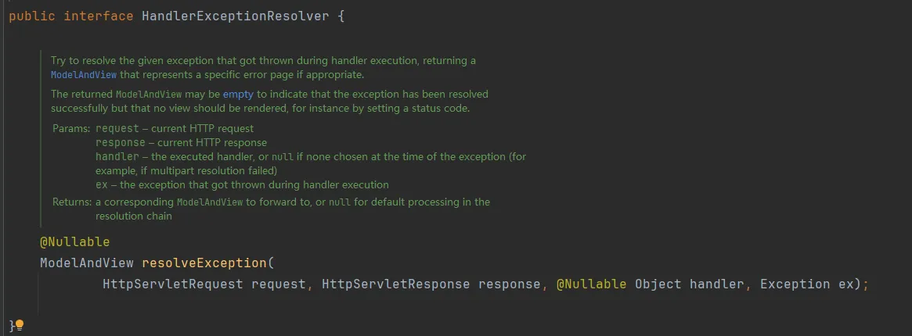
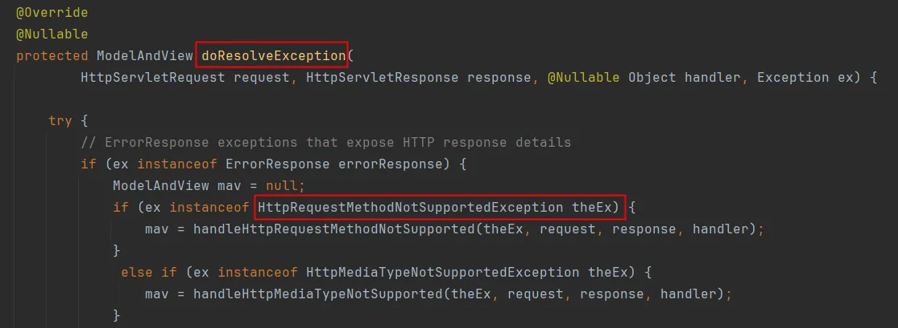

# 1. 什么是异常处理器
```
Spring MVC在处理器方法执行过程中出现了异常，可以采用异常处理器进行应对。
一句话概括异常处理器作用：处理器方法执行过程中出现了异常，跳转到对应的视图，在视图上展示友好信息。
SpringMVC为异常处理提供了一个接口：HandlerExceptionResolver
```



```
核心方法是：resolveException。
该方法用来编写具体的异常处理方案。返回值ModelAndView，表示异常处理完之后跳转到哪个视图。
HandlerExceptionResolver 接口有两个常用的默认实现：
● DefaultHandlerExceptionResolver
● SimpleMappingExceptionResolver
```
# 2. 默认的异常处理器
```
DefaultHandlerExceptionResolver 是默认的异常处理器。
核心方法：
```



```
当请求方式和处理方式不同时，DefaultHandlerExceptionResolver的默认处理态度是：405
```
# 3. 自定义的异常处理器
```
自定义异常处理器需要使用：SimpleMappingExceptionResolver
自定义异常处理机制有两种语法：
● 通过XML配置文件
● 通过注解
```

## 3.1 配置文件方式
```
<bean class="org.springframework.web.servlet.handler.SimpleMappingExceptionResolver">
    <property name="exceptionMappings">
        <props>
            <!--用来指定出现异常后，跳转的视图-->
            <prop key="java.lang.Exception">tip</prop>
        </props>
    </property>
    <!--将异常信息存储到request域，value属性用来指定存储时的key。-->
    <property name="exceptionAttribute" value="e"/>
</bean>
在视图页面上展示异常信息：
tip.html如下
<!DOCTYPE html>
<html lang="en" xmlns:th="http://www.thymeleaf.org">
<head>
    <meta charset="UTF-8">
    <title>出错了</title>
</head>
<body>
<h1>出错了，请联系管理员！</h1>
<div th:text="${e}"></div>
</body>
</html>
```
## 3.2 注解方式
```
@ControllerAdvice
public class ExceptionController {

    @ExceptionHandler
    public String tip(Exception e, Model model){
        model.addAttribute("e", e);
        return "tip";
    }
}
```
## 3.3 自定义异常类体系
```
实际开发中，通常会建立一套自定义异常类体系，让不同类型的异常对应不同的处理逻辑：

// 业务异常的基类
package com.powernode.springmvc.exception;

public class BusinessException extends RuntimeException {
    private Integer code;  // 业务状态码

    public BusinessException() {}

    public BusinessException(String message) {
        super(message);
    }

    public BusinessException(Integer code, String message) {
        super(message);
        this.code = code;
    }

    public Integer getCode() {
        return code;
    }
}

// 用户相关异常
package com.powernode.springmvc.exception;

public class UserNotFoundException extends BusinessException {
    public UserNotFoundException(String message) {
        super(404, message);
    }
}

// 权限相关异常
package com.powernode.springmvc.exception;

public class PermissionDeniedException extends BusinessException {
    public PermissionDeniedException(String message) {
        super(403, message);
    }
}

这样设计的好处是：
● 不同异常类型对应不同的处理策略，是跳转不同页面还是返回不同JSON
● 业务状态码可以让前端根据不同的错误码做不同的UI展示
● 继承体系便于统一处理和扩展
```
## 3.4 @ExceptionHandler处理多种异常类型
```
@ControllerAdvice
public class ExceptionController {

    // 专门处理用户不存在异常
    @ExceptionHandler(UserNotFoundException.class)
    public String handleUserNotFound(UserNotFoundException e, Model model){
        model.addAttribute("msg", e.getMessage());
        model.addAttribute("code", e.getCode());
        return "error_user_not_found";  // 跳转到专门的错误页面
    }

    // 专门处理权限异常
    @ExceptionHandler(PermissionDeniedException.class)
    public String handlePermissionDenied(PermissionDeniedException e, Model model){
        model.addAttribute("msg", e.getMessage());
        return "error_permission_denied";
    }

    // 处理其他所有业务异常（兜底）
    @ExceptionHandler(BusinessException.class)
    public String handleBusinessException(BusinessException e, Model model){
        model.addAttribute("msg", e.getMessage());
        model.addAttribute("code", e.getCode());
        return "error_business";
    }

    // 处理未知异常（最终兜底）
    @ExceptionHandler(Exception.class)
    public String handleException(Exception e, Model model){
        model.addAttribute("msg", "服务器内部错误，请联系管理员");
        return "error";
    }
}

也可以在一个方法中处理多种异常类型：
@ExceptionHandler({UserNotFoundException.class, PermissionDeniedException.class})
public String handleMultiException(Exception e, Model model){
    model.addAttribute("msg", e.getMessage());
    return "error_common";
}

当一个异常同时匹配多个@ExceptionHandler时，SpringMVC会选择最具体的那个（子类优先于父类）。
```
## 3.5 @ResponseStatus注解
```
@ResponseStatus注解可以直接在自定义异常类上声明对应的HTTP状态码。
当异常被抛出且没有被@ExceptionHandler捕获时，SpringMVC会自动设置响应的HTTP状态码。

package com.powernode.springmvc.exception;

import org.springframework.http.HttpStatus;
import org.springframework.web.bind.annotation.ResponseStatus;

// 当UserNotFoundException被抛出时，HTTP响应状态码自动设置为404
@ResponseStatus(code = HttpStatus.NOT_FOUND, reason = "用户不存在")
public class UserNotFoundException extends BusinessException {
    public UserNotFoundException(String message) {
        super(404, message);
    }
}

注意：
● @ResponseStatus只在异常未被@ExceptionHandler捕获时生效
● 如果@ExceptionHandler捕获了该异常，状态码由处理方法的返回值决定
● reason属性的值会作为响应体返回给客户端
```
## 3.6 ResponseEntityExceptionHandler基类
```
SpringMVC提供了ResponseEntityExceptionHandler抽象类，它预先处理了多种SpringMVC内部异常。
我们可以继承它来快速实现RESTful API的全局异常处理：

package com.powernode.springmvc.controller;

import org.springframework.http.HttpHeaders;
import org.springframework.http.HttpStatus;
import org.springframework.http.ResponseEntity;
import org.springframework.web.bind.annotation.ExceptionHandler;
import org.springframework.web.bind.annotation.RestControllerAdvice;
import org.springframework.web.context.request.WebRequest;
import org.springframework.web.servlet.mvc.method.annotation.ResponseEntityExceptionHandler;

import java.util.HashMap;
import java.util.Map;

@RestControllerAdvice  // 相当于 @ControllerAdvice + @ResponseBody，适合REST API
public class GlobalExceptionHandler extends ResponseEntityExceptionHandler {

    // 处理自定义业务异常，返回JSON
    @ExceptionHandler(BusinessException.class)
    public ResponseEntity<Map<String, Object>> handleBusinessException(
            BusinessException e, WebRequest request) {
        Map<String, Object> body = new HashMap<>();
        body.put("code", e.getCode());
        body.put("message", e.getMessage());
        body.put("timestamp", System.currentTimeMillis());
        return new ResponseEntity<>(body, HttpStatus.INTERNAL_SERVER_ERROR);
    }

    // 处理参数校验失败异常（MethodArgumentNotValidException等）
    // 这些异常在ResponseEntityExceptionHandler中已有默认处理，可以重写覆盖
}
```
## 3.7 控制器级别 vs 全局级别 @ExceptionHandler
```
@ExceptionHandler可以写在两个位置：

1. 写在控制器内部（控制器级别）：
   ● 只处理该控制器中抛出的异常
   ● 适合针对特定Controller的异常处理逻辑

@Controller
public class UserController {

    @ExceptionHandler(UserNotFoundException.class)
    public String handleUserNotFound(UserNotFoundException e, Model model){
        model.addAttribute("msg", e.getMessage());
        return "error";
    }

    @RequestMapping("/api/user/{id}")
    public String getById(@PathVariable("id") Integer id){
        // 如果找不到用户，抛出UserNotFoundException
        // 该异常会被当前Controller中的@ExceptionHandler捕获
        if (id <= 0) {
            throw new UserNotFoundException("用户ID无效: " + id);
        }
        return "ok";
    }
}

2. 写在@ControllerAdvice类中（全局级别）：
   ● 处理所有控制器中抛出的异常
   ● 适合统一的异常处理逻辑

@ControllerAdvice
public class GlobalExceptionController {
    @ExceptionHandler(Exception.class)
    public String handleAll(Exception e, Model model){
        model.addAttribute("msg", e.getMessage());
        return "error";
    }
}

优先级规则：
● 控制器级别的@ExceptionHandler优先级高于全局级别的@ExceptionHandler
● 如果控制器中有匹配的@ExceptionHandler，则优先使用控制器的
● 如果控制器中没有，则查找@ControllerAdvice中的匹配方法
```
## 3.8 异常处理器优先级规则总结
```
当发生异常时，SpringMVC按以下顺序查找异常处理器：

1. 先查找当前Controller中是否有匹配的@ExceptionHandler方法
   ● 如果有，使用当前Controller的处理器（不再查找全局的）
   
2. 如果当前Controller没有匹配的处理器，查找所有@ControllerAdvice中的@ExceptionHandler
   ● 按照@ControllerAdvice的@Order或@Priority排序
   ● 在同一@ControllerAdvice中，优先匹配最具体的异常类型

3. 如果都没有找到匹配的@ExceptionHandler：
   ● 检查异常类上是否有@ResponseStatus注解，有则发送对应状态码
   ● 如果没有@ResponseStatus，交给Servlet容器处理（通常显示500错误页面）

建议的最佳实践：
● 通用的异常处理逻辑放在@ControllerAdvice中（如：Exception.class的兜底处理）
● 特定Controller的自定义逻辑放在Controller内部
● 服务器内部不可预知的异常统一处理，返回友好的错误页面或JSON
```

# 4. web.xml配置错误页面
```
除了使用SpringMVC的异常处理器外，还可以在web.xml中配置全局的错误页面。
这种方式适用于所有未被SpringMVC异常处理器捕获的异常，包括404等HTTP错误。

web.xml配置如下：
<!-- 根据HTTP错误状态码配置错误页面 -->
<error-page>
    <error-code>404</error-code>
    <location>/WEB-INF/thymeleaf/error_404.html</location>
</error-page>
<error-page>
    <error-code>500</error-code>
    <location>/WEB-INF/thymeleaf/error_500.html</location>
</error-page>

<!-- 根据异常类型配置错误页面 -->
<error-page>
    <exception-type>java.lang.Exception</exception-type>
    <location>/WEB-INF/thymeleaf/error.html</location>
</error-page>

注意：
● web.xml错误页面是Servlet容器级别的，优先级低于SpringMVC的异常处理器
● 如果SpringMVC已经处理了异常（返回了ModelAndView），则不会触发web.xml的错误页面
● 建议将web.xml错误页面作为最后一层兜底方案
```