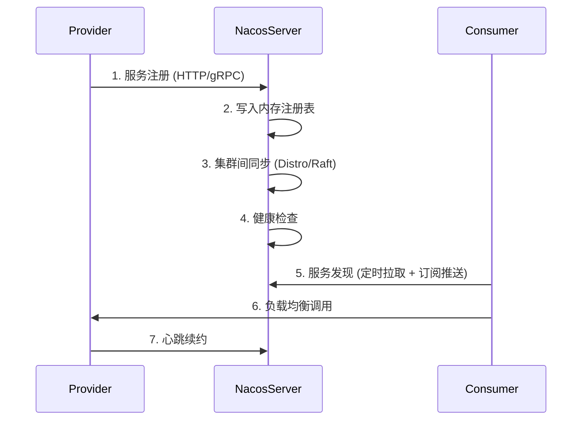
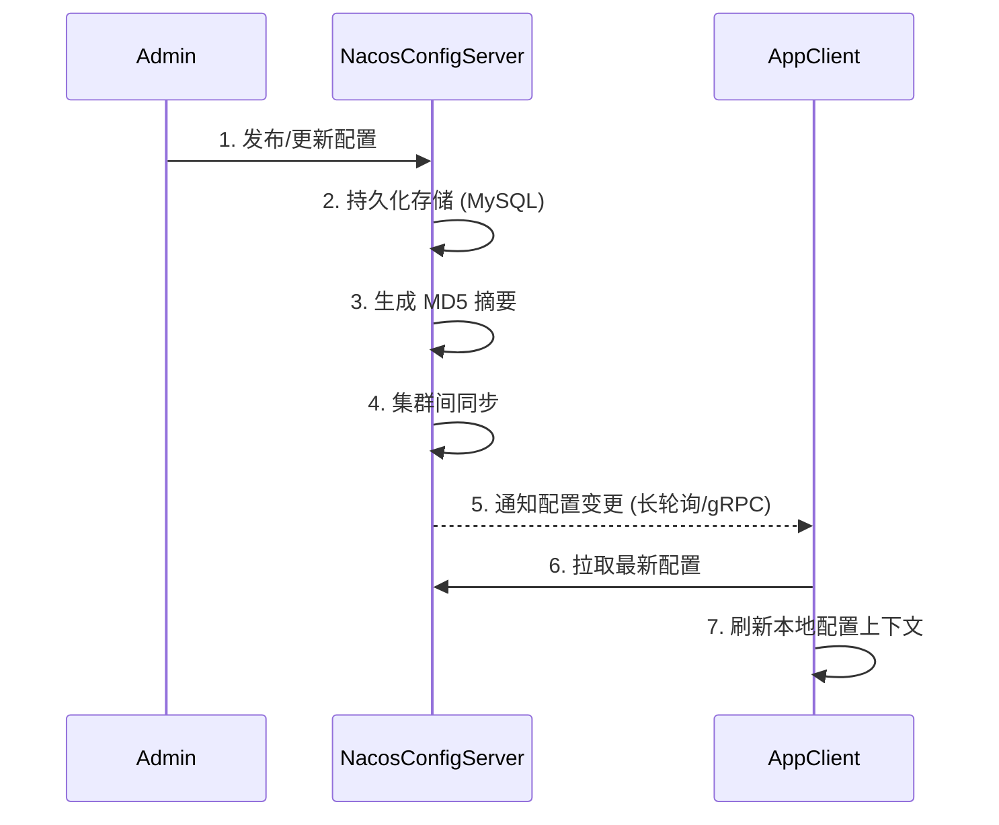


# 1. 整体架构

Nacos 采用分层架构设计，每一层职责清晰，依赖关系自上而下：

```
┌─────────────────────────────────────────────────────────────────┐
│                      接入层 (Access Layer)                       │
│  ┌──────────┐  ┌──────────┐  ┌──────────┐  ┌──────────────────┐ │
│  │  HTTP    │  │  gRPC    │  │  DNS-F   │  │  Console (UI)    │ │
│  │  REST    │  │  Long    │  │  SDK     │  │                  │ │
│  │  API     │  │  Polling │  │          │  │                  │ │
│  └────┬─────┘  └────┬─────┘  └────┬─────┘  └────────┬─────────┘ │
├───────┼─────────────┼─────────────┼────────────────┼──────────────┤
│       └─────────────┼─────────────┼────────────────┘              │
│                     ▼             ▼                               │
│                 ┌─────────────────────────┐                      │
│                 │       OpenAPI 层         │                      │
│                 └───────────┬─────────────┘                      │
├─────────────────────────────┼──────────────────────────────────────┤
│                             ▼                                      │
│  ┌─────────────────────────────────────────────────────────────┐  │
│  │                    核心功能层 (Core Layer)                    │  │
│  │                                                              │  │
│  │  ┌──────────────┐  ┌──────────────┐  ┌──────────────────┐   │  │
│  │  │   Naming     │  │   Config     │  │    Cluster       │   │  │
│  │  │   Service    │  │   Service    │  │    Manager       │   │  │
│  │  │              │  │              │  │                  │   │  │
│  │  │ ──────────── │  │ ──────────── │  │ ──────────────── │   │  │
│  │  │ • 服务注册   │  │ • 配置 CRUD  │  │ • 节点发现       │   │  │
│  │  │ • 服务发现   │  │ • 长轮询     │  │ • 心跳检测       │   │  │
│  │  │ • 健康检查   │  │ • 动态刷新   │  │ • 集群同步       │   │  │
│  │  │ • 负载均衡   │  │ • 灰度发布   │  │ • Leader 选举    │   │  │
│  │  └──────┬───────┘  └──────┬───────┘  └────────┬─────────┘   │  │
│  └─────────┼─────────────────┼───────────────────┼──────────────┘  │
├─────────────┼─────────────────┼───────────────────┼──────────────────┤
│             └─────────────────┼───────────────────┘                  │
│                               ▼                                      │
│  ┌─────────────────────────────────────────────────────────────┐   │
│  │                   一致性协议层 (Consistency Layer)            │   │
│  │                                                              │   │
│  │  ┌──────────────────┐  ┌──────────────────┐  ┌───────────┐  │   │
│  │  │   Raft Protocol  │  │  Distro Protocol │  │   JRaft   │  │   │
│  │  │   (CP 模式)      │  │  (AP 模式)       │  │   (引擎)  │  │   │
│  │  │                  │  │                  │  │           │  │   │
│  │  │ • Leader 选举    │  │ • 异步复制       │  │           │  │   │
│  │  │ • 日志复制       │  │ • 最终一致性     │  │           │  │   │
│  │  │ • 强一致性读     │  │ • 反熵同步       │  │           │  │   │
│  │  └──────────────────┘  └──────────────────┘  └───────────┘  │   │
│  └─────────────────────────────────────────────────────────────┘   │
├──────────────────────────────────────────────────────────────────────┤
│                               ▼                                      │
│  ┌─────────────────────────────────────────────────────────────┐   │
│  │                    存储层 (Persistence Layer)                 │   │
│  │                                                              │   │
│  │  ┌──────────────┐  ┌──────────────┐  ┌──────────────────┐   │   │
│  │  │   Derby      │  │   MySQL      │  │   自定义存储     │   │   │
│  │  │   (内置)     │  │   (集群)     │  │   (SPI 扩展)    │   │   │
│  │  └──────────────┘  └──────────────┘  └──────────────────┘   │   │
│  └─────────────────────────────────────────────────────────────┘   │
└─────────────────────────────────────────────────────────────────────┘
```

# 2. Nacos 服务端核心模块

## 2.1 服务管理（Naming Service）

负责处理服务注册、服务发现和健康检查的核心逻辑。主要包含以下组件：

- **ServiceManager**：管理所有注册的服务信息
- **ClusterManager**：管理集群节点信息
- **ConsistencyService**：一致性服务的抽象接口
- **HealthCheckProcessor**：健康检查处理器
- **PushService**：服务变更推送服务

## 2.2 配置管理（Config Service）

负责处理配置的增删改查、动态刷新和灰度发布。主要包含：

- **ConfigCacheService**：配置缓存服务
- **ConfigChangePublisher**：配置变更发布
- **LongPollingService**：长轮询服务
- **DumpService**：配置持久化服务
- **LocalConfigInfoProcessor**：本地配置信息处理器

## 2.3 集群管理（Cluster Manager）

负责 Nacos 集群节点之间的通信、数据同步和 Leader 选举：

- **ServerMemberManager**：管理集群成员信息
- **ClusterRpcClientProxy**：集群间 RPC 通信代理
- **DistroConsistencyServiceImpl**：Distro 协议实现

# 3. 数据模型设计

## 3.1 命名空间模型

```
Tenant (Namespace)
  ├── Namespace-1 (生产环境)
  │     ├── Service-A (Group: DEFAULT_GROUP)
  │     │     ├── Instance-1 (10.0.0.1:8080)
  │     │     ├── Instance-2 (10.0.0.2:8080)
  │     │     └── Instance-3 (10.0.0.3:8080)
  │     └── Service-B (Group: CUSTOM_GROUP)
  │           └── Instance-1 (10.0.1.1:8080)
  ├── Namespace-2 (测试环境)
  │     └── Service-A (Group: DEFAULT_GROUP)
  │           └── Instance-1 (10.1.0.1:8080)
  └── Namespace-3 (开发环境)
        └── ...
```

## 3.2 配置数据模型

```
Namespace
  └── Group
        └── DataID
              └── Content (配置文件内容)
              └── MD5 (内容摘要)
              └── Type (配置类型: properties/yaml/json/...)
              └── Description (配置描述)
```

## 3.3 服务数据模型（源码核心类）

```java
// 服务 (Service)
public class Service {
    private String name;                    // 服务名
    private String namespaceId;             // 命名空间ID
    private String groupName;               // 分组名
    private Map<String, Cluster> clusterMap; // 集群
    private long lastModifiedMillis;        // 最后修改时间
    private boolean ephemeral;              // 是否临时实例服务
    private float protectThreshold;         // 保护阈值 (0-1)
    private HealthCheckMode healthCheckMode; // 健康检查模式
    private String metadata;                // 元数据
}

// 集群 (Cluster)
public class Cluster {
    private String serviceName;              // 所属服务名
    private String name;                     // 集群名 (如 DEFAULT)
    private HealthChecker healthChecker;     // 健康检查器
    private Map<String, Instance> instances; // 持久实例
    private Map<String, Instance> ephemeralInstances; // 临时实例
}

// 实例 (Instance)
public class Instance {
    private String instanceId;    // 实例ID
    private String ip;            // IP 地址
    private int port;             // 端口
    private double weight;        // 权重 (0-100)
    private boolean healthy;      // 是否健康
    private boolean enabled;      // 是否启用
    private boolean ephemeral;    // 是否临时
    private String clusterName;   // 集群名
    private String serviceName;   // 服务名
    private Map<String, String> metadata; // 元数据
    private long lastBeat;        // 最后心跳时间
    private long instanceHeartBeatInterval; // 心跳间隔 (ms)
}
```

# 4. CAP 理论在 Nacos 中的应用

## 4.1 CP 模式与 AP 模式

Nacos 是目前唯一支持**在服务发现和配置管理两个场景中根据需要切换 CAP 模型**的注册中心。

```
                    选择 AP 模式
          ┌─────────────────────────┐
          │   服务注册与发现场景     │
          │                         │
          │  牺牲一致性，保证可用性 │
          │  使用 Distro 协议       │
          │  最终一致性             │
          └─────────────────────────┘

                    选择 CP 模式
          ┌─────────────────────────┐
          │   配置管理场景           │
          │                         │
          │  牺牲可用性，保证一致性 │
          │  使用 Raft 协议         │
          │  强一致性               │
          └─────────────────────────┘
```

## 4.2 为什么服务注册选择 AP 模式

1. **服务发现的核心需求是高可用**：注册中心不可用会导致整个微服务体系瘫痪
2. **可以容忍短暂的数据不一致**：即使某个注册节点有延迟数据，也不影响基本的服务调用
3. **网络分区场景**：在网络分区发生时，AP 模式下集群可以继续对外提供服务

## 4.3 为什么配置管理选择 CP 模式

1. **配置数据必须精确一致**：配置数据错误可能导致业务逻辑错误
2. **可以容忍短暂的不可用**：客户端有本地快照兜底，短时间取不到新配置不影响运行
3. **版本管理要求**：配置的回滚、灰度发布都要求数据准确的版本控制

# 5. 通信协议架构

## 5.1 协议分层

Nacos 2.x 对通信协议进行了全面升级：

| 协议层 | 1.x 实现 | 2.x 实现 | 说明 |
|--------|---------|---------|------|
| 服务端间通信 | HTTP / 自定义 TCP | gRPC (Stream) | 双向流通信 |
| 客户端到服务端 | HTTP + UDP | gRPC + HTTP | gRPC 为主推通道 |
| 配置通知 | HTTP 长轮询 | gRPC 长连接 + 主动推送 | 降低延时 |
| 服务订阅 | HTTP + UDP 广播 | gRPC 双向流 | 实时推送 |

## 5.2 gRPC 通信模型

```
Client                          Nacos Server
  │                                    │
  │──── setup gRPC connection ────────>│  (Bi-directional Stream)
  │                                    │
  │<──── ServerCheckRequest ───────────│  (定期检查客户端状态)
  │──── ServerCheckResponse ──────────>│
  │                                    │
  │──── InstanceRegisterRequest ──────>│  (服务注册)
  │<──── InstanceRegisterResponse ─────│
  │                                    │
  │──── ServiceSubscribeRequest ──────>│  (服务订阅)
  │<──── ServiceSubscribeResponse ─────│
  │<──── NotifySubscriberRequest ──────│  (服务变更推送)
  │                                    │
  │──── ConfigBatchListenRequest ─────>│  (配置监听)
  │<──── ConfigChangeNotifyRequest ────│  (配置变更推送)
  │                                    │
  │<──── ClientDetectionRequest ───────│  (客户端探测)
  │──── ClientDetectionResponse ──────>│
```

# 6. 服务注册流程架构



# 7. 配置管理流程架构



# 8. 源码模块结构

Nacos 源码（GitHub: alibaba/nacos）的主要模块划分：

```
nacos
├── address/            # 地址服务器模块
├── api/                # API 接口定义
├── auth/               # 鉴权模块
├── client/             # 客户端 SDK
├── cmdb/               # CMDB 数据库元数据管理
├── common/             # 公共工具和常量
├── config/             # 配置中心服务模块
├── console/            # 控制台模块
├── consistency/        # 一致性协议层
├── core/               # 核心类定义
├── distribution/       # 打包发布相关
├── example/            # 示例代码
├── istio/              # Istio 集成
├── naming/             # 命名服务（注册中心）模块
├── persistence/        # 持久化模块
├── plugin/             # 插件模块
├── prometheus/         # Prometheus 监控
├── sys/                # 系统模块
└── test/               # 测试模块
```
